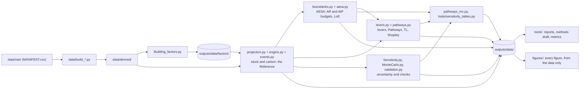

# Architecture: module map and data flow

What each module does and how data move from the inputs to the reported numbers. The methods as implemented, with
every equation and parameter, are generated into `outputs/reports/METHODS_DRAFT.md` (Table 1, the levers:
`outputs/reports/LEVERS_TABLE.md`); every setting with its basis is in `outputs/reports/ASSUMPTIONS.md`; every output
file and the script that writes it is in `outputs/INDEX.md`. How to run, the data freeze and the data provenance:
`README.md`.

## 1. Data flow

The model is bottom-up and demand-driven. Construction capacity, prices and policy are not modelled; building type
(detached, townhouses, apartments) weights the carbon factors and the lever parameters but no result is reported by
typology.

1. **Stock.** Consents become completions (completion rate 0.945, 17-month lag). Population and household size give
   households; the census dwelling-count identity gives net replacement and vacancy; the forward model
   (`engine.forward`) turns households into dwellings required and floor area by demand band. The observed 2026–2027
   building above the requirement (the overbuild) and the starting surplus are absorbed by 2035 on the logistic path.
2. **Carbon.** Case-study factors per m² (16 New Zealand LCAs, 2025 technology) by typology, material and stage. A1–A3
   follow item-level decarbonisation paths (Horup et al. 2025), A4–A5 a 1%/yr decline (Resch et al. 2021).
   Maintenance (B2, B4) is booked in the year each event occurs; later events and C1–C4 are committed after 2050 (a
   range). Soil carbon loss applies to floor area on newly converted land.
3. **AESA.** The 2026–2050 carbon is compared with the sector's share of a global carrying capacity under acquired
   rights (AR) and ability to pay (AtP), side by side, never averaged; LoE = impact / budget.
4. **Levers.** Each lever changes one or two inputs of the forward model (`levers.LEVER_PARAMETER`); every run, the
   Reference included, passes through the same `pathways.run`. Exact Shapley values attribute the reductions.
5. **Uncertainty.** One-at-a-time sensitivities, replacement variants, a Latin-hypercube Monte Carlo of the Reference
   (Sobol indices in the full profile) and of the Pathways and TL, and the rolling-origin hindcast.

**Compute, then draw.** The model scripts write CSV and JSON only; `figures/` draws every figure last, from those
files, so the figures can be redrawn without the model (`run_all.py --figures-only`, `redraw.py`). `engine.py` and
`events.py` are pure functions shared by `projection.py`, `MonteCarlo.py` and `pathways.py`.

## 2. Module map

### Pipeline and infrastructure

| module | role |
|---|---|
| `run_all.py` | runs every step in its own process, in order, with a log per step; stops at the first failure |
| `runprofile.py` | the run profiles (light, full): draws, seeds, bootstrap size, figure formats and output folder |
| `layout.py` | every output path, defined once |
| `naming.py` | the vocabulary: every reader-facing label and the release names of data columns |
| `figure_plan.py` | the registry of figures and tables (id, title, caption, module, sources) and the number maps |
| `figsource.py` | writes the arrays a figure draws that are not otherwise exported (`outputs/data/figure_source/`) |
| `indexes.py` | writes `outputs/INDEX.md` and `outputs/FIGURES.md` |
| `redraw.py` | redraws the figures from the committed outputs with a palette file (no model run) |

### Inputs (`data/`)

| module | role |
|---|---|
| `data/fetch_sources.py` | downloads the raw Stats NZ files and records URL, SHA-256 and date in `data/raw/MANIFEST.csv` |
| `data/build_consents.py` | monthly consents (dwellings, floor area, value by type) from the Infoshare export; logs every revision |
| `data/build_population_quarterly.py` | quarterly estimated resident population (mean quarter) |
| `data/build_households_2023.py` | household-size knots of the Stats NZ 2023-base household projections |
| `data/build_census.py` | census dwelling occupancy, 2018 and 2023, with cross-checks |
| `data/build_census_headship.py` | census living arrangements by age and role (2013, 2018, 2023), stated household targets, one-person shares and ERP age groups (L1 at TL) |
| `data/build_material_items.py` | item-level case-study LCA table, checked against `building_data.xlsx` |
| `data/build_lca_events.py` | replacement and repaint event counts per item line (needs the non-redistributed root tables) |
| `data/build_horup.py` | the Horup et al. (2025) Table S4 material paths and the Table S3 archetype envelope (L10) |
| `data/build_oecd_vacancy.py` | OECD HM1.1 vacancy rates by country (L2 at TL) |
| `data/build_gdp.py`, `data/build_wdi.py`, `data/build_wpp.py` | GDP and final consumption, World Bank WDI, UN WPP 2024 (AESA inputs) |

### Stock and carbon

| module | role |
|---|---|
| `Building_factors.py` | per-typology carbon factors by material and stage from the 16 case studies; item and event tables |
| `projection.py` | the Reference: consents, households, stock calibration, replacement, the overbuild, carbon by stage and band |
| `engine.py` | the forward model as pure functions: stock identity, replacement path, overbuild absorption, forward run |
| `events.py` | time-resolved B2/B4 events and the committed emissions after 2050 |
| `bands.py` | the demand-band accounting of every run and the display bands |
| `household_headship.py` | census headship by age group (2013, 2018, 2023; calibrated f and g), the back-check, and the by-age L1 at TL sensitivity (household-size ratio path) |
| `gap_2026.py` | decomposition of the observed 2026 building against the model |

### AESA

| module | role |
|---|---|
| `aesa.py` | the AESA equations (sharing principles, budgets, LoE) as pure functions |
| `boundaries.py` | the AR and AtP budgets from the raw data, the LoE of every run and its sensitivities |

### Levers and pathways

| module | role |
|---|---|
| `levers.py` | the ten levers: level → modified forward inputs; every Ambitious and TL value with its source; the TL rule |
| `pathways.py` | lever, strategy, pathway and TL runs; re-occupation; Shapley values; waterfalls; back-cast and solution space |

### Uncertainty and checks

| module | role |
|---|---|
| `Sensitivity.py` | one-at-a-time sensitivity rows of the Reference |
| `MonteCarlo.py` | Latin-hypercube Monte Carlo of the Reference and Sobol indices |
| `pathways_mc.py` | the Monte Carlo of the Pathways and TL on the same draws |
| `mcstats.py` | the statistics of the Monte Carlo insight analyses (LOWESS, standardised regression and partial rank correlation coefficients), from their published definitions |
| `validation.py` | rolling-origin hindcast and the 2026 out-of-sample check |
| `Diagnostics.py` | diagnostic data of the projection, past and future together |

### Reports and checks (`tools/`)

| module | role |
|---|---|
| `tools/metrics.py`, `tools/results.py` | headline metrics (`metrics.json`) and `RESULTS.md`, and the README results block |
| `tools/methods.py` | assembles the methods draft from `baseline_draft.py`, `pb_methods.py`, `pathways_methods.py`, `release_methods.py` and `uncertainty_methods.py` |
| `tools/assumptions.py` | the assumption register (`ASSUMPTIONS.md`) |
| `tools/availability.py` | data and code availability statements and the third-party data table |
| `tools/sensitivity_tables.py` | the grouped one-at-a-time tables and the tornado |
| `tools/overbuild_2026.py`, `tools/replacement_scenarios.py`, `tools/reconciliation.py`, `tools/demand_balance.py`, `tools/figures_report.py` | the overbuild, the replacement variants, the accounting reconciliation, the market balance and the report figures' data |
| `tools/lever_audit.py` | the lever consistency audit (nine checks; STOP on failure) |
| `tools/check_outputs.py`, `tools/figure_manifest.py` | the final output check and the figure manifest |

### Figures (`figures/`)

| module | role |
|---|---|
| `figures/style.py` | the palette from `palette.toml`, fonts, sizes and saving |
| `figures/draw.py` | the shared drawing rules (signed bands, display lines, boundary lines and zones) |
| `figures/audit.py` | a record of every drawn figure (read by the tests) |
| `figures/data.py` | the readers of the data files |
| `figures/paper_main.py`, `figures/paper_extended.py` | Fig1–Fig7; the Extended Data, EDT1 and part of the Supplementary Figures |
| `figures/calibration.py`, `figures/market_balance.py`, `figures/validation.py`, `figures/boundaries.py`, `figures/pathways.py`, `figures/montecarlo.py`, `figures/sensitivity.py` | one module per group of Supplementary Figures and diagnostics |
| `figures/index.py` | `outputs/FIGURES.md` |

### Tests (`tests/`)

`python -m pytest tests` runs on the outputs of the active profile; `tests/README.md` lists what each file protects.
The regression lock (`tests/regression_lock.json`) holds the SHA-256 of every deterministic data file and of the Monte
Carlo draw files.

## 3. Glossary

| term | meaning |
|---|---|
| floor area | gross floor area (GFA), m² |
| Reference | the adopted projection with no interventions |
| Low / High / Very High replacement | the replacement variants of the Reference |
| demand band | a reason for building; negative bands keep their sign |
| market balance | the display band of building above or below need: the history residual, the starting surplus, the 2026–27 overbuild and its absorption |
| S, v | household size (population / households), vacancy rate |
| RV, UC | retirement-village unit, dwellings under construction |
| OLF, FSI | floor area per design occupant, floor area / footprint |
| ρ | persistence of departures from the calibrated stock identity |
| PCHIP | shape-preserving piecewise cubic Hermite interpolation |
| upfront carbon | A1–A5 + soil carbon loss |
| committed after 2050 | later B2/B4 and C1–C4 of the 2026–2050 cohorts (a range) |
| AESA, SOS | absolute environmental sustainability assessment, safe operating space |
| AR / AtP | acquired rights / ability to pay |
| LoE | level of exceedance = impact / budget |
| S1–S3, L1–L10 | the PAS 2080 strategies (Avoid, Switch, Improve) and the levers |
| L*x* at TL | lever L*x* at its Theoretical Limit (internal identifiers `TL1`–`TL10`) |
| λ | position of a level between Reference (0) and Ambitious (1); Moderate λ = 0.5 |
