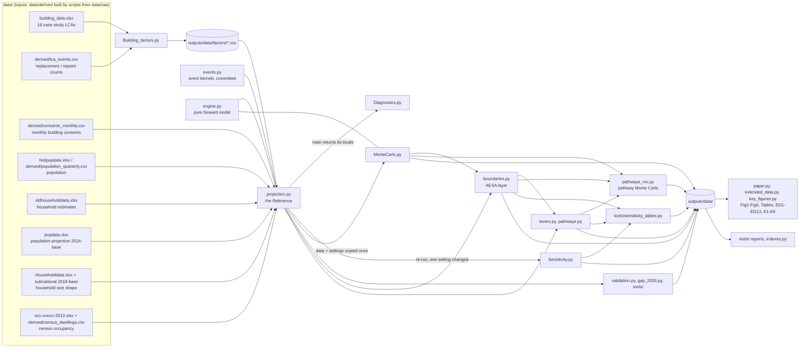
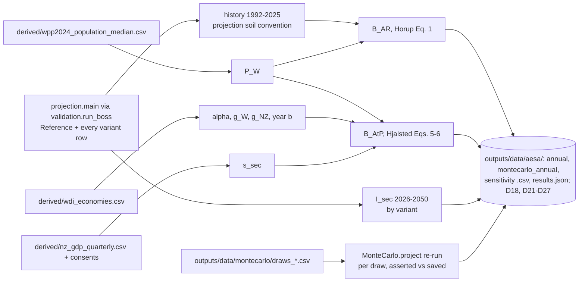
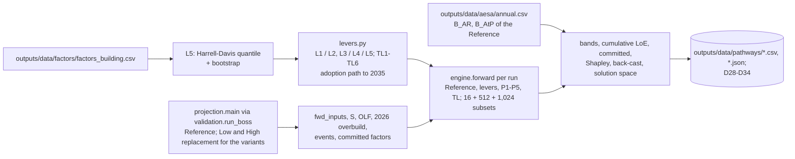

# Architecture: how the model works (MODEL v2.0.0)

This document is for a reviewer who knows statistics or modelling but not this
code or New Zealand housing data. It describes what each script reads, what it
calculates and in what order, and what it writes. Headline numbers are not
repeated here: they are generated into `outputs/reports/RESULTS.md` and
`outputs/data/metrics.json`, the figures and tables of the paper with their captions into
`outputs/paper/PAPER.md`, and the Extended Data into `outputs/extended_data/EXTENDED_DATA.md`. Every setting, with its basis (data, literature,
author decision, judgement), is in `outputs/reports/ASSUMPTIONS.md`; the methods as
implemented are in `outputs/reports/METHODS_DRAFT.md` (one document in three parts:
baseline projection, planetary-boundary layer (AESA), pathways and the theoretical
limit). Every other figure is indexed in `outputs/diagnostics/DIAGNOSTICS.md`, and
every output file, with the script that writes it, in `outputs/INDEX.md`. Labels
follow one vocabulary (`naming.py`; `docs/RENAMING.md` maps the earlier names to
the release names, `docs/FIGURE_PLAN.md` the earlier figure names to the figure ids
Fig1–Fig6, ED1–ED13, the key figures K1–K6 and the diagnostics D01–D34; the model-v1.1.0 ids H1–H11 are mapped in
`docs/RENAMING.md`, section 6). Parameter values quoted below are the adopted settings in
`projection.py` unless another module is named.

---

## 1. What the model answers

How much new residential floor area New Zealand will build from 2026 to 2050,
and how much embodied carbon that floor area carries, split by reason for
building (the demand bands: population growth (untargeted), smaller households, extra space,
vacancy, the 2026 overbuild, historical replacement, the recent replacement
surge) and by material and
life-cycle stage. Building type (detached houses, townhouses, apartments) is
internal to the model: it weights the case-study carbon factors and the lever
parameters, and no result is reported by typology.

The model is bottom-up and demand-driven: people → households → dwellings
required → floor area → carbon. Construction capacity, prices and policy are not
modelled. Carbon intensities are the 2025 case-study values; with
`DECARB_MODE = 'horup_item'` (adopted) the A1–A3 part of each case-study EPD
item follows the material-specific GWP paths of Horup et al. (2025) from 2026,
and A4–A5 a generic 1%/yr path after Resch et al. (2021) (section 4.9); with
`'none'` and `DECARB_A45 = 'held'` every factor is held at 2025 (frozen
technology). With `ACCOUNTING = 'time_resolved'` (adopted) materials and
construction (A1–A5) and soil carbon loss are counted in the construction year
and maintenance (B2, B4) in the year it occurs; later maintenance and end of life
are committed after 2050 (later B2/B4 and C1–C4), reported as a range
(section 4.10).

The adopted projection with no interventions is the **Reference**. Its two
replacement variants, **Low replacement** and **High replacement**, bracket the
replacement assumption (section 4.4). The planetary-boundary layer (AESA,
section 9) compares carbon 2026–2050 with two allocations of a global carrying
capacity; the pathway layer (section 10) changes the inputs the levers act on.

---

## 2. Scripts and data flow



`python run_all.py` runs everything in a fixed order (section 11), each script in
its own process, and writes to `outputs/` (section 12). **One engine:** the
forward model is in `engine.py` (stock calibration, census dwelling-count rates,
replacement path, the 2026 overbuild (`engine.market_excess`), forward
projection). These are pure functions; `projection.py` and `MonteCarlo.py` both
call them. `projection.main()` returns a dictionary of all its local variables,
which the other scripts read; `validation.run_boss(**settings)` is the in-memory
entry point that runs it silently with settings changed and restores the module
defaults afterwards.

---

## 3. `Building_factors.py`: carbon per square metre

1. Each case study's absolute emissions (by material and EN 15978 stage) are
   divided by its floor area.
2. Materials are grouped into six lines: concrete, steel, timber, plastics &
   paint, plasterboard, others.
3. Buildings are pooled into three typologies: equal weight within sub-type,
   then equal weight across sub-types. A_2 duplicates A_1 (scaled by
   1.000073), so apartments have one independent case.
4. Soil carbon loss is land-use change, not a material: soil loss per m² of
   floor = soil loss per m² of footprint (58.77 kg CO₂e/m², area-weighted over
   the soil orders of Auckland land zoned for urbanisation) / floor space index.
5. Stage D is written out but never added. Stages in scope: A1–A3, A4–A5,
   B2/B4, C1–C4.
6. Replacement and repaint events (`event_rows`): each line of
   `data/derived/lca_events.csv` (counts and lifespan from the LCAQuick root
   tables; stage totals from `building_data.xlsx` and the item table) is split
   into n events of line B2/B4 / n at k L / (n + 1) years (sensitivity k L / n;
   a fractional year split linearly), each divided into A1–A3 : A4–A5 : C1–C4
   in proportion to the line's initial stages and carrying its decarbonisation
   path (replacements: the item's S4 row; repaints and recoating: the paint
   path). Pooled per typology like the factors; the pooled events add up to the
   B2/B4 factor of each typology (tested).

Outputs (`outputs/data/factors/`): `factors_material.csv`,
`factors_typology.csv`, `factors_building.csv`, `factors_a13_decarb.csv`,
`factors_building_a13_reduction.csv`, `factors_a13_item_coverage.csv`,
`factors_events.csv`, `factors_building_events.csv`, `factors_a45_item.csv`.

---

## 4. `projection.py`: the Reference projection

### 4.1 Consents (history 1991–2025)

Monthly consents are summed to calendar years: floor area and dwellings by
typology, and an all-category dwelling count. Retirement-village (RV) units =
all-category − three typologies. RV units are dwellings in the stock but carry
no floor area or carbon (no RV case study); forward they are a constant share
of all dwellings built (ratio of sums 2016–2025, 5.6%). RV floor area is
reported separately, out of scope. Realised dwelling size = floor area /
dwellings, held per typology at its 2023–2025 average.

Dwellings built = 0.95 × consents (completion rate; Jones et al. 2024 bounds
0.92–0.96). No completion lag in the adopted run (Little's-law lag is a
sensitivity).

### 4.2 Population and households (history)

Population: estimated resident population at 31 December. Households: Stats NZ
Dwelling and Household Estimates (DHE) at 31 December. After the 2018 base the
DHE series is 0.888 × lagged consents, so increments after June 2018 are
scaled by one factor k = 0.824, chosen so that June 2023 grows over June 2018
by the census ratio of occupied + residents-away private dwellings. 2024–25
household values are consent-derived and not used as evidence (the household
size anchor is 2023).

### 4.3 Net replacement: the census dwelling-count identity

For each intercensal interval: net replacement = (completions − change in
census private dwellings) / stock-years, with completions corrected for the
change in dwellings under construction on census night. This uses neither the
household estimates nor the empty/away split (which breaks between 2013 and
2018). Long run (ratio of sums 1991–2023): 0.101% of stock per year; the
2018–2023 interval: 0.312%. A fixed BRANZ demolition rate (0.135%/yr) splits
the net rate into demolition and a residual (net unconsented additions); only
their sum is identified.

The household stock identity (built = new households + vacancy allowance +
vacancy change + net replacement) is still calibrated and printed for
comparison, and is used by the hindcast with one vacancy definition throughout
(the pooled 2018/2023 empty share).

### 4.4 Replacement variants

`engine.replacement_path`, set by `REPLACEMENT_VARIANT`, three variants, all with
typology shares held: **Low replacement** (`LOW`) the long-run rate throughout;
**Reference** (`REF`) the 2018–2023 rate fading to the long-run rate with a
10-year half-life (`REPLACEMENT_HALF_LIFE`; 5 and 15 years as sensitivity
variants); **High replacement** (`HIGH`) the 2018–2023 rate persists. The
half-life is not identifiable from the census record.

### 4.5 Population projection

Stats NZ 2024-base stochastic projection: the median path is observed 2025 plus
the published median growth (PCHIP between knots); the 5th/95th paths add the
published spread of the *level* about the median, shifted to zero in 2025.
2026 growth is observed (mean-quarter ERP, June quarter 2026 − June quarter
2025); later growth is the projection's, so the level shift is permanent.

### 4.6 Household size

`S_StatsNZ = population / households` at the shared knots of the 2018-base
subnational population and household projections (2018–2043). Interpolation:
one cubic Hermite through every knot (PCHIP derivatives at interior knots, zero
slope at 2043), held constant after 2043. Applied as a shape rebased on the
observed 2023 value; households = population / S for every population path.
Household decline is floored at zero (it becomes vacancy).

### 4.7 Typology mix

Floor-area shares are held at their 2022–2026 consented average
(`MIX_HELD_WINDOW`; ratio of sums of consented floor area over the window, 2026
being the observed months) in every variant; 2026 uses the observed consented
mix. The mix is internal to the model: it weights the case-study factors and is
not reported. (The damped typology-mix trend of earlier versions, never run in a
reported result, is removed from the code.)

### 4.8 Forward requirement and the 2026 overbuild

```
dwellings built (all categories) = new households + vacancy allowance + vacancy change
                                   + net replacement (variant rate × last year's stock)
                                   + 2026 overbuild
in-scope dwellings              = dwellings built × (1 − RV share)
floor area                      = in-scope dwellings × blended dwelling size
```

Vacancy: the vacancy-rate parameter is held at its published 2023 census value
(5.39%; on the consistent definition 2023 is the series maximum, 5.38%, minimum
4.01% in 1996); implied stock vacancy rises to ≈6.4% because the 2026 overbuild
is not absorbed (values: `outputs/data/baseline/overbuild_2026.json`, `vacancy`).

2026 building is observed: 0.95 × consents over the latest 12 observed months
(the year to July 2026). Its excess over the 2026 requirement is booked in
2026; from 2027 building stays above the requirement by gap_ref × ρ^(t−2026),
with gap_ref = building 2026 − requirement 2027 and ρ the estimated persistence
of departures from the calibrated identity (`OVERBUILD_RULE = 'market_excess'`,
`OVERBUILD_GAP_REF = '2027'`). The 2026 overbuild is stock-adding
(`OVERBUILD_BOOKING = 'surplus'`, `OVERBUILD_ABSORPTION = 0`: extra vacancy,
never absorbed); booking it as redevelopment, payback (absorption 0.20 or 0.10
a year) and the gap against the 2026 requirement are sensitivities. 2026 floor
area is fixed to the observed consented floor area of the same months times the
completion rate; the difference to the modelled floor area is carried in the
2026 overbuild band.

The floor area is reported in demand bands (bookkeeping; they add up to the
total), bottom to top: Population growth (at the occupied area per person, net
of consolidation), Smaller households (from falling household size), Extra space
(new-dwelling size above the occupied area), Vacancy (the vacancy allowance on
new households and the change in the vacancy rate), 2026 overbuild, Historical
replacement (the long-run net replacement rate: demolition net of unconsented
additions, 1991–2023 ratio of sums) and Recent replacement surge (the variant's
rate above that long-run rate: the 2018–2023 knock-down-and-rebuild wave, fading
in the Reference); carbon has one
further band, Maintenance (B2, B4), 2026–2050. In the figures and the data files
of the bands RV units are removed from every band in proportion (each band ×
(1 − RV share)), so all bands are in scope and sum exactly to the in-scope total
(tested). Only population growth is untargeted by the pathways (smaller households are targeted
by L2 Household occupancy).

### 4.9 Carbon

Floor area by typology × intensity, by band, material, soil and stage. Upfront
= materials and construction (A1–A5) + soil carbon loss. Soil carbon loss
applies only to floor area on new footprints: zero on the replacement bands
(land already settled).

**Material decarbonisation** (`DECARB_MODE`). `'none'`: every A1–A3 factor held
at its 2025 value. `'horup_item'` (adopted): the A1–A3 factor of each EPD item of
the case studies (`data/derived/material_items.csv`, built by
`data/build_material_items.py` from the supplied item table and checked against
`building_data.xlsx`) is multiplied, year by year, by the relative GWP path of
its counterpart in Horup et al. (2025) SI Table S4 (average of 9 premise
scenarios, relative to 2025; linear between 2025, 2030, 2040 and 2050), mapped
one-to-one by `data/material_item_map.csv` (direct; by Horup et al. p. 6 for
other cementitious and wood-based products; a labelled proxy; or held, the
lift); summed per building and class, then pooled, so the 2025 totals are the
class totals. `DECARB_ITEM_CASE` selects its sensitivities (proxies held;
NZ-made electricity-intensive items held). **A4–A5** (`DECARB_A45`): `'resch'`
(adopted) e^(−0.01 (t − 2025)) after Resch et al. (2021) Table 1; `'held'` and
`'item'` (each item's S4 path) are sensitivities. C1–C4 and soil carbon loss stay
at 2025. The history (1991–2025) always uses 2025 factors. The Monte Carlo
bootstraps the same reductions per case study with the same resampled cases.
Coverage by mapping basis: `outputs/data/factors/factors_a13_item_coverage.csv`.

### 4.10 Accounting of the later stages (`ACCOUNTING`)

`'time_resolved'` (adopted): the construction year carries materials and
construction (A1–A5) and soil carbon loss; `events.py` builds per typology a
kernel K[i, j] (kg/m² of the cohort built in year i occurring in year j, each
event component at its own factor in year j) and `engine.forward` adds gfa @ K
to the carbon of year j. Events after 2050 and all C1–C4 of the 2026–2050
cohorts are committed after 2050 (later B2/B4 and C1–C4; `COMMITTED`): upper
bound at 2025 factors, lower bound with the 2050 factors held (no extrapolation
beyond the last source year). At 2025 factors, upfront + maintenance (B2, B4)
2026–2050 + committed B2/B4 + C1–C4 equals the whole-life total exactly (tested;
`tools/reconciliation.py`). `'whole_life_at_construction'` books every stage in
the construction year; with A4–A5 held it reproduces the earlier whole-life
results exactly (tested against `tests/regression_pb_v2.json`). It is the
accounting of the frozen-technology check run (section 8) and an AESA
sensitivity row (section 9).

**Outputs.** `outputs/data/baseline/projection.json` (floor area, carbon by
stage, material and demand band, committed after 2050, settings),
`outputs/data/baseline/annual.csv` (history 1991–2025 and the Reference by year:
floor area, carbon and its components materials and construction (A1–A5), soil
carbon loss and maintenance (B2, B4), which add up to the annual carbon) and
`outputs/data/baseline/bands_annual.csv` (the in-scope demand bands by year).
`projection.figures()` draws D01–D03, D08, D09 and D13 from the returned state,
never from inside the computation.

---

## 5. `Diagnostics.py`

Runs `projection.main()` once: household formation and the DHE/consent
relationship (D04), the stock and vacancy (D05), and the vacancy-definition
appendix (D06). The history of household formation (D04c), of the stock identity
(D05c) and of the demand bands (Fig2; `outputs/data/baseline/bands_history.csv`) is
one bar per census interval (interval means, one vacancy definition): between
censuses annual detail is not identified. In D05c the history's net replacement
is census-measured, the rate of the census dwelling-count identity of each
interval (D07) × the previous year's stock, the quantity the model uses (2024–25:
the 2018–23 rate carried), and an "Unexplained building" band holds what household
formation, vacancy and census-measured replacement leave over (redevelopment not
captured by the census counts, error in the household estimates, or residual; it
may be negative). In D04c the history is stacked from population growth and from
household-size change, census-anchored at both ends; 2024–25 are consent-derived
estimates with no census check. The interval values are computed by
`validation.stock_identity_history` and `validation.household_formation_history`
and written to `outputs/data/baseline/stock_identity_history.csv` and
`household_formation_history.csv`. Accounting identities, factor sums and the
two interval histories are checked in `tests/test_identities.py`.

## 6. `Sensitivity.py`

Re-runs `projection.main()` with one setting changed per row: replacement
variants and half-lives, household-size variants and tails, dwelling-size
window, completion rate and lag, census under-construction correction, booking
and gap reference of the 2026 overbuild, soil on replacement, and the
decarbonisation rows (`Sensitivity.DECARB_CASES`: frozen technology, proxies
held, NZ-made electricity-intensive items held, A4–A5 held, A4–A5 on the item
paths, event timing L / n). Population rows reuse the projection's 5th/95th
paths; carbon-factor rows (jackknife and single-case extremes of the materials
factor) and soil-order rows re-weight the Reference floor area. Whole life at
construction is an accounting convention, not a parameter: it is an AESA
sensitivity row only. Writes
`outputs/data/baseline/sensitivity_one_at_a_time.csv` and the annual carbon of every row
(`sensitivity_annual_carbon.csv`, with the population rows also on the exact engine paths); no
figures (MODEL v2.0.0: the grouped tables of `tools/sensitivity_tables.py` feed Extended Data
ED1–ED4). One-at-a-time ranges are not additive.

## 7. `MonteCarlo.py`

Within each variant (Reference, Low replacement, High replacement): 5,000 Latin
hypercube draws of population rank z (moving population between the published
percentile levels and household size between Stats NZ Low/Medium/High with the
same z), a dwelling-size multiplier, the completion rate (two-piece uniform with
median 0.95) and a stratified bootstrap of the carbon factors. Each draw runs the
same `engine.py` chain; before sampling, the draw at the median of every input is
checked against `projection.main()` to 1e-9. With decarbonised materials
(`DECARB_MODE`), the bootstrap also resamples each case study's reduction by
year, its event kernel and its event age profile with the same resampled cases
and multipliers, so the random stream and every 2025-factor draw are unchanged.
Sobol first-order and total indices (Reference, 1,024 × 6 evaluations). This is
within-variant parametric uncertainty only; the variant differences and the
carbon-factor and soil-order bounds are reported separately (ED1, D19). Writes
`outputs/data/montecarlo/` (`draws_<variant>.csv`, `summary_<variant>.csv`,
`annual_<variant>.csv`, `sobol_REF.csv`) and D20.

## 8. Validation, frozen-technology check and reports

**Frozen-technology check.** The adopted run decarbonises materials and
resolves events in time. `run_all.py` also runs projection, Sensitivity,
MonteCarlo, the variant table and the AESA layer with `DECARB_MODE = 'none'`,
`DECARB_A45 = 'held'` and `ACCOUNTING = 'whole_life_at_construction'`
(environment `PATHWAY_FROZEN=1`) into `outputs/data/frozen_technology/`, without
figures. `tests/test_regression_v1_2_1.py` compares that run, and its own
recomputation of the Reference metrics and the Low, Reference and High totals,
with commit a83cf03 (tag baseline-v1.2.1) to 1e-9, and `tests/test_v3.py` checks
the whole-life accounting against `tests/regression_pb_v2.json` (tag
baseline-PB_v2).

`validation.py`: rolling-origin hindcast of dwellings built from 2006, 2013 and
2018 (consistent vacancy definition), and the 2026 out-of-sample check (model
run without any 2026 data vs observed consents); it also writes the demand bands
of the history by census interval. `gap_2026.py`: decomposition of the 2026 gap.
`tools/`: the 2026 overbuild report (`overbuild_2026.py`), the variant table
(`replacement_scenarios.py`: Low replacement, the Reference with half-lives 5, 10
and 15 years, High replacement, and the three main variants without the census
under-construction correction), the reconciliation of the accounting
(`reconciliation.py`), the reality checks and the report figures D07, D10–D12,
D14, D15 and D19 (`figures_report.py`), `metrics.json` (`metrics.py`), and the
documents: `RESULTS.md` (`results.py`), `ASSUMPTIONS.md` (`assumptions.py`),
`METHODS_DRAFT.md` (`methods_draft.py`, merging `baseline_draft.py`,
`pb_methods.py` and `pathways_methods.py`) and `LEVERS_TABLE.md`
(`pathways_methods.py`), all in `outputs/reports/`. `tools/check_outputs.py`
checks that terms of retired code paths appear in no generated output.
`tools/design_docs.py` (`docs/RENAMING.md`, `docs/FIGURE_PLAN.md`) and
`tools/palette_check.py` (`docs/PALETTE.md`) write the design documents and are
not part of the pipeline.

## 9. `boundaries.py`: planetary-boundary layer (AESA, climate change)

A layer on top of the model outputs; nothing in the model changes. Equations
are pure functions in `aesa.py`; `boundaries.py` assembles data, runs and
figures.



1. **History (at 2025 factors).** Sector emissions 1992–2025 = built floor
   area by typology × the 2025 case-study factors, with soil carbon loss only on
   the non-replacement floor area, as in `engine.forward`: net replacement in
   year y = census-interval rate × last year's stock × (1 − RV share) × dwelling
   size (2024–25: the 2018–23 rate carried). The base follows the projection's
   accounting rule (`boundaries.window_base`): upfront of the base window's
   construction plus the maintenance events of the cohorts built in the base
   window that occur in it. The mean 2016–2025 is Ī_sec,base. Historical carbon is used only
   for the AR base and the base-window sensitivity rows; no figure shows carbon
   before 2026 except the AR base window of D21 (tested).
2. **Acquired rights.** B_AR(t) = SOS (Ī_sec,base / I_glob) × population
   modifier relative to t0 = 2025 (NZ: model path; world: WPP 2024 median,
   dated 31 December as the mean of 1 July t and t+1).
3. **Ability to pay.** α, g_W and g_NZ in base year b (latest year with ≥ 98%
   WDI population coverage of PPP GDP per capita), over the covered economies;
   s_sec = consented residential value / final consumption expenditure
   2016–2025. B_AtP(t) = SOS / P_W(t) × g_W/g_NZ × α × P_NZ(t) × s_sec. AR and
   AtP are reported side by side and never averaged.
4. **Variants.** Every deterministic row of `tools/replacement_scenarios.py` is
   re-run (full projection run); they share the population path, so the
   boundaries are the same and only I_sec differs.
5. **Monte Carlo.** Each saved draw of the Reference, Low replacement and High
   replacement is re-run through `MonteCarlo.project()` from its saved
   parameters (MonteCarlo.py unchanged); the run stops unless every draw
   reproduces its saved outputs to 1e-9. The boundaries are recomputed from each
   draw's NZ population path, and the AR base Ī_sec,base from the draw's
   case-study carbon factors (2025 technology) on the observed history, so
   factor uncertainty enters base and projection alike.
6. **Sensitivities** of cumulative LoE (Reference): source pair, GDP measure,
   AR base window (5 years, 20 years, the full consistent history from 1992),
   NZ population source, s_sec definition, the decarbonisation and accounting
   rows (including whole life at construction), the wider maintenance scope
   (events of all cohorts since 1992 in base and projection) and α = 1. The
   Stats NZ 5th/95th population paths, which move carbon and the AR boundary
   together, are evaluated with the same boundary functions
   (`results.json` "population_paths"; used in ED1, ED2 and ED4).
7. **Committed after 2050** per variant, in years of the 2050 AR boundary
   (`outputs/data/aesa/results.json` "committed"; Fig3c). For the pathway Monte Carlo the
   budgets of every Reference draw are written to `montecarlo_draw_budgets.csv`.

Settings, sources and limitations: top of `boundaries.py` and
`outputs/reports/ASSUMPTIONS.md`; methods as implemented: part 2 of
`outputs/reports/METHODS_DRAFT.md`.

---

## 10. Pathways and the theoretical limit (`levers.py`, `pathways.py`)

A layer on top of the Reference, like the AESA layer: nothing in the model
changes and no baseline output is rewritten (every baseline number is locked by
`tests/test_regression_model_v1.py`). `pathways.py` obtains the projection state
from `validation.run_boss()` (`projection.main()` returns its locals, in memory
only) and re-calls `engine.forward()` with copies of `fwd_inputs` modified by the
pure functions of `levers.py`. Which input each lever changes is recorded in
`docs/HOOKS.md` (a historical record, written before the pathway code with the
module names and lever ids of that time) and in `levers.LEVER_PARAMETER`.



1. **Pathways and levers** (settings Moderate and Ambitious). Adoption path: a
   normalised logistic, one rule for every adoption window 2026 → E (W = E −
   2026): midpoint 2026 + W/2 and speed k = ln(81) / (2W/3), so that 10–90% of
   adoption falls within the middle two-thirds of the window; w(2026) = 0,
   w(E) = 1, w = 1 after E (`levers.adoption_window`). Adopted: full roll-out by
   2035 (midpoint 2030.5, k = ln(81)/6), following RECC, Pauliuk et al. 2024; P5
   sensitivities: full roll-out by 2030 (midpoint 2028) and by 2045 (midpoint
   2035.5). Nine levers in four families (MODEL v2.1.0; business-as-usual
   decarbonisation applies in every run; only population growth is untargeted):
   P1 Space per person = L1 Dwelling size (`size`: a share f = 0.25 / 0.50 of the
   space above the occupied area S × OLF removed, never below it) + L2 Household
   occupancy (households = population / S, S(y) = max(S_ref, S_ref + w (S_target
   − S_ref)); Moderate the Stats NZ High variant, Ambitious its maximum 2.6933
   (2043) held; Ambitious ≥ Moderate ≥ Reference asserted every year). P2
   Existing stock = L3 Vacancy (v* = 4.7% / 4.0%) + L4 Overbuild absorption
   (0.10 / 0.20, `engine.market_excess(..., 'surplus', a)`) + L5 Building
   lifetime extension (`rate_demol` and the surge × (1 − w d), d = 0.20 / 0.40;
   renovation carbon not modelled). P3 Construction = L6 Material carbon (A1–A3
   towards the Harrell-Davis ratio r = 0.916 / 0.827) + L7 Construction-stage
   carbon (A4–A5 factor towards e^(−(ln2/25)t) / 1 − t/25; A5 as energy, an upper
   bound). P4 Land = L8 Soil-aware planning (soil factor × (1 − w x), x = 0.073 /
   0.146) + L9 Brownfield development (soil-free floor area = replacement + w ·
   max(0, s · total − replacement), s = 0.41 / 0.59; `engine.forward`
   `brownfield_share`). P5 Combined = all nine. The typology shares stay at the
   Reference held mix. Resolved values: `outputs/data/pathways/levers.json`;
   Table 1: `outputs/reports/LEVERS_TABLE.md`.
2. **Identity.** With every lever off the call is the reference call of the
   projection, and the run reproduces the Reference to 1e-9; each lever at zero
   strength is the Reference (`tests/test_pathways.py`); 2026 is never changed.
3. **Per run**: carbon 2026–2050 by stage, floor area by demand band (exact),
   committed after 2050, dwellings built, household size, soil-free share,
   implied vacancy, cumulative LoE. Checks that stop the run: identity, sizes
   below the occupied area, implied vacancy below 4.0%, negative dwellings built,
   a household decline in a pathway run, the L2 ordering, fewer than 10
   independent L6 cases or r ≥ 1, Shapley efficiency.
4. **Attribution**: Shapley values over the 16 pathway subsets (main) and the 512
   lever subsets (Extended Data), exact rational arithmetic.
5. **Variants**: the Reference and P5 under Low and High replacement.
6. **Gap**: back-cast (k on every 2027–2050 cohort, brentq) and the demand ×
   intensity solution space (Horup et al. 2025, Fig. 6 style).

Methods as implemented: part 3 of `outputs/reports/METHODS_DRAFT.md`.

**Theoretical limit TL (MODEL v2.1.1).** A hyper-optimistic theoretical limit; a thought
experiment, not a pathway: P5 Moderate with TL1–TL10, every lever and item on the standard adoption
rule with full roll-out by 2030 (logistic, midpoint 2028, k = ln(81)/(8/3), the window of the
pathways' 2030 sensitivity; the pathways keep full roll-out by 2035; `levers.apply_tl`), each the
limit of one lever: TL1 f = 1 (size = occupied area), TL2 the historical maximum household size
(2.7905, 1991), TL3 v = 0, TL4 the 2026 overbuild absorbed in full (absorption rate; not on the
adoption path, as L4), TL5 the surge removed and demolition −40%, TL6 r = min(own best independent
case, r_Ambitious) per typology, TL7 A4–A5 = 0, TL8 the lowest soil order, TL9 brownfield share 0.89
(London), TL10 OLF 19.69 m² per person (no lever counterpart). Every item is asserted at least as
strong as its Ambitious lever (otherwise the run stops). `pathways.run_tl` re-occupies the released
dwellings at a constant share of need (`pathways.reoccupation`): the dwellings released in 2027–2050
on the adoption path by zero vacancy, by the household-size change (TL2) and by the absorbed 2026
overbuild, R, meet a constant share s = min(R, G+)/G+ of each year's need (G+ the positive need
2027–2050), never ahead of the cumulative release nor above the year's need (a shortfall is carried
forward; where each constraint binds is recorded); built_t = max(gross_t, 0) − re-occupied_t enters
`engine.forward` as a stock-adding join. Where R > G+ the surplus stays vacant in 2050. Asserted:
built_t ≥ 0 in every run, Σ re-occupied = min(R, G+), built_t > 0 in every year of the deterministic
TL. The rule applies to every TL-family run, including the TL base (P5 Moderate by 2030,
re-occupied). Shapley over TL1–TL10 (1,024 subsets, exact) relative to the TL base, with two
separate lines (TL's faster adoption, by 2030 instead of 2035; the re-occupation rule) closing the
gap to P5 Moderate exactly (`shapley_theoretical_limit.csv`; Fig5b, ED8); the sequential waterfall
Reference → P1 … P4 (= P5) → full roll-out by 2030 → released dwellings re-occupied → TL1 … TL10
(= TL) by demand band (`waterfall_sequential.csv`; K5). Sensitivity: TL with every limit from
1 January 2027 (instant, same rule; run `TL-from2027`, deterministic and Monte Carlo; ED7).

**Pathway Monte Carlo (`pathways_mc.py`).** The 5,000 saved Reference draws of `MonteCarlo.py` are
run through P5 (Moderate) and TL with the levers applied identically (L6 and L7 on each draw's own
A1–A3 and A4–A5, re-derived with the same bootstrap and seed, checked identical); the TL targets
are fixed absolute values (TL6 capped at the Ambitious ratio so TL ≥ Ambitious in every draw).
Population and household size share one draw. The central draw must reproduce the deterministic
runs to 1e-9 (otherwise the run stops). Insight analyses (`mcstats.py`, numpy / scipy, checked
against statsmodels): SRC and PRCC with bootstrap 95% intervals, LOWESS and least-squares fits, and
the conditional TL (Firth penalised-likelihood logistic regression of P(TL LoE AR ≤ 1), profile
intervals; the maximum-likelihood estimate does not exist under separation), on the inputs with the
carbon selector replaced by a carbon-factor index (ED11–ED13).

**Grouped sensitivity tables (`tools/sensitivity_tables.py`).** The rows of
`docs/SENSITIVITY_PLAN.md`, grouped by type of change, from the existing data files; the new rows
(L1–L9 each at Ambitious within P5; P5 on the population 5th / 95th paths, exact engine path; TL
under Low / High replacement) are computed with the pathway engine, and every run that an existing
file holds is asserted to reproduce it (1e-12). Writes `outputs/data/sensitivity/`.

---

## 11. Run modes

`run_all.py` (its docstring is the reference; in Spyder or any IPython console:
open it and Run, or `runfile('run_all.py')`, `runfile('run_all.py',
args='--pathways-only')`). Paths are resolved from the repository folder, so the
working directory does not matter. Each step runs in its own process with the
non-interactive matplotlib backend and `PATHWAY_SAVE_FIGURES=1`, its console
output going to `outputs/logs/<step>.log`. A failed step prints its name and the
log to read, and the run stops there (non-zero exit code from the command line;
no `SystemExit` in an interactive console).

**Full run** (`python run_all.py`): the only basis for reported results and
tags. It first deletes `outputs/paper/`, `outputs/extended_data/`, `outputs/diagnostics/` (with the
figure audit records), `outputs/data/` and `outputs/reports/`, so nothing stale
survives, then runs: `Building_factors.py`, `projection.py`, `Diagnostics.py`,
`Sensitivity.py`, `MonteCarlo.py`, `boundaries.py` (reads the Monte Carlo
draws), `validation.py`, `gap_2026.py`, `tools/overbuild_2026.py`,
`tools/replacement_scenarios.py`, `tools/reconciliation.py`,
`tools/figures_report.py`; the frozen-technology check (projection, Sensitivity,
MonteCarlo, the variant table and boundaries with `PATHWAY_FROZEN=1`, figures
not saved; section 8); `pathways.py`; `pathways_mc.py`; `tools/sensitivity_tables.py`;
`tools/metrics.py`; `paper.py`; `extended_data.py`;
`tools/results.py`, `tools/assumptions.py`, `tools/pathways_methods.py
--sections`, `tools/methods_draft.py`, `tools/check_outputs.py`; `indexes.py`;
and last `pytest tests/` on the complete output set.

**Quick run** (`python run_all.py --quick`, development only; environment
`PATHWAY_QUICK=1`): the same steps with 1,000 Monte Carlo draws per variant and
128 Sobol base samples, and without the frozen-technology Monte Carlo and AESA
steps. Only the figure folders and audit records are cleared; data and reports
are overwritten where a step writes them. In the tests, the numerical regression
lock and the file checks of `tests/test_regression_v1_2_1.py` are skipped.
`metrics.json` (`run_mode`), the generated documents and every figure are marked
"QUICK RUN, not for reporting".

**Pathways only** (`python run_all.py --pathways-only`): the projection is
unchanged, so only the pathway layer runs, on the outputs of a previous full
run: `pathways.py` (`projection.main()` in memory; no projection output is
written; the pathway figures D28, D30, D32, D34 are overwritten in place), `pathways_mc.py`,
`tools/sensitivity_tables.py`, `paper.py`, `extended_data.py`,
`tools/pathways_methods.py --sections` (`LEVERS_TABLE.md` and the Pathways
section of `ASSUMPTIONS.md`, each replacing only its own section),
`tools/methods_draft.py`, `indexes.py`, then
`pytest tests/test_pathways.py tests/test_regression_model_v1.py tests/test_regression_model_v2.py
tests/test_pathways_mc.py tests/test_sensitivity_tables.py tests/test_release.py
tests/test_output_manifest.py`. Nothing is cleared and nothing
is marked as quick.

---

## 12. Outputs

`layout.py` defines every path once; `outputs/INDEX.md` lists every file with
what it holds and the script that writes it (the registry is `indexes.FILES`).

| folder | content |
|---|---|
| `outputs/paper/` | the figures of the paper Fig1–Fig6 (PNG and PDF), the source data of each (`Fig*.csv`), Tables 1–2 (Markdown and CSV) and `PAPER.md` |
| `outputs/extended_data/` | the Extended Data ED1–ED13 (PNG; with `--export` PDF and source data) and `EXTENDED_DATA.md` |
| `outputs/key_figures/` | the key figures K1–K6 (PNG; with `--export` PDF and source data) and `KEY_FIGURES.md` |
| `outputs/diagnostics/<group>/` | every other figure (PNG; D16, D17, D29, D31 and D33 are superseded by Extended Data) in the groups data_calibration, validation, sensitivity, monte_carlo, planetary_boundary, pathways_si; `DIAGNOSTICS.md`; `_audit/` the figure audit records |
| `outputs/data/baseline/` | the Reference projection and its checks (projection, annual series, demand bands, variants, validation, 2026 gap and overbuild, reconciliation, reality checks, one-at-a-time sensitivity) |
| `outputs/data/montecarlo/` | draws, summaries, annual percentiles by variant; Sobol indices of the Reference |
| `outputs/data/aesa/` | boundaries, levels of exceedance, AESA sensitivity rows, committed after 2050 |
| `outputs/data/pathways/` | lever parameters, every pathway and TL run, bands, Shapley tables, back-cast, solution space, the pathway Monte Carlo |
| `outputs/data/sensitivity/` | the grouped one-at-a-time tables (Reference carbon, P5 carbon, planetary boundary, replacement variants) |
| `outputs/data/factors/` | the case-study factors (`Building_factors.py`) |
| `outputs/data/frozen_technology/` | the frozen-technology check run (same file names) |
| `outputs/data/metrics.json` | the headline metrics and the run mode |
| `outputs/reports/` | `RESULTS.md`, `ASSUMPTIONS.md`, `METHODS_DRAFT.md`, `LEVERS_TABLE.md`, the validation, gap, overbuild, variant, reality-check and reconciliation reports (frozen-technology run: `frozen_technology_<name>.md`) |
| `outputs/logs/` | console output of each step; git-ignored, not part of the release |

Data files carry the release names of `naming.py` (ASCII hyphens; variant ids
`REF`, `LOW`, `HIGH`).

---

## 13. Figures

* **`figure_plan.py`** lists every figure of the release: the paper Fig1–Fig6 and
  Tables 1–2, the Extended Data ED1–ED13, the key figures K1–K6 (title, panels, data source, draft caption,
  print width) and the diagnostics by group, with the earlier figures each replaces
  (`docs/FIGURE_PLAN.md`), and the figures allowed to draw maintenance as its own layer.
* **`style.py`** holds the palette (`docs/PALETTE.md`, checked for colour-vision
  deficiency by `tools/palette_check.py`), the bundled typeface (Liberation
  Sans), the print sizes (89 mm single column, 183 mm double column, text
  5–7 pt) and saving. `save_figure(fig, name, note)` writes a planned figure to
  its place (`layout.figure`): PNG at 300 dpi, and a vector PDF as well for the
  paper and Extended Data figures, with fixed metadata (no software version or creation date)
  so that re-runs are byte-stable; it first writes the figure's audit record. In
  a quick run every figure carries a "QUICK RUN, not for reporting" footer.
* **`plotting.py`** holds the shared drawing rules: demand bands are stacked and
  sum to the total, with no separate total line; negative parts are drawn
  below zero, never clipped; the AR and AtP boundaries are lines, never a shaded range and never
  averaged.
* **`naming.py`** supplies every reader-facing label (variants, pathways,
  settings, levers, TL, adoption paths, bands, components, metrics), the
  vacancy wording (`VACANCY_WORDING`) and the terms of earlier versions that no
  reader-facing text may use (`OLD_TERMS`).
* **`figaudit.py`** records, for every saved figure, each axes' labels and the
  range of calendar years its data cover, every text of the figure, its note,
  the script that drew it and whether it draws maintenance (B2, B4) as its own layer
  (`outputs/diagnostics/_audit/<figure>.json`); the tests read these records.
* **`paper.py`** draws Fig1–Fig6 and writes Tables 1–2 from the data files of
  `outputs/data/` only (no model is run), with the source data of each figure (panel,
  series, x, value, unit) and `PAPER.md`: the headline findings, every figure with its
  caption (numbers filled from the data) and the tables. **`extended_data.py`** does the
  same for ED1–ED13 and `EXTENDED_DATA.md`; **`key_figures.py`** draws K1–K6 and `KEY_FIGURES.md` (reusing
  the panel functions of `paper.py`).
* **`indexes.py`** writes `outputs/diagnostics/DIAGNOSTICS.md` (every diagnostic
  by group, with its note and drawing script) and `outputs/INDEX.md`.

The diagnostics are drawn by the script that owns the data: `projection.py`
(D01–D03, D08, D09, D13), `Diagnostics.py` (D04–D06), `tools/figures_report.py`
(D07, D10–D12, D14, D15, D19), `MonteCarlo.py` (D20), `boundaries.py` (D18,
D21–D27), `pathways.py` (D28, D30, D32, D34).

---

## 14. Tests

`tests/` runs last in the full pipeline. `conftest.py` provides one silent
Reference run per session (it needs the factor files of `Building_factors.py`).

* **`test_regression_model_v1.py`**: the numerical regression lock of the
  release. `tests/regression_model_v1.json` holds every number the pipeline
  reported at commit ee37ef1 (67 files, 488,484 values), captured by
  `tests/capture_regression_model_v1.py` before the refurbish; each captured
  identifier is mapped forward to its release file, column, row or JSON path by
  `naming.LEGACY` (documented in `docs/RENAMING.md`) and must be reproduced to
  1e-12 relative (booleans and integers exactly). A value may be absent only
  where `naming.LEGACY.removed()` says so (by-typology reporting and the removed
  mix-trend setting). The values the release adds are locked by the same test
  once captured from the release run (`capture_regression_model_v1.py
  --additions`); until then that test is skipped. This lock replaces the byte
  lock of earlier versions. MODEL v1.1.0 changes only the values of the adoption-path
  sensitivities (full roll-out by 2030 and by 2045): `tests/regression_model_v1_1.json`
  lists each with its old and new value (written by
  `tests/capture_regression_model_v1_1.py`, which refuses any other change), and the
  test requires the listed values to equal their new value, every other value its
  captured one, and the list to be exact.
* **`test_output_manifest.py`**: byte reproducibility of the release. The
  SHA-256 of every release output (console logs excluded) is recorded in
  `tests/output_manifest_model_v2.json` by `tools/output_manifest.py`, with the
  environment that wrote it (Python, numpy, pandas, scipy, matplotlib, FreeType,
  machine); after a run in the same environment every file must be reproduced
  byte for byte and no other written. Elsewhere the test is skipped with the
  reason (floating-point and font rasterisation may differ in the last bits),
  and the numerical lock applies.
* **`test_regression_model_v2.py`** (MODEL v2.0.0): coverage of the lock. Every number of
  `outputs/data/` must be covered by the v1 lock or listed in
  `tests/regression_model_v2_additions.json` (the v1.1.0 values no file captured and the values
  MODEL v2.0.0 adds, captured by `tests/capture_regression_model_v2.py`, append-only) and
  reproduced to 1e-12; no other number may appear.
* **`test_pathways_mc.py`**, **`test_sensitivity_tables.py`**: the pathway Monte Carlo (central
  draw = deterministic runs to 1e-9; Reference percentiles = AESA layer; ordered percentiles and
  probabilities) and the grouped sensitivity tables (every row = its source; new runs reproduce the
  overlapping existing runs).
* **`test_release_map.py`**: the release map is complete and one-to-one (every
  captured identifier has a release location; merged files are identical;
  removals are by-typology reporting or the removed mix-trend setting).
* **`test_release.py`**: the values the release adds agree with the locked
  numbers (annual components, stages and materials with the annual carbon, annual and
  census-interval bands with the band totals, the history's replacement split with its band,
  variant series with the variant totals, population paths with the Reference); the paper
  and Extended Data figures exist as PNG, PDF and source data within their print width,
  `PAPER.md` and `EXTENDED_DATA.md` show every figure with a filled caption, Table 2 carries
  the Monte Carlo intervals and P(LoE ≤ 1) of TL under AR and AtP; every planned figure
  exists and no other; maintenance is drawn only where `figure_plan.MAINTENANCE_ALLOWED`
  allows; every output file is indexed once; `DIAGNOSTICS.md` names the drawing script of
  every diagnostic; no reader-facing text (reports, `PAPER.md`, `EXTENDED_DATA.md`,
  `DIAGNOSTICS.md`, `INDEX.md`, the texts of every figure) uses a term of
  `naming.OLD_TERMS`; every module that draws a figure imports `style.py` and
  `plotting.py`, and only `style.save_figure` writes figure files.
* **`test_regression_v1_2_1.py`**: the frozen-technology check run reproduces
  every headline number of commit a83cf03 to 1e-9 (section 8); High is compared
  with `tests/regression_v2_high.json`.
* **`test_v2.py`**: three replacement variants only, typology shares held in
  every variant, Low and Reference unchanged against
  `tests/regression_pb_v1_2_low_ref.json` (tag baseline-PB_v1.2), the
  largest parameters shown with both ends, whole life at construction only in
  the AESA sensitivity, the material colours in one order and soil carbon loss
  the top layer, stale terms absent from the outputs.
* **`test_v3.py`**: the event table reproduces the supplied tables; events per
  line equal the counts and add up to the line B2/B4; maintenance 2026–2050 +
  committed (2025 factors) = whole-life total; whole life at construction with
  A4–A5 held reproduces `tests/regression_pb_v2.json`; soil unchanged; the A4–A5
  path; every figure file is planned; no figure shows carbon before 2026 except
  the AR base window of D21.
* **`test_identities.py`**: accounting identities (typology and band sums,
  stock identities, material + soil = carbon, stages + soil = total, the band
  stack is the total, the projection is deterministic and leaks no state,
  household size passes through the published knots).
* **`test_decarb.py`, `test_decarb_item.py`**: the S4 paths match the table; the
  item table reproduces the workbook; the mapping is complete and one-to-one;
  2025 class totals are kept; reductions recomputed from items; soil, other
  stages and the history unchanged; sensitivity cases; the Monte Carlo
  bootstrap stream unchanged.
* **`test_pb.py`**: AESA equations, reproduction of the earlier manuscript and
  its constants, α, the population modifier, LoE definitions, units, Monte Carlo
  percentiles ordered.
* **`test_pathways.py`**: the identity with every lever off, each lever at zero
  strength, 2026 unchanged, the adoption path, L1 sizes never below the occupied
  area, implied vacancy and dwellings built in every run, the Harrell-Davis
  estimator against scipy, exact Shapley efficiency, band sums, the back-cast,
  constant-share re-occupation (known paths; built_t ≥ 0, re-occupied = min(R, G+),
  never ahead of the release) and the TL components.
* **`test_census_uc.py`, `test_soil.py`, `test_overbuild_2026.py`,
  `test_validation.py`**: the under-construction correction, soil carbon loss
  zero on net replacement, the replacement paths, nowcast and 2026 overbuild
  rule on synthetic inputs, and the 2026 out-of-sample check on synthetic
  consents.

---

## 15. Glossary

| term | meaning |
|---|---|
| floor area | gross floor area (GFA), m² |
| Reference | the adopted projection with no interventions (replacement half-life 10 years) |
| Low / High replacement | the replacement variants of the Reference: the 1991–2023 long-run rate throughout / the 2018–2023 rate persists |
| demand band | a reason for building (population growth, smaller households, extra space, vacancy, 2026 overbuild, historical replacement, recent replacement surge; for carbon also maintenance (B2, B4), 2026–2050) |
| 2026 overbuild | observed 2026 building above the requirement, fading at ρ; never absorbed in the Reference |
| DHE | Stats NZ Dwelling and Household Estimates |
| ERP | estimated resident population |
| S | average household size = population / households |
| v | vacancy rate = empty private dwellings / all private dwellings |
| RV | retirement-village unit |
| UC | dwellings under construction on census night |
| OLF | occupancy load factor = floor area per design occupant |
| FSI | floor space index = floor area / building footprint |
| ρ | persistence of departures from the calibrated stock identity |
| PCHIP | piecewise cubic Hermite interpolation, a shape-preserving spline |
| EN 15978 stages | A1–A3 product, A4–A5 construction, B2/B4 maintenance (replacement and repaint events), C1–C4 end of life, D beyond the life cycle |
| upfront carbon | materials and construction (A1–A5) + soil carbon loss |
| committed after 2050 | later B2/B4 and C1–C4 of the 2026–2050 cohorts, a range (2050 factors held / 2025 factors) |
| AESA | absolute environmental sustainability assessment |
| SOS | safe operating space: the global carrying capacity for climate change (kg CO₂-eq/yr) |
| AR / AtP | acquired rights / ability to pay (allocation principles) |
| LoE | level of exceedance = impact / boundary (> 1: exceeded); LoE AR and LoE AtP against each principle |
| s_sec | the sector's share of final consumption expenditure (upscaling, Hjalsted Eq. 6) |
| P1–P5, L1–L9 | pathways (Space per person, Existing stock, Construction, Land, Combined) and levers (Dwelling size, Household occupancy, Vacancy, Overbuild absorption, Building lifetime extension, Material carbon, Construction-stage carbon, Soil-aware planning, Brownfield development) |
| Moderate / Ambitious | the two settings of every lever |
| adoption path | the share w(y) of a lever's full strength: full roll-out by 2035 (adopted), by 2030 or by 2045 (sensitivities; by 2030 is also TL's path), full strength from 2027 (the instant TL sensitivity) |
| TL, TL1–TL10 | theoretical limit and its ten items, each the limit of one lever (No extra space, Historical maximum household size, No vacancy, Overbuild fully absorbed, Building lifetime extension at the limit, Best-practice materials, Zero-emission construction, Lowest-carbon soils, Brownfield maximum; TL10 Minimum space per person) |
