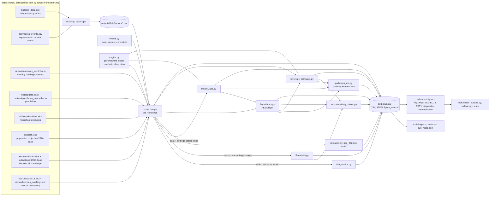
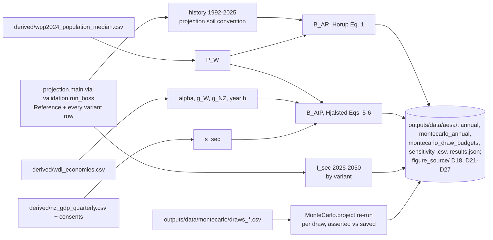
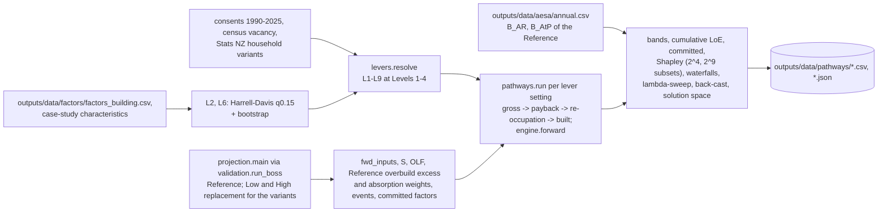

# Architecture: how the model works (MODEL v3.0.0)

This document is for a reviewer who knows statistics or modelling but not this
code or New Zealand housing data. It describes what each script reads, what it
calculates and in what order, and what it writes. Headline numbers are not
repeated here: they are generated into `outputs/reports/RESULTS.md` and
`outputs/data/metrics.json`. Every figure (the paper Fig1–Fig8, the Extended Data
ED1–ED14 and the table EDT1, and the diagnostics) is listed with its caption, data
sources and audit note in `outputs/FIGURES.md`. Every setting, with its basis (data, literature,
author decision, judgement), is in `outputs/reports/ASSUMPTIONS.md`; the methods as
implemented are in `outputs/reports/METHODS_DRAFT.md` (one document in three parts:
baseline projection, planetary-boundary layer (AESA), pathways and the theoretical
limit; copied to `docs/METHODS_DRAFT.md`, with Table 1 in `docs/LEVERS_TABLE.md`), and
every output file, with the script that writes it, in `outputs/INDEX.md`. Paths are
those of the full profile; the light profile (the default) writes the same tree under
`outputs/_light/` (section 11). Labels follow one vocabulary (`naming.py`;
`docs/RENAMING.md` maps the earlier names to the release names, section 11 the
MODEL v2.1 levers, TL components, bands and folders to those of MODEL v3.0.0;
`docs/FIGURE_PLAN_v3.md` lists the figures and the retired ones). What changed from
MODEL v2.1.2 is recorded in `docs/CHANGELOG_v3.md`. Parameter values quoted below are
the adopted settings in `projection.py` unless another module is named.

---

## 1. What the model answers

How much new residential floor area New Zealand will build from 2026 to 2050,
and how much embodied carbon that floor area carries, split by reason for
building (the demand bands: population growth (untargeted), smaller households, extra space,
vacancy, the 2026 overbuild, demolition replacement, the recent replacement
surge, and two negative bands, overbuild absorbed and unconsented additions) and by
material and life-cycle stage. Building type (detached houses, townhouses, apartments) is
internal to the model: it weights the case-study carbon factors and the lever
parameters, and no result is reported by typology.

The model is bottom-up and demand-driven: people → households → dwellings
required → floor area → carbon. Construction capacity, prices and policy are not
modelled. Carbon intensities are the 2025 case-study values; with
`DECARB_MODE = 'horup_item'` (adopted) the A1–A3 part of each case-study EPD
item follows the material-specific GWP paths of Horup et al. (2025) from 2026,
and A4–A5 a generic 1%/yr path after Resch et al. (2021) (section 4.9); with
`'none'` and `DECARB_A45 = 'held'` every factor is held at 2025 (frozen
technology, a sensitivity row). With `ACCOUNTING = 'time_resolved'` (adopted) materials and
construction (A1–A5) and soil carbon loss are counted in the construction year
and maintenance (B2, B4) in the year it occurs; later maintenance and end of life
are committed after 2050 (later B2/B4 and C1–C4), reported as a range
(section 4.10).

The adopted projection with no interventions is the **Reference**. In MODEL v3.0.0
it absorbs the 2026 overbuild by 2035 (section 4.8); the MODEL v2.1 Reference, in
which the overbuild is never absorbed, is kept as a sensitivity row and as the
legacy run (`run_all.py --reference-legacy`, section 11). Its two
replacement variants, **Low replacement** and **High replacement**, bracket the
replacement assumption (section 4.4). The planetary-boundary layer (AESA,
section 9) compares carbon 2026–2050 with two allocations of a global carrying
capacity; the pathway layer (section 10) changes the inputs the levers act on.

---

## 2. Scripts and data flow



`python run_all.py` runs everything in a fixed order (section 11), each script in
its own process, and writes to `outputs/` (full profile) or `outputs/_light/` (light
profile, the default; section 12). **Compute, then draw:** the model scripts write
CSV and JSON only and draw nothing; every figure is drawn last by the `figures/`
package from the data files (section 13), so a figure can be redrawn without
running the model (`run_all.py --figures-only`). **One engine:** the
forward model is in `engine.py` (stock calibration, census dwelling-count rates,
replacement path, the 2026 overbuild (`engine.market_excess`) and its logistic
absorption (`engine.logistic_weights`, `engine.absorb_overbuild`), forward
projection). These are pure functions; `projection.py`, `MonteCarlo.py` and
`pathways.py` call them. `projection.main()` returns a dictionary of all its local variables,
which the other scripts read; `validation.run_boss(**settings)` is the in-memory
entry point that runs it silently with settings changed and restores the module
defaults afterwards.

---

## 3. `Building_factors.py`: carbon per square metre

1. Each case study's absolute emissions (by material and EN 15978 stage) are
   divided by its floor area.
2. Materials are grouped into six lines: concrete, steel, timber, plastics &
   paint, plasterboard, others.
3. Buildings are pooled into three typologies: equal weight within sub-type,
   then equal weight across sub-types. A_2 duplicates A_1 (scaled by
   1.000073), so apartments have one independent case.
4. Soil carbon loss is land-use change, not a material: soil loss per m² of
   floor = soil loss per m² of footprint (58.77 kg CO₂e/m², area-weighted over
   the soil orders of Auckland land zoned for urbanisation) / floor space index.
5. Stage D is written out but never added. Stages in scope: A1–A3, A4–A5,
   B2/B4, C1–C4.
6. Replacement and repaint events (`event_rows`): each line of
   `data/derived/lca_events.csv` (counts and lifespan from the LCAQuick root
   tables; stage totals from `building_data.xlsx` and the item table) is split
   into n events of line B2/B4 / n at k L / (n + 1) years (sensitivity k L / n;
   a fractional year split linearly), each divided into A1–A3 : A4–A5 : C1–C4
   in proportion to the line's initial stages and carrying its decarbonisation
   path (replacements: the item's S4 row; repaints and recoating: the paint
   path). Pooled per typology like the factors; the events of each line add up to
   its B2/B4 and the pooled events to the B2/B4 factor of each typology (checked
   when the factors are written; the script stops otherwise).

Outputs (`outputs/data/factors/`): `factors_material.csv`,
`factors_typology.csv`, `factors_building.csv`, `factors_a13_decarb.csv`,
`factors_building_a13_reduction.csv`, `factors_a13_item_coverage.csv`,
`factors_events.csv`, `factors_building_events.csv`, `factors_a45_item.csv`.

---

## 4. `projection.py`: the Reference projection

### 4.1 Consents (history 1991–2025)

Monthly consents are summed to calendar years: floor area and dwellings by
typology, and an all-category dwelling count. Retirement-village (RV) units =
all-category − three typologies. RV units are dwellings in the stock but carry
no floor area or carbon (no RV case study); forward they are a constant share
of all dwellings built (ratio of sums 2016–2025, 5.6%). RV floor area is
reported separately, out of scope. Realised dwelling size = floor area /
dwellings, held per typology at its 2023–2025 average.

Dwellings built (MODEL v4.0.0) = 0.945 × consents lagged 17 months, monthly,
aggregated to calendar years (Jones, Greenaway-McGrevy & Crow 2025: completion
milestones 93% / >95%, median completion time 1.27–1.53 yr). The same lag is used
in the history and the projection; projection years whose lagged months are all
observed (2026–2027) are pipeline years, observed in every run. Sensitivities:
lag 0 / 15 / 19 months, completion rate 0.93 / 0.96.

### 4.2 Population and households (history)

Population: estimated resident population at 31 December. Households: Stats NZ
Dwelling and Household Estimates (DHE) at 31 December. After the 2018 base the
DHE series is 0.888 × lagged consents, so increments after June 2018 are
scaled by one factor k = 0.824, chosen so that June 2023 grows over June 2018
by the census ratio of occupied + residents-away private dwellings. 2024–25
household values are consent-derived and not used as evidence (the household
size anchor is 2023).

### 4.3 Net replacement: the census dwelling-count identity

For each intercensal interval: net replacement = (completions − change in
census private dwellings) / stock-years, with completions corrected for the
change in dwellings under construction on census night. This uses neither the
household estimates nor the empty/away split (which breaks between 2013 and
2018). Long run (ratio of sums 1991–2023): 0.101% of stock per year; the
2018–2023 interval: 0.312%. A fixed BRANZ demolition rate (0.135%/yr) splits
the net rate into demolition and a residual (net unconsented additions); only
their sum is identified.

The household stock identity (built = new households + vacancy allowance +
vacancy change + net replacement) is still calibrated and printed for
comparison, and is used by the hindcast with one vacancy definition throughout
(the pooled 2018/2023 empty share).

### 4.4 Replacement variants

`engine.replacement_path`, set by `REPLACEMENT_VARIANT`, three variants, all with
typology shares held: **Low replacement** (`LOW`) the long-run rate throughout;
**Reference** (`REF`) the 2018–2023 rate fading to the long-run rate with a
10-year half-life (`REPLACEMENT_HALF_LIFE`; 5 and 15 years as sensitivity
variants); **High replacement** (`HIGH`) the 2018–2023 rate persists. The
half-life is not identifiable from the census record.

### 4.5 Population projection

Stats NZ 2024-base stochastic projection: the median path is observed 2025 plus
the published median growth (PCHIP between knots); the 5th/95th paths add the
published spread of the *level* about the median, shifted to zero in 2025.
2026 growth is observed (mean-quarter ERP, June quarter 2026 − June quarter
2025); later growth is the projection's, so the level shift is permanent.

### 4.6 Household size

`S_StatsNZ = population / households` at the shared knots of the 2018-base
subnational population and household projections (2018–2043). Interpolation:
one cubic Hermite through every knot (PCHIP derivatives at interior knots, zero
slope at 2043), held constant after 2043. Applied as a shape rebased on the
observed 2023 value; households = population / S for every population path.
Household decline is floored at zero (it becomes vacancy).

### 4.7 Typology mix

Floor-area shares are held at their 2022–2026 consented average
(`MIX_HELD_WINDOW`; ratio of sums of consented floor area over the window, 2026
being the observed months) in every variant; 2026 uses the observed consented
mix. The mix is internal to the model: it weights the case-study factors and is
not reported. (The damped typology-mix trend of earlier versions, never run in a
reported result, is removed from the code.)

### 4.8 Forward requirement, the 2026 overbuild and its absorption

```
dwellings built (all categories) = new households + vacancy allowance + vacancy change
                                   + net replacement (variant rate × last year's stock)
                                   + 2026 overbuild − overbuild absorbed
in-scope dwellings              = dwellings built × (1 − RV share)
floor area                      = in-scope dwellings × blended dwelling size
```

Vacancy: the vacancy-rate parameter is held at its published 2023 census value
(5.39%, `VACANCY_PARAMETER = 'census_2023'`; on the consistent definition 2023 is
the series maximum, 5.38%, minimum 4.01% in 1996; the mean of the 1986–2023
censuses on one definition is a sensitivity row). The implied stock vacancy
(1 − households / (stock + surplus still vacant)) rises above the parameter after
2026 and returns to it by 2035, when the overbuild is absorbed (values:
`outputs/data/baseline/overbuild_2026.json`, `vacancy`, and
`overbuild_absorption_log.csv`).

2026 building is observed: 0.95 × consents over the latest 12 observed months
(the year to July 2026). Its excess over the 2026 requirement is booked in
2026; from 2027 building stays above the requirement by gap_ref × ρ^(t−2026),
with gap_ref = building 2026 − requirement 2027 and ρ the estimated persistence
of departures from the calibrated identity (`OVERBUILD_RULE = 'market_excess'`,
`OVERBUILD_GAP_REF = '2027'`). This market excess is stock-adding
(`OVERBUILD_BOOKING = 'surplus'`). 2026 floor area is fixed to the observed
consented floor area of the same months times the completion rate; the
difference to the modelled floor area is carried in the 2026 overbuild band.

**Absorption (MODEL v3.0.0).** The surplus is absorbed by 2035
(`OVERBUILD_ABSORPTION_START = 2026`, `OVERBUILD_ABSORPTION_END = 2035`) along the
normalised logistic of the levers (`engine.logistic_weights`: midpoint 2030.5,
k = ln(81)/6, w(2026) = 0, w = 1 from 2035; section 10). With C_t the cumulative
excess, the surplus still vacant on the target path is U*_t = C_t (1 − w_t), and
the target payback (building avoided) is C_t w_t − C_(t−1) w_(t−1). The payback
is capped at the year's building before the payback, max(gross_t, 0) with
gross_t = requirement_t + excess_t (the requirement of the run without any join);
a shortfall is carried to the next year (`engine.absorb_overbuild`). The join
entering `engine.forward` is excess − payback, stock-adding, so the stock identity
holds. Each year (excess, cumulative excess, weight, target, payback paid and
carried, whether the cap binds, surplus vacant, dwellings built, implied vacancy)
is written to `outputs/data/baseline/overbuild_absorption_log.csv`
(`projection.export_absorption_log`). Theory (stock-flow models of the housing
market) fixes the direction, reversion of vacancy to its equilibrium rate, not the
speed; 2035 is the adoption window of the levers, and the speed is bracketed by
sensitivity rows: never absorbed (the MODEL v2.1 Reference), absorbed by 2030 and
by 2045. Booking the excess as redevelopment (stock-neutral) and the gap against
the 2026 requirement are further sensitivities. With
`OVERBUILD_ABSORPTION_END = None` (environment `PATHWAY_REFERENCE_LEGACY=1`) the
MODEL v2.1 rule applies: a constant share `OVERBUILD_ABSORPTION` (0) of the
remaining surplus a year, i.e. never absorbed.

The floor area is reported in demand bands (bookkeeping; they add up to the
total), bottom to top: Population growth (at the occupied area per person, net
of consolidation), Smaller households (from falling household size), Extra space
(new-dwelling size above the occupied area), Vacancy (the vacancy allowance on
new households and the change in the vacancy rate), 2026 overbuild (the market
excess), Demolition replacement (the fixed BRANZ demolition rate), Recent
replacement surge (the variant's rate above the long-run net rate: the 2018–2023
knock-down-and-rebuild wave, fading in the Reference), and two negative bands:
Overbuild absorbed (the payback, building avoided) and Unconsented additions (the
calibrated long-run residual of the census dwelling-count identity: dwellings that
appear without a new-dwelling consent); carbon has one further band, Maintenance
(B2, B4), 2026–2050. The theoretical-limit runs add a third negative band,
Released dwellings (TL) (section 10). The negative bands keep their sign in the
data (`naming.NEGATIVE_BANDS`). In the figures and the data files of the bands
RV units are removed from every band in proportion (each band × (1 − RV share)),
so all bands are in scope and sum exactly to the in-scope total (tested). Only
population growth is untargeted by the pathways (smaller households are targeted
by L3 Household size).

### 4.9 Carbon

Floor area by typology × intensity, by band, material, soil and stage. Upfront
= materials and construction (A1–A5) + soil carbon loss. Soil carbon loss
applies only to floor area on new footprints: zero on the replacement bands
(demolition replacement, unconsented additions and the surge; land already
settled). The overbuild absorbed carries the soil share of the excess it offsets.

**Material decarbonisation** (`DECARB_MODE`). `'none'`: every A1–A3 factor held
at its 2025 value. `'horup_item'` (adopted): the A1–A3 factor of each EPD item of
the case studies (`data/derived/material_items.csv`, built by
`data/build_material_items.py` from the supplied item table and checked against
`building_data.xlsx`) is multiplied, year by year, by the relative GWP path of
its counterpart in Horup et al. (2025) SI Table S4 (average of 9 premise
scenarios, relative to 2025; linear between 2025, 2030, 2040 and 2050), mapped
one-to-one by `data/material_item_map.csv` (direct; by Horup et al. p. 6 for
other cementitious and wood-based products; a labelled proxy; or held, the
lift); summed per building and class, then pooled, so the 2025 totals are the
class totals. `DECARB_ITEM_CASE` selects its sensitivities (proxies held;
NZ-made electricity-intensive items held). **A4–A5** (`DECARB_A45`): `'resch'`
(adopted) e^(−0.01 (t − 2025)) after Resch et al. (2021) Table 1; `'held'` and
`'item'` (each item's S4 path) are sensitivities. C1–C4 and soil carbon loss stay
at 2025. The history (1991–2025) always uses 2025 factors. The Monte Carlo
bootstraps the same reductions per case study with the same resampled cases.
Coverage by mapping basis: `outputs/data/factors/factors_a13_item_coverage.csv`.

### 4.10 Accounting of the later stages (`ACCOUNTING`)

`'time_resolved'` (adopted): the construction year carries materials and
construction (A1–A5) and soil carbon loss; `events.py` builds per typology a
kernel K[i, j] (kg/m² of the cohort built in year i occurring in year j, each
event component at its own factor in year j) and `engine.forward` adds gfa @ K
to the carbon of year j. Events after 2050 and all C1–C4 of the 2026–2050
cohorts are committed after 2050 (later B2/B4 and C1–C4; `COMMITTED`): upper
bound at 2025 factors, lower bound with the 2050 factors held (no extrapolation
beyond the last source year). At 2025 factors, upfront + maintenance (B2, B4)
2026–2050 + committed B2/B4 + C1–C4 equals the whole-life total exactly
(`tools/reconciliation.py`, which stops the run otherwise).
`'whole_life_at_construction'` books every stage in the construction year; it is
an AESA sensitivity row (section 9) and the basis of the reconciliation. (The
frozen-technology check run of MODEL v2.1, which used it, is no longer run; the
`PATHWAY_FROZEN` switch and the `layout` helpers for its data are kept for the
layout of earlier releases.)

**Outputs.** `outputs/data/baseline/projection.json` (floor area, carbon by
stage, material and demand band, committed after 2050, settings),
`outputs/data/baseline/annual.csv` (history 1991–2025 and the Reference by year:
floor area, carbon and its components materials and construction (A1–A5), soil
carbon loss and maintenance (B2, B4), which add up to the annual carbon),
`annual_by_stage.csv` and `annual_by_material.csv`,
`outputs/data/baseline/bands_annual.csv` (the in-scope demand bands by year) and
`overbuild_absorption_log.csv` (section 4.8). `projection.py` draws nothing: run as
a script it writes the exact arrays of D01–D03, D08, D09 and D13 and the paths of
ED3 as figure source data (`projection.export_figure_sources`;
`outputs/data/figure_source/<figure id>.json` and `projection_paths.json`,
`figsource.py`), from the returned state, never from inside the computation.

---

## 5. `Diagnostics.py`

Runs `projection.main()` once and writes the figure source data (no figure) of
household formation and the DHE/consent relationship (D04), the stock and vacancy
(D05), and the vacancy-definition appendix (D06); `figures/calibration.py` draws
them. The history of household formation (D04c), of the stock identity
(D05c) and of the demand bands (Fig1; `outputs/data/baseline/bands_history.csv`,
written by `validation.py`) is
one bar per census interval (interval means, one vacancy definition): between
censuses annual detail is not identified. In D05c the history's net replacement
is census-measured, the rate of the census dwelling-count identity of each
interval (D07) × the previous year's stock, the quantity the model uses (2024–25:
the 2018–23 rate carried), and an "Unexplained building" band holds what household
formation, vacancy and census-measured replacement leave over (redevelopment not
captured by the census counts, error in the household estimates, or residual; it
may be negative). In D04c the history is stacked from population growth and from
household-size change, census-anchored at both ends; 2024–25 are consent-derived
estimates with no census check. The interval values are computed by
`validation.stock_identity_history` and `validation.household_formation_history`
and written to `outputs/data/baseline/stock_identity_history.csv` and
`household_formation_history.csv`. Accounting identities, factor sums and the
two interval histories are checked in `tests/test_identities.py`.

## 6. `Sensitivity.py`

Re-runs `projection.main()` with one setting changed per row: replacement
variants and half-lives, household-size variants and tails, dwelling-size
window, completion rate and lag, census under-construction correction, the
absorption of the 2026 overbuild (never absorbed, the MODEL v2.1 Reference; by
2030; by 2045), its booking as redevelopment and its gap reference, the vacancy
parameter (1986–2023 census mean on one definition), soil on replacement, and the
decarbonisation rows (`Sensitivity.DECARB_CASES`: frozen technology, proxies
held, NZ-made electricity-intensive items held, A4–A5 held, A4–A5 on the item
paths, event timing L / n). Population rows reuse the projection's 5th/95th
paths; carbon-factor rows (jackknife and single-case extremes of the materials
factor) and soil-order rows re-weight the Reference floor area. Whole life at
construction is an accounting convention, not a parameter: it is an AESA
sensitivity row only. Writes
`outputs/data/baseline/sensitivity_one_at_a_time.csv` and the annual carbon of every row
(`sensitivity_annual_carbon.csv`, with the population rows also on the exact engine paths); no
figures (the grouped tables of `tools/sensitivity_tables.py`, section 10, feed the tornado
Fig7 and the diagnostics D16, D41 and D42; D17 and ED14 draw the annual paths). One-at-a-time
ranges are not additive.

## 7. `MonteCarlo.py`

Within each variant (Reference, Low replacement, High replacement): Latin
hypercube draws (5,000 in the full profile, seed 20260924; 1,000 in the light
profile, seed 20261014; `runprofile.py`) of population rank z (moving population between the published
percentile levels and household size between Stats NZ Low/Medium/High with the
same z), a dwelling-size multiplier, the completion rate (two-piece uniform with
median 0.95) and a stratified bootstrap of the carbon factors. Each draw runs the
same `engine.py` chain; before sampling, the draw at the median of every input is
checked against `projection.main()` to 1e-9. With decarbonised materials
(`DECARB_MODE`), the bootstrap also resamples each case study's reduction by
year, its event kernel and its event age profile with the same resampled cases
and multipliers, so the random stream and every 2025-factor draw are unchanged.
Each draw absorbs its own 2026 overbuild on the Reference's logistic weights, as
the projection does. The carbon-factor bootstrap (4,000 replicates) is part of the
design and the same in both profiles. Sobol first-order and total indices
(Reference, 1,024 × 6 evaluations) in the full profile only. This is
within-variant parametric uncertainty only; the variant differences and the
carbon-factor and soil-order bounds are reported separately (one-at-a-time rows,
D16; variants, D19). Writes `outputs/data/montecarlo/` (`draws_<variant>.csv`,
`summary_<variant>.csv`, `annual_<variant>.csv`, the convergence of the percentiles
and the input distributions of the Reference, and `sobol_REF.csv` in the full
profile); no figure (D20, D37, D38: `figures/montecarlo.py`).

## 8. Validation and reports

MODEL v3.0.0 no longer runs the frozen-technology check of MODEL v2.1 (the
projection, Monte Carlo and AESA layer at 2025 factors with whole life at
construction); its regression locks are retired with the other v1/v2 locks
(section 14). Frozen technology remains a one-at-a-time row (section 6) and whole
life at construction an AESA sensitivity row (section 9).

`validation.py`: rolling-origin hindcast of dwellings built from 2006, 2013 and
2018 (consistent vacancy definition), and the 2026 out-of-sample check (model
run without any 2026 data vs observed consents); it also writes the demand bands
of the history by census interval. `gap_2026.py`: decomposition of the 2026 gap.
`tools/`: the 2026 overbuild report, with the absorbed total and the absorption
year (`overbuild_2026.py`), the variant table
(`replacement_scenarios.py`: Low replacement, the Reference with half-lives 5, 10
and 15 years, High replacement, and the three main variants without the census
under-construction correction), the reconciliation of the accounting
(`reconciliation.py`), the reality checks and the figure source data of D07, D10,
D12, D14, D15 and D19 (`figures_report.py`, compute only), `metrics.json`
(`metrics.py`), and the documents: `RESULTS.md` (`results.py`), `ASSUMPTIONS.md`
(`assumptions.py`), `METHODS_DRAFT.md` and `LEVERS_TABLE.md` (`methods.py`, merging
`baseline_draft.py`, `pb_methods.py` and `pathways_methods.py`; both copied to
`docs/`), all in `outputs/reports/`. `tools/check_outputs.py` checks that terms of
retired code paths appear in no generated output. `tools/design_docs_v3.py`
(`docs/FIGURE_PLAN_v3.md`, section 11 of `docs/RENAMING.md`), `tools/design_docs.py`
(sections 1–10 of `docs/RENAMING.md`, the record of MODEL v1.0.0–v2.1.2) and
`tools/palette_check.py` (`docs/PALETTE.md`) write the design documents and are not
part of the pipeline.

## 9. `boundaries.py`: planetary-boundary layer (AESA, climate change)

A layer on top of the model outputs; nothing in the model changes. Equations
are pure functions in `aesa.py`; `boundaries.py` assembles data and runs and
writes the figure source data of D18 and D21–D27, which `figures/boundaries.py`
draws.



1. **History (at 2025 factors).** Sector emissions 1992–2025 = built floor
   area by typology × the 2025 case-study factors, with soil carbon loss only on
   the non-replacement floor area, as in `engine.forward`: net replacement in
   year y = census-interval rate × last year's stock × (1 − RV share) × dwelling
   size (2024–25: the 2018–23 rate carried). The base follows the projection's
   accounting rule (`boundaries.window_base`): upfront of the base window's
   construction plus the maintenance events of the cohorts built in the base
   window that occur in it. The mean 2016–2025 is Ī_sec,base. Historical carbon is used only
   for the AR base and the base-window sensitivity rows; no figure shows carbon
   before 2026 except the AR base window of D21 (tested).
2. **Acquired rights.** B_AR(t) = SOS (Ī_sec,base / I_glob) × population
   modifier relative to t0 = 2025 (NZ: model path; world: WPP 2024 median,
   dated 31 December as the mean of 1 July t and t+1).
3. **Ability to pay.** α, g_W and g_NZ in base year b (latest year with ≥ 98%
   WDI population coverage of PPP GDP per capita), over the covered economies;
   s_sec = consented residential value / final consumption expenditure
   2016–2025. B_AtP(t) = SOS / P_W(t) × g_W/g_NZ × α × P_NZ(t) × s_sec. AR and
   AtP are reported side by side and never averaged.
4. **Variants.** Every deterministic row of `tools/replacement_scenarios.py` is
   re-run (full projection run); they share the population path, so the
   boundaries are the same and only I_sec differs.
5. **Monte Carlo.** Each saved draw of the Reference, Low replacement and High
   replacement is re-run through `MonteCarlo.project()` from its saved
   parameters (MonteCarlo.py unchanged); the run stops unless every draw
   reproduces its saved outputs to 1e-9. The boundaries are recomputed from each
   draw's NZ population path, and the AR base Ī_sec,base from the draw's
   case-study carbon factors (2025 technology) on the observed history, so
   factor uncertainty enters base and projection alike.
6. **Sensitivities** of cumulative LoE (Reference): source pair, GDP measure,
   AR base window (5 years, 20 years, the full consistent history from 1992),
   NZ population source, s_sec definition, the decarbonisation and accounting
   rows (including whole life at construction), the wider maintenance scope
   (events of all cohorts since 1992 in base and projection) and α = 1. The
   Stats NZ 5th/95th population paths, which move carbon and the AR boundary
   together, are evaluated with the same boundary functions
   (`results.json` "population_paths"; used by `tools/sensitivity_tables.py`
   for the population rows and the tornado Fig7).
7. **Committed after 2050** per variant, in years of the 2050 AR boundary
   (`outputs/data/aesa/results.json` "committed"; Fig3 b draws the committed
   range itself from `baseline/projection.json`). For the pathway Monte Carlo the
   budgets of every Reference draw are written to `montecarlo_draw_budgets.csv`.

Settings, sources and limitations: top of `boundaries.py` and
`outputs/reports/ASSUMPTIONS.md`; methods as implemented: part 2 of
`outputs/reports/METHODS_DRAFT.md`.

---

## 10. Pathways and the theoretical limit (`levers.py`, `pathways.py`)

A layer on top of the Reference, like the AESA layer: nothing in the model
changes and no baseline output is rewritten. `pathways.py` obtains the projection state
from `validation.run_boss()` (`projection.main()` returns its locals, in memory
only) and re-calls `engine.forward()` with copies of `fwd_inputs` modified by the
pure functions of `levers.py` (`levers.inputs`); with every lever off the run is
the Reference (checked to 1e-9; the run stops otherwise). Which input each lever
changes is recorded in `levers.LEVER_PARAMETER` and in `docs/HOOKS.md` (a
historical record, written before the pathway code with the module names and
lever ids of that time; `docs/RENAMING.md` section 11 maps the MODEL v2.1 lever
ids to the present ones). `pathways.py` computes and writes data only.



1. **Ambition levels.** Every lever has four levels, after the 2050 Pathways
   Calculator (DECC 2010; DESNZ 2023) and EUCalc (D2.5, 2020): **Reference**
   (Level 1, the lever off), **Moderate** (Level 2), **Ambitious** (Level 3) and the
   theoretical limit **TL** (Level 4). Ambitious is the best value already achieved,
   by the first applicable sub-rule (`naming.LEVER_SUBRULE`): A, a case-study
   distribution exists: the Harrell-Davis 0.15 quantile of the pooled scale-free
   case ratios (the top-15% convention of the EU Taxonomy), with a percentile
   bootstrap interval; B, an NZ record with no structural trend exists: the best
   value ever observed in New Zealand; C, otherwise a published reference value.
   Levels between Reference and Ambitious are indexed by λ ∈ [0, 1] on the
   lever's native parameter, x(λ) = x_ref + λ (x_amb − x_ref); Moderate is λ = 0.5,
   the exact midpoint (per year for the path levers L3 and L7). TL is the
   definitional zero or full where one exists, else the best single observation;
   every TLn is asserted at least as strong as Ambitious (`levers.tl_strength`;
   the run stops otherwise).
2. **Adoption path.** Every level, TL included, moves from the Reference along
   one rule for every adoption window 2026 → E (W = E − 2026): a normalised
   logistic with midpoint 2026 + W/2 and speed k = ln(81) / (2W/3), so that 10–90%
   of adoption falls within the middle two-thirds of the window; w(2026) = 0,
   w(E) = 1, w = 1 after E (`levers.adoption_window`, `levers.ramp`; the same rule
   as `engine.logistic_weights`). Adopted: full roll-out by 2035 (midpoint 2030.5,
   k = ln(81)/6), following RECC (Pauliuk et al. 2024); x(y) = x_ref + w(y)
   (x_level − x_ref). Sensitivities: P5 by 2030 (midpoint 2028) and by 2045
   (midpoint 2035.5), and the instant TL (every limit at full strength from 2027).
   2026 is observed and never changed.
3. **Levers** (`levers.py` docstring; resolved values with their anchors and
   sources: `outputs/data/pathways/levers.json`; Table 1:
   `docs/LEVERS_TABLE.md`). Business-as-usual decarbonisation (section 4.9)
   applies in every run; only population growth is untargeted.

   | pathway | lever (sub-rule) | what it changes | Ambitious | TL |
   |---|---|---|---|---|
   | P1 Space per person | L1 Dwelling size (B) | a share f of the extra-space margin (size − occupied area S × OLF) removed, applied after L2; never below the occupied area | f such that the size at full strength (2035) equals the smallest annual mean consented size 1990–2025, per typology | TL1 No extra space: f = 1 |
   | | L2 Design density (A) | OLF and dwelling size of every typology × r | r = HD q0.15 of the 16 case-study ratios OLF_i / typology median | TL2 Densest design: per typology min(own densest case, r_Ambitious) |
   | | L3 Household size (C) | S = S_ref + gap; households = population / S | gap = Stats NZ High − Medium household size (held at its 2043 value after 2043) | TL3 Historical maximum household size (at least the Ambitious path) |
   | P2 Existing stock | L4 Vacancy (B) | the vacancy-rate parameter | the 1996 census minimum on one definition | TL4 No vacancy: v = 0 |
   | | L5 Building lifetime (C) | demolition rate and the recent-surge component × (1 − d); unconsented additions untouched | d = 0.40 (Pellan et al. 2024); renovation carbon not modelled | TL5 No demolition: d = 1 (demolition and surge) |
   | P3 Construction | L6 Material carbon (A) | A1–A3 term × r (decarbonisation still applies on top) | r = HD q0.15 of the case ratios A1–A3_i / pooled | TL6 Best-practice materials: per typology min(own best independent case, r_Ambitious) |
   | | L7 Construction-stage carbon (C) | A4–A5 factor path | linear to zero by 2050 (A5 treated as energy, an upper bound) | TL7 Zero-emission construction: A4–A5 = 0 |
   | P4 Land | L8 Soil-aware planning (C) | soil carbon loss per m² × (1 − x) | x = 0.146 (Christoforatos, Pickering & Schipper 2026) | TL8 Lowest-carbon soils: the lowest soil order |
   | | L9 Brownfield development (C) | soil-free floor area = replacement + w · max(0, s · total − replacement) (`engine.forward` `brownfield_share`) | s = 0.59 (England 2018–21) | TL9 All brownfield: s = 1 |

   P5 Combined is every lever (`naming.PATHWAY_LEVERS`). The typology shares stay
   at the Reference held mix. The data STOP conditions of `levers.resolve`: the L2
   sample must have 16 cases in the three typologies; f in [0, 1] for every
   typology; the Stats NZ High household size at least the Medium one in every
   year; at least 10 independent L6 cases and r < 1; the model's A4–A5 path equal
   to the Resch path.
4. **One run** (`pathways.run`; every run, the Reference included, in the same
   order per year: gross → overbuild payback → re-occupation → built):
   (i) the lever inputs and the requirement without any join (`engine.forward`,
   join = 0); (ii) the need, that requirement plus the dwellings released by TL4
   (zero vacancy: −min(vacancy change, 0)), so that this release is re-occupied by
   rule (iv) rather than netted at once; (iii) the 2026 overbuild: the market excess
   of the Reference (computed once and held fixed in every run, checked) is
   absorbed along the Reference's logistic weights with the run's own need
   (`engine.absorb_overbuild`, section 4.8); (iv) re-occupation (TL-family runs with
   TL3 and / or TL4 only, below); (v) `engine.forward` with the stock-adding join =
   excess − payback + TL4 release − re-occupied, so the stock identity holds and
   released dwellings stay vacant until re-occupied.
5. **Theoretical limit.** A hyper-optimistic theoretical limit; a thought
   experiment, not a pathway: every lever at Level 4 (TL1–TL9), adopted on the same
   logistic 2026 → 2035 as every level. **Re-occupation** (`pathways.reoccupation`):
   the dwellings released in 2027–2050 by TL3 (household decline, −min(Δ households,
   0) / (1 − v)) and by TL4, R = R3 + R4, meet a constant share of each year's need
   after the payback: re-occupied_t = max(gross_t, 0) × s, s = min(R, G+)/G+ (G+ the
   positive need 2027–2050). The cumulative re-occupied never exceeds the cumulative
   released; where that binds, the shortfall is built (not carried) and s is
   recomputed from the remaining pool over the remaining years. built_t =
   max(gross_t, 0) − re-occupied_t ≥ 0; where R > G+ the surplus stays vacant in
   2050. The re-occupied dwellings form the negative band Released dwellings (TL),
   attributed to TL3 and TL4 in proportion R3 : R4. The year-by-year record of TL
   and of the instant TL (need, gross after payback, releases, share,
   re-occupied, whether the release binds, built, cumulative released and
   re-occupied) is `outputs/data/pathways/reoccupation_log.csv`; the definition,
   Level-4 values, R3, R4, G+ and the human-terms indicators (household size,
   dwelling size, m² per person, implied vacancy, dwellings built) are in
   `theoretical_limit.json`.
6. **Runs** (cached by lever setting and reused across games and variants): the
   Reference; each lever alone at Moderate, Ambitious and TL; P1–P5 at Moderate
   and Ambitious; TL; the instant TL; P5 by 2030 and by 2045; the λ-sweep of each
   lever (λ = 0, 0.1, …, 1 and the TL point); and the variants: the Reference, P5
   (Moderate, Ambitious) and TL under Low and High replacement. Per run: carbon
   2026–2050 by stage, floor area and carbon by demand band (exact), committed
   after 2050, dwellings built, household size, soil-free share, implied vacancy,
   cumulative LoE.
7. **Checks that stop the run** (`pathways.checks`, `pathways.ordering`): the
   no-lever run reproduces the Reference (carbon, floor area by typology, join,
   committed, bands, LoE) to 1e-9; dwellings built ≥ 0 in every run and year; no
   negative stage, floor-area or material value; cumulative re-occupied ≤
   cumulative released; outside the TL family, implied vacancy ≥ 4.0% and no
   household decline; dwelling size never below the occupied area; 2026 unchanged;
   the overbuild excess identical in every run; exact Shapley efficiency; the
   ordering Reference ≥ Moderate ≥ Ambitious ≥ TL of each lever's native quantity
   as it enters the engine, per typology and year, and of the cumulative carbon of
   the single-lever runs (annual reversals are reported, not stopped:
   `ordering_checks.json`); TL ≤ P5 Ambitious ≤ P5 Moderate in each variant.
8. **Attribution**: exact Shapley values (rational arithmetic) of cumulative
   carbon, LoE AR and LoE AtP over every subset: the four pathways (16 subsets) at
   Moderate and at Ambitious; the nine levers (2⁹ = 512 subsets) at Moderate and at
   Ambitious; the nine levers at TL from the Reference (512; Fig8); and TL1–TL9 from
   P5 Moderate (512; ED8). `shapley.csv`, `shapley_subsets.csv`.
9. **Waterfalls**: the sequential path Reference → + P1 → + P2 → + P3 → + P4
   (= P5) → + TL1 … + TL9 (= TL), every step a cached run and its change split
   exactly into the in-scope demand bands, at Moderate (Fig5) and at Ambitious
   (ED7) (`waterfall.csv`). There is no timing step: TL is adopted on the same
   logistic as every level.
10. **Gap**: back-cast (a uniform factor k on the floor area of every 2027–2050
   cohort, brentq) for the Reference, P5 Moderate, P5 Ambitious and TL, and the
   demand × intensity solution space (Horup et al. 2025, Fig. 6 style) with the
   P1–P5 and TL markers (`backcast.json`, `solution_space.csv`; Fig6).

Writes `outputs/data/pathways/`: `runs.csv`, `annual.csv`, `bands.csv`,
`bands_annual.csv`, `shapley.csv`, `shapley_subsets.csv`, `solution_space.csv`,
`lambda_sweep.csv`, `waterfall.csv`, `lever_annual.csv`, `reoccupation_log.csv`,
`backcast.json`, `ordering_checks.json`, `theoretical_limit.json` and
`levers.json`. Methods as implemented: part 3 of
`outputs/reports/METHODS_DRAFT.md`.

**Pathway Monte Carlo (`pathways_mc.py`).** Every saved Reference draw of
`MonteCarlo.py` (5,000 in the full profile, 1,000 in the light one) is re-run
through `MonteCarlo.project` and then through `pathways.run`, the function of the
deterministic runs: P5 Moderate, P5 Ambitious, TL and the instant TL (summary
only). Every level is applied to the draw's own inputs (the L2 and L6 ratios to
the draw's OLF, dwelling sizes and A1–A3; L3 adds the published gap to the draw's
household size); the overbuild excess is the draw's own Reference excess, held
fixed in its lever runs and absorbed on the Reference weights; TL3 is never weaker
than the draw's Ambitious path (counted). Each draw's LoE uses its own AR and AtP
budgets (`aesa/montecarlo_draw_budgets.csv`). The run stops unless the central draw
reproduces the deterministic runs to 1e-9, every draw's Reference carbon equals
the saved draw, the bootstrap is reproduced exactly, and in every draw TL ≤ P5
Ambitious ≤ P5 Moderate, dwellings built ≥ 0 and the cumulative re-occupied ≤ the
cumulative released. Insight analyses (`mcstats.py`, numpy / scipy, checked
against statsmodels) on the four sampled inputs (population rank, dwelling-size
multiplier, completion rate, carbon-factor index): SRC and PRCC with percentile
bootstrap intervals (500 replicates in the light profile, 2,000 in the full),
LOWESS and least-squares fits, and the conditional TL (Firth penalised-likelihood
logistic regression of P(TL LoE AR ≤ 1), profile intervals; the maximum-likelihood
estimate does not exist under separation) (ED4, ED5, D39, D40).

**Grouped sensitivity tables (`tools/sensitivity_tables.py`).** The rows of
`docs/SENSITIVITY_PLAN.md`, grouped by type of change, from the existing data files;
the new runs (P5 with one lever L1–L9 at Ambitious and the others at Moderate; P5 on
the population 5th / 95th paths, exact engine path, with the budgets of that path;
TL under Low / High replacement) are computed with the pathway engine, and every
run that an existing file holds is asserted to reproduce it (1e-12). Writes
`outputs/data/sensitivity/`: `reference_carbon.csv` (D16), `p5_carbon.csv` (D41),
`planetary_boundary.csv` (D42), `replacement_variants.csv` (ED13) and `tornado.csv`
(Fig7: the low and high case of eight inputs of the Reference, the overbuild
absorption timing among them; cumulative carbon and LoE AR and AtP).

---

## 11. Run modes

`run_all.py` (its docstring is the reference; in Spyder or any IPython console:
open it and Run, or `runfile('run_all.py', args='--profile full')`). Paths are
resolved from the repository folder, so the working directory does not matter.
Each step runs in its own process with the non-interactive matplotlib backend, its
console output going to `<outputs>/logs/<step>.log`. A failed step prints its name
and the log to read, and the run stops there (exit code 1 from the command line;
no `SystemExit` in an interactive console).

**Run profiles** (`--profile {light,full}`, environment `PATHWAY_PROFILE`;
`runprofile.PROFILES`). Only the stochastic layer and the figure formats differ;
the deterministic results (the Reference, every lever, pathway and TL run, the
Shapley values, the waterfalls) do not depend on the profile
(`tests/test_profiles.py`).

| profile | Monte Carlo | Sobol | bootstrap | figures | outputs |
|---|---|---|---|---|---|
| `light` (default) | 1,000 Latin hypercube draws, seed 20261014 | off | 500 replicates | PNG at 200 dpi with the footer "LIGHT RUN — n=1000" | `outputs/_light/` (a mirror of the tree) |
| `full` | 5,000 draws, seed 20260924 | on | 2,000 replicates | PDF + PNG at 600 dpi | `outputs/` |

The bootstrap setting applies to the percentile intervals of the Harrell-Davis
estimators (L2, L6) and of the pathway Monte Carlo SRC / PRCC; the carbon-factor
bootstrap of `MonteCarlo.py` is part of the Monte Carlo design and the same in
both profiles. Reported results come from the full profile only.

**Pipeline** (`python run_all.py [--profile full]`). It first deletes the data,
reports and figure folders of its output tree (`data/`, `reports/`,
`paper_main/`, `paper_extended/`, `diagnostics/` with the figure audit records,
`FIGURES.md`, `INDEX.md`, and the retired MODEL v2.1.2 folders `paper/`,
`extended_data/`, `key_figures/`), so nothing stale survives, then computes:
`Building_factors.py`, `projection.py`, `Diagnostics.py`, `Sensitivity.py`,
`MonteCarlo.py`, `boundaries.py` (reads the Monte Carlo draws), `validation.py`,
`gap_2026.py`, `tools/overbuild_2026.py`, `tools/replacement_scenarios.py`,
`tools/reconciliation.py`, `tools/figures_report.py`, `pathways.py`,
`pathways_mc.py`, `tools/sensitivity_tables.py`, `tools/metrics.py`,
`tools/results.py`, `tools/assumptions.py`, `tools/methods.py`; writes
`run_meta.json`; then draws: `python -m figures` (every figure of
`figure_plan.py`, the Extended Data table and `FIGURES.md`, from the data files
only); then `tools/check_outputs.py`, `indexes.py`, `run_meta.json` again (with
the step timings) and last `pytest tests/` on the complete output set. The model
scripts write CSV and JSON only. `run_meta.json` records the profile, mode, number
of draws, Sobol and bootstrap settings, the seeds (Monte Carlo, the L2 and L6
Harrell-Davis bootstraps, the insight bootstrap, Sobol), the figure formats, dpi
and footer, the git hash and whether the tree was modified, the SHA-256 of every
input under `data/`, a timestamp and the seconds of each step. The
frozen-technology check run of MODEL v2.1 is no longer part of the pipeline.

**Figures only** (`python run_all.py --figures-only [--profile full]`): deletes
the figure folders and runs `python -m figures` on the data of a previous run;
the SHA-256 of every file of `<outputs>/data/` before and after must agree, or the
run stops (record: `logs/figures_only_check.json`).

**Legacy Reference** (`python run_all.py --reference-legacy`; environment
`PATHWAY_REFERENCE_LEGACY=1`): the MODEL v2.1 Reference, in which the overbuild is
never absorbed (`OVERBUILD_ABSORPTION_END = None`): `Building_factors.py`,
`projection.py`, `MonteCarlo.py` and `boundaries.py` into `outputs/_legacy/`
(never mixed with the v3 outputs), then the legacy lock
`tests/test_reference_legacy.py` (1e-12) and `run_meta.json`.

---

## 12. Outputs

`layout.py` defines every path once (its docstring is the reference); `outputs/INDEX.md`
lists every file with what it holds and the script that writes it (the registry is
`indexes.FILES`). Paths below are those of the full profile; the light profile
writes the same tree under `outputs/_light/`, and `--reference-legacy` under
`outputs/_legacy/`.

| folder | content |
|---|---|
| `outputs/paper_main/` | the paper figures Fig1–Fig8 (`figure_plan.PAPER_MAIN`) |
| `outputs/paper_extended/` | the Extended Data ED1–ED14 and the table EDT1, lever levels by typology (`figure_plan.PAPER_EXTENDED`, `EXTENDED_TABLES`) |
| `outputs/diagnostics/<group>/` | every other figure, in the groups calibration, validation, boundaries, pathways, montecarlo, sensitivity (`figure_plan.DIAGNOSTICS`); `_audit/` the figure audit records |
| `outputs/FIGURES.md` | every figure with its file, data sources, caption and audit note (`figures/index.py`) |
| `outputs/run_meta.json` | profile, draws, seeds, git and input hashes, timestamp, step timings (section 11) |
| `outputs/data/baseline/` | the Reference projection and its checks (projection, annual series by stage and material, demand bands, overbuild absorption log, variants, validation, 2026 gap and overbuild, reconciliation, reality checks, one-at-a-time sensitivity) |
| `outputs/data/montecarlo/` | draws, summaries, annual percentiles by variant; convergence and input distributions of the Reference; Sobol indices of the Reference (full profile) |
| `outputs/data/aesa/` | boundaries, levels of exceedance, AESA sensitivity rows, committed after 2050, the budgets of every Monte Carlo draw |
| `outputs/data/pathways/` | lever parameters, every lever, pathway and TL run, bands, Shapley tables, waterfalls, λ-sweep, re-occupation log, back-cast, solution space, ordering checks, the pathway Monte Carlo |
| `outputs/data/sensitivity/` | the grouped one-at-a-time tables (Reference carbon, P5 carbon, planetary boundary, replacement variants) and the tornado of Fig7 |
| `outputs/data/factors/` | the case-study factors (`Building_factors.py`) |
| `outputs/data/figure_source/` | the exact arrays of the diagnostics (and the paths of ED3) that are not otherwise exported, written by the model scripts (`figsource.py`) |
| `outputs/data/metrics.json` | the headline metrics and the run mode |
| `outputs/reports/` | `RESULTS.md`, `ASSUMPTIONS.md`, `METHODS_DRAFT.md`, `LEVERS_TABLE.md`, the validation, gap, overbuild, variant, reality-check and reconciliation reports |
| `outputs/logs/` | console output of each step; git-ignored, not part of the release |

Data files carry the release names of `naming.py` (ASCII hyphens; variant ids
`REF`, `LOW`, `HIGH`).

---

## 13. Figures

Compute and draw are separate: the model scripts write data only
(`tests/test_figures_v3.py` checks that they do not plot), and every figure is
drawn by the `figures/` package from the files of `outputs/data/` (`python -m
figures` draws every figure, `python -m figures <file id> …` the ones named).

* **`figure_plan.py`** is the registry of every figure: `PAPER_MAIN` (Fig1 floor
  area by demand band, history and projection; Fig2 the Reference carbon by band,
  material and stage; Fig3 the Reference against the boundaries; Fig4 the pathways
  against the boundaries; Fig5 the waterfall Reference → P1 … P4 → TL1 … TL9; Fig6
  the solution space; Fig7 the tornado; Fig8 the Shapley value of each lever),
  `PAPER_EXTENDED` (ED1–ED14) and `EXTENDED_TABLES` (EDT1), `DIAGNOSTICS` by group
  (calibration, validation, boundaries, pathways, montecarlo, sensitivity), each
  with its title, drawing module and data sources; `FULL_ONLY` (figures drawn only
  in the full profile: D20, the Sobol indices); `PB_FIGURES` (figures with a
  planetary boundary, which must show the zones); `MAINTENANCE_ALLOWED` (the
  figures allowed to draw maintenance as its own layer); and `RETIRED` (the
  MODEL v2.1.2 folders and figure ids not carried forward, with the reason;
  `docs/FIGURE_PLAN_v3.md`).
* **`figsource.py`** writes and reads the figure source data
  (`outputs/data/figure_source/<figure id>.json`, lossless for float64): the
  exact arrays a diagnostic draws when they are not in a published data table.
* **`figures/style.py`** holds the palette (`docs/PALETTE.md`, checked for
  colour-vision deficiency by `tools/palette_check.py`; `registry()` lists every
  colour of every group), the bundled typeface (Liberation Sans), the print sizes
  (89 mm single column, 183 mm double column, text 5–7 pt) and saving: a figure is
  written to its place (`layout.figure`) in the formats of the run profile, with
  fixed metadata (no software version or creation date) so that re-runs are
  byte-stable, after its audit record. In the light profile every figure carries
  the "LIGHT RUN — n=1000" footer.
* **`figures/draw.py`** holds the shared drawing rules. Negative bands keep their
  sign: in time series positive bands are stacked up from zero and negative bands
  down from zero, the net a black line; in cumulative bars each negative band is
  an unfilled segment outlined in its band colour, hanging from the top of the
  positive stack, so the bar ends at its net total (marked by a tick). Material and
  stage values are never negative (the drawing stops otherwise). The AR and AtP
  boundaries are lines (AR solid, AtP dotted), never a shaded range and never
  averaged. Only the recent replacement surge is hatched.
* **`figures/audit.py`** records, for every saved figure, each axes' labels and the
  range of calendar years its data cover, every text of the figure, its note,
  whether it draws a boundary, the zones and maintenance as its own layer
  (`outputs/diagnostics/_audit/<figure>.json`); the tests and `FIGURES.md` read
  these records.
* **`figures/data.py`** reads the data files of the active profile;
  **`figures/index.py`** writes `outputs/FIGURES.md`; **`figures/__main__.py`**
  draws the figures, then the table EDT1, then the index.
* One module per group draws the figures: `paper_main.py` (Fig1–Fig8),
  `paper_extended.py` (ED1–ED14, EDT1), `calibration.py` (D01–D06, D08, D09, D13,
  D35), `validation.py` (D07, D10, D12, D14, D15, D19), `boundaries.py` (D18,
  D21–D27), `pathways.py` (D28, D29, D31–D34, D36), `montecarlo.py` (D20, D37–D39)
  and `sensitivity.py` (D16, D17, D40–D42).
* **`naming.py`** supplies every reader-facing label (variants, pathways, levels,
  levers `LEVERS`, the pathway families `PATHWAY_LEVERS`, the sub-rules, TL, adoption
  paths, bands `BANDS` and `NEGATIVE_BANDS`, components, metrics), the vacancy
  wording (`VACANCY_WORDING`) and the terms of earlier versions that no reader-facing
  text may use (`OLD_TERMS`).
* **`indexes.py`** writes `outputs/INDEX.md`.

---

## 14. Tests

`tests/` runs last in the pipeline, on the outputs of the active profile
(`PATHWAY_PROFILE`; light by default). `conftest.py` provides one silent Reference
run per session (it needs the factor files of `Building_factors.py`) and excludes
`tests/retired/` from collection.

* **`test_reference_legacy.py`**: the legacy lock. With the overbuild never absorbed
  (`OVERBUILD_ABSORPTION_END = None`, the setting of `--reference-legacy`), the
  Reference reproduces MODEL v2.1 to 1e-12 relative: every numeric column of the
  forecast table, every array of the engine result of each population percentile,
  the annual carbon by typology and the near-term join
  (`tests/reference_legacy_v2_1.json.gz`, captured at model-v2.1.2 before any v3
  change by `tests/capture_reference_legacy_v2_1.py`). The v3 Reference differs
  from it only through the absorption.
* **`test_model_v3.py`**: the model rules and STOP conditions: the logistic weights;
  overbuild absorption (payback cap and carry; the Reference absorbs by 2035; the
  absorption log; the excess identical in every run); Moderate the exact midpoint;
  the data STOP conditions of the levers; the ordering Reference ≥ Moderate ≥
  Ambitious ≥ TL; TL ≤ P5 in every Monte Carlo draw; the L1 / L2 interaction;
  dwellings built ≥ 0 and implied vacancy ≥ 4% outside TL; the re-occupation log and
  the recomputed share; Shapley efficiency; waterfall sums; material and stage values
  never negative; `run_meta.json`.
* **`test_figures_v3.py`**: the model scripts do not plot; no duplicate colour in the
  palette registry; only the surge band hatched; the boundary styles; the sign rules
  of time series and cumulative bars; material and stage values never negative;
  every planned figure drawn and audited; drawing leaves the data byte-identical.
* **`test_profiles.py`**: the profile settings; the lever parameters agree in both
  profiles except the bootstrap intervals; when both output trees exist, every
  deterministic data file is identical.
* **`test_regression_model_v3.py`**: the v3 regression lock (`tests/regression_v3.py`):
  the SHA-256 of every deterministic data file (JSON without its profile fields) and of
  the Monte Carlo draw files of each profile, captured by
  `tests/capture_regression_model_v3.py` from a light and, if present, a full run
  (it stops unless the deterministic hashes of the two agree); skipped until
  `tests/regression_model_v3.json` is captured.
* **`test_identities.py`**: accounting identities (typology and band sums,
  stock identities, material + soil = carbon, stages + soil = total, the band
  stack is the total, the projection is deterministic and leaks no state,
  household size passes through the published knots, the census-interval histories
  of D04 and D05).
* **`test_decarb.py`, `test_decarb_item.py`**: the S4 paths match the table; the
  item table reproduces the workbook; the mapping is complete and one-to-one;
  2025 class totals are kept; reductions recomputed from items; soil, other
  stages and the history unchanged; sensitivity cases; the Monte Carlo
  bootstrap stream unchanged.
* **`test_mcstats.py`**: the insight statistics against statsmodels (fixtures),
  closed-form cases, the logistic maximum, Firth's penalised likelihood and its
  profile bounds.
* **`test_census_uc.py`, `test_soil.py`, `test_overbuild_2026.py`,
  `test_validation.py`**: the under-construction correction, soil carbon loss
  zero on net replacement, the replacement paths, nowcast and 2026 overbuild
  rule on synthetic inputs, and the 2026 out-of-sample check on synthetic
  consents.

The locks of MODEL v1–v2.1 (`test_regression_model_v1.py`, `_v2.py`, `_v2_1.py`,
`test_regression_v1_2_1.py`, `test_output_manifest.py`, `test_data_unchanged.py`,
`test_release.py`, `test_release_map.py`, `test_v2.py`, `test_v3.py`, `test_pb.py`,
`test_pathways.py`, `test_pathways_mc.py`, `test_sensitivity_tables.py`,
`test_palette.py`) are kept for the record in `tests/retired/` and not collected:
MODEL v3.0.0 changes the Reference on purpose, and the legacy lock keeps the link to
MODEL v2.1.

---

## 15. Glossary

| term | meaning |
|---|---|
| floor area | gross floor area (GFA), m² |
| Reference | the adopted projection with no interventions (replacement half-life 10 years; the 2026 overbuild absorbed by 2035) |
| legacy Reference | the MODEL v2.1 Reference: the 2026 overbuild never absorbed (`--reference-legacy`; a sensitivity row) |
| Low / High replacement | the replacement variants of the Reference: the 1991–2023 long-run rate throughout / the 2018–2023 rate persists |
| demand band | a reason for building (population growth, smaller households, extra space, vacancy, 2026 overbuild, demolition replacement, recent replacement surge; negative: overbuild absorbed, unconsented additions, and in TL runs released dwellings (TL); for carbon also maintenance (B2, B4), 2026–2050) |
| 2026 overbuild | observed 2026 building above the requirement, continuing above it at the persistence ρ (the market excess) |
| overbuild absorbed | the cumulative overbuild absorbed by building less, logistic 2026 → 2035, the payback capped at the year's building with carry (negative band) |
| unconsented additions | the calibrated long-run residual of the census dwelling-count identity: dwellings that appear without a new-dwelling consent (negative band) |
| DHE | Stats NZ Dwelling and Household Estimates |
| ERP | estimated resident population |
| S | average household size = population / households |
| v | vacancy rate = empty private dwellings / all private dwellings |
| RV | retirement-village unit |
| UC | dwellings under construction on census night |
| OLF | occupancy load factor = floor area per design occupant |
| FSI | floor space index = floor area / building footprint |
| ρ | persistence of departures from the calibrated stock identity |
| PCHIP | piecewise cubic Hermite interpolation, a shape-preserving spline |
| EN 15978 stages | A1–A3 product, A4–A5 construction, B2/B4 maintenance (replacement and repaint events), C1–C4 end of life, D beyond the life cycle |
| upfront carbon | materials and construction (A1–A5) + soil carbon loss |
| committed after 2050 | later B2/B4 and C1–C4 of the 2026–2050 cohorts, a range (2050 factors held / 2025 factors) |
| AESA | absolute environmental sustainability assessment |
| SOS | safe operating space: the global carrying capacity for climate change (kg CO₂-eq/yr) |
| AR / AtP | acquired rights / ability to pay (allocation principles) |
| LoE | level of exceedance = impact / boundary (> 1: exceeded); LoE AR and LoE AtP against each principle |
| s_sec | the sector's share of final consumption expenditure (upscaling, Hjalsted Eq. 6) |
| P1–P5, L1–L9 | pathways (Space per person, Existing stock, Construction, Land, Combined) and levers (Dwelling size, Design density, Household size, Vacancy, Building lifetime, Material carbon, Construction-stage carbon, Soil-aware planning, Brownfield development) |
| Reference / Moderate / Ambitious / TL | the four ambition levels of every lever (Levels 1–4); Moderate the exact midpoint of Reference and Ambitious |
| sub-rule A / B / C | how Ambitious is set: case-study distribution (Harrell-Davis q0.15) / best value ever observed in New Zealand / published reference value |
| λ | the position of a level between Reference (0) and Ambitious (1) on the native parameter; Moderate λ = 0.5 |
| adoption path | the share w(y) of a level's full strength: full roll-out by 2035 (adopted, every level and TL), by 2030 or by 2045 (P5 sensitivities), full strength from 2027 (the instant TL sensitivity) |
| TL, TL1–TL9 | theoretical limit and its nine items, TLn the Level 4 of Ln (No extra space, Densest design, Historical maximum household size, No vacancy, No demolition, Best-practice materials, Zero-emission construction, Lowest-carbon soils, All brownfield) |
| re-occupation | the dwellings released by TL3 and TL4 meet a constant share of each year's need; released dwellings (TL) is their negative band |
| light / full profile | the run profiles of `run_all.py` (section 11) |
