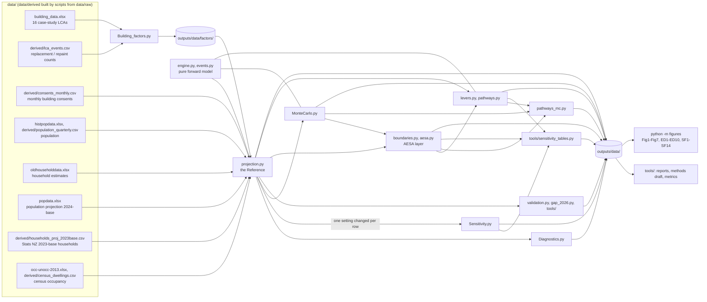

# Architecture: how the model works (MODEL v4.7)

For a reviewer who knows modelling but not this code or New Zealand housing data: what each script reads,
calculates and writes, in order. Results are not repeated here. They are generated into
`outputs/reports/RESULTS.md` and `outputs/data/metrics.json`.

Where the other references live:
- Every figure and table, with its caption and data sources: `outputs/FIGURES.md`.
- Every setting with its basis: `outputs/reports/ASSUMPTIONS.md`.
- The methods as implemented: `outputs/reports/METHODS_DRAFT.md`, with Table 1 (the levers) in
  `outputs/reports/LEVERS_TABLE.md`.
- Every output file and the script that writes it: `outputs/INDEX.md`.
- How to run, data provenance and the data freeze: `README.md`. Release history: `CHANGELOG.md`.

Paths are those of the full profile; the light profile writes the same tree under `outputs/_light/`. Parameter values
are the adopted settings of `projection.py` unless another module is named.

---

## 1. What the model answers

How much new residential floor area New Zealand will build in 2026–2050, and how much embodied carbon it carries.

**Splits reported:**
- by reason for building (the **demand bands**);
- by material;
- by life-cycle stage.

Building type (detached, townhouses, apartments) is internal: it weights the case-study carbon factors and the
lever parameters. No result is reported by typology.

**The chain:**
- The model is bottom-up and demand-driven: people → households → dwellings required → floor area → carbon.
- Construction capacity, prices and policy are not modelled.
- Carbon factors start from 16 New Zealand case-study LCAs (2025 technology).
- A1–A3 follow material-specific decarbonisation paths (Horup et al. 2025); A4–A5 follow a generic 1%/yr decline
  (Resch et al. 2021).

**Three layers:**
1. **Reference projection:** the adopted projection with no interventions.
2. **Planetary-boundary layer (AESA, climate change):** compares carbon 2026–2050 with the sector's share of a
   global carrying capacity under acquired rights (AR) and ability to pay (AtP). The two principles are reported
   side by side, never averaged.
3. **Pathways:** nine levers at four ambition levels, the Moderate and Ambitious Pathways and the theoretical limit
   (TL), with exact Shapley attribution.

---

## 2. Scripts and data flow



**Compute, then draw.**
- The model scripts write CSV and JSON only.
- Every figure is drawn last by the `figures/` package from the data files, so figures can be redrawn without the
  model (`run_all.py --figures-only`, `redraw.py`).

**One engine.**
- `engine.py` holds the forward model as pure functions:
  - stock calibration and census dwelling-count rates;
  - the replacement path;
  - the 2026 overbuild and its logistic absorption;
  - the forward projection.
- `events.py` builds the maintenance-event kernels.
- `projection.py`, `MonteCarlo.py` and `pathways.py` all call them.

**State passing.**
- `projection.main()` returns its local variables.
- `validation.run_boss(**settings)` runs it in memory with settings changed and restores the defaults afterwards.

---

## 3. `Building_factors.py`: carbon per square metre

1. Each case study's absolute emissions (by material and EN 15978 stage) are divided by its floor area.
2. Materials are grouped in six lines: concrete, steel, timber, plastics & paint, plasterboard, others.
3. Buildings are pooled into three typologies: equal weight within sub-type, then across sub-types. A_2 duplicates
   A_1, so apartments have one independent case.
4. Soil carbon loss is land-use change, not a material:
   - per m² of footprint, 58.77 kg CO₂e (area-weighted over the soil orders of Auckland land zoned for
     urbanisation);
   - divided by the floor space index to get the value per m² of floor.
5. Stages in scope: A1–A3, A4–A5, B2/B4, C1–C4. Stage D is written out but never added.
6. Replacement and repaint events: each line of `data/derived/lca_events.csv` is split into n events of size B2/B4
   / n, at k·L / (n + 1) years. Each event is divided into A1–A3 : A4–A5 : C1–C4 in proportion to the line's
   initial stages and carries its own decarbonisation path. The events add up to the B2/B4 factor of each typology
   (checked; the script stops otherwise).
7. Material decarbonisation: the A1–A3 factor of each EPD item (`data/derived/material_items.csv`) follows the
   relative GWP path of its counterpart in Horup et al. (2025) SI Table S4. The mapping is
   `data/material_item_map.csv`; items without a counterpart are held. Coverage:
   `factors_a13_item_coverage.csv`.

Writes `outputs/data/factors/`.

---

## 4. `projection.py`: the Reference

### 4.1 Consents and completions (history 1991–2025)

- **Consents:** monthly consents (`data/derived/consents_monthly.csv`, to September 2026) give floor area and
  dwellings by typology, plus an all-category dwelling count.
- **Completions:**
  - Dwellings built = 0.945 × consents lagged 17 months (`COMPLETION_RATE`, `COMPLETION_LAG_MONTHS`), aggregated
    to calendar years.
  - Source: Jones, Greenaway-McGrevy & Crow 2025 (completion milestones; median completion time 1.27–1.53 yr).
  - The same lag applies everywhere consents become "built".
- **Pipeline years:** projection years whose lagged months are all observed (2026–2027). Their building is observed
  in every run.
- **Retirement-village (RV) units:** all-category dwellings minus the three typologies. They are in the stock but
  carry no floor area or carbon (no case study). Forward, they are a constant share of all dwellings built (ratio
  of sums 2016–2025).
- **Dwelling size:** floor area / dwellings, held per typology at its 2023–2025 average.

### 4.2 Population and households (history)

- **Population:** estimated resident population (ERP) at 31 December.
- **Households:** Stats NZ Dwelling and Household Estimates at 31 December.
  - The post-2018 increments are scaled by one factor, k = 0.824, so that 2018 → 2023 growth matches the census
    ratio of occupied plus residents-away private dwellings.
  - After the 2023 census (2024–25), households = ERP / the model's household-size path anchored on 2023.
- **Household size:** S = population / households.

### 4.3 Net replacement: the census dwelling-count identity

- **Definition:** per intercensal interval, net replacement = (completions − change in census private dwellings) /
  stock-years.
- **Completions** are corrected for the change in dwellings under construction (only when there is no lag).
- **Rates:**
  - long run (1991–2023): 0.101% of stock per year;
  - 2018–2023: 0.312%.
- **Split:** a fixed BRANZ demolition rate (0.135%/yr) splits the net rate into demolition and a residual (net
  unconsented additions). Only their sum is identified.

### 4.4 Replacement variants

`engine.replacement_path` (`REPLACEMENT_VARIANT`):

| variant | net replacement rate |
|---|---|
| Low | the long-run rate |
| Reference | the 2018–2023 rate fading to the long-run rate, half-life 10 years (5 / 15 are sensitivities; sampled in the Monte Carlo) |
| High | the 2018–2023 rate persists |
| Very High | the interval-length-weighted trend of the census rates continues |

The variants are deterministic runs (ED3); they are not run through the Monte Carlo.

### 4.5 Population projection

- **Median path:** the Stats NZ 2024-base stochastic projection, starting from observed 2025 plus the published
  median growth.
- **5th / 95th paths:** add the published spread of the level about the median.
- **2026 growth** is observed (June quarter 2026 vs 2025), so the level shift is permanent.

### 4.6 Household size

- **Source:** S = people in households / households at the five-yearly knots (2023–2048) of the Stats NZ 2023-base
  family and household projections, Medium A (living-arrangement propensities held at 2023).
- **Interpolation (`S_TAIL = 'pchip_secant'`):**
  - PCHIP through every knot;
  - the end slope at 2048 is the 2043–2048 secant slope;
  - linear continuation in 2049–2050.
- **Rebasing:** applied as a shape on the observed 2023 S. Households = population / S.
- **Pairing:** the 5th / 95th population paths take Low A / High A (`HH_SIZE_PAIRED`); the Monte Carlo pairs them
  through one z.
- **Floor:** household decline is floored at zero; it becomes vacancy.

### 4.7 Starting surplus

The 2024–2025 stock-identity residual is compared with the 1992–2023 census-interval residuals (time-weighted mean
m and SD s).
- **Rule:** if it exceeds m + 2s, then (residual − m) × 2 years becomes a surplus of vacant dwellings at 1 January
  2026.
- **Absorption:** the surplus is absorbed with the overbuild by 2035, in every run and Monte Carlo draw
  (`STARTING_SURPLUS`).

### 4.8 Forward requirement, the 2026 overbuild and its absorption

```
dwellings built (all categories) = new households + vacancy allowance + vacancy change
                                   + net replacement (variant rate x last year's stock)
                                   + 2026 overbuild - surplus absorbed
in-scope dwellings              = dwellings built x (1 - RV share)
floor area                      = in-scope dwellings x blended dwelling size
```

- **Vacancy:** the vacancy-rate parameter is held at its 2023 census value (5.39%).
- **2026 overbuild (`market_excess`):**
  - The pipeline years' observed building above the requirement is the market excess.
  - From 2028 the excess fades at ρ, the estimated persistence of departures from the calibrated identity.
- **Absorption:**
  - The excess and the starting surplus are absorbed by 2035 along the normalised logistic of the levers
    (midpoint 2030.5, k = ln(81)/6).
  - The payback is capped at the year's building, with any shortfall carried forward.
  - The surplus still vacant, the payback and the implied vacancy are logged in
    `baseline/overbuild_absorption_log.csv`.

**Demand bands:**
- Positive: population growth, household-size change (signed), extra space, vacancy, the 2026 overbuild, demolition
  replacement, the recent replacement surge.
- Negative: surplus absorbed, unconsented additions.
- Carbon only: maintenance (B2, B4).
- TL runs only: released dwellings.
- The bands sum exactly to the in-scope total. The figures show six display bands (`bands.DISPLAY`):
  - population growth;
  - household-size change;
  - extra space;
  - vacancy;
  - net replacement;
  - market balance.

### 4.9 Carbon and accounting

- **Carbon** = floor area by typology × intensity.
- **Upfront** = A1–A5 + soil carbon loss. Soil loss applies only to floor area on new footprints.
- **Time-resolved accounting (`ACCOUNTING`):**
  - The construction year carries the upfront carbon.
  - Replacement and repaint events (B2, B4) fall in the year they occur.
  - Events after 2050 and all C1–C4 of the 2026–2050 cohorts are **committed after 2050**, reported as a range
    (2050 factors held / 2025 factors).
  - At 2025 factors, upfront + maintenance + committed equals the whole-life total exactly (`tools/reconciliation.py`).
- **History (1991–2025)** uses 2025 factors.

**Writes** `baseline/projection.json`, `annual.csv`, `annual_by_stage.csv`, `annual_by_material.csv`,
`bands_annual.csv`, `overbuild_absorption_log.csv` and the figure source data (`figure_source/`).

---

## 5. Diagnostics, sensitivity and Monte Carlo

**`Diagnostics.py`** writes the figure source data of household formation, the stock and vacancy, and the vacancy
definition (SF1, SF2).
- The histories are one bar per census interval (interval means): between censuses, annual detail is not identified.
- Interval values: `validation.stock_identity_history` and `validation.household_formation_history`.

**`Sensitivity.py`** re-runs the Reference with one setting changed per row:
- replacement variants and half-lives;
- household size (2018–2023 pace, propensity B, the post-2048 tail);
- dwelling-size window;
- completion rate and lag;
- the starting surplus and the overbuild absorption, booking and gap;
- the vacancy parameter;
- soil on replacement;
- decarbonisation (frozen technology, proxies held, NZ-made electricity-intensive items held, A4–A5 variants, event
  timing).

Population rows reuse the projection's 5th / 95th paths. Carbon-factor and soil-order rows re-weight the Reference
floor area. One-at-a-time ranges are not additive (ED4, Fig7a).

**`MonteCarlo.py`** samples the Reference only, by Latin hypercube (5,000 draws in the full profile, 1,000 in the
light; `runprofile.py`).
- **Inputs:**
  - population rank z (household size moves with it through Low / Medium / High A);
  - a dwelling-size multiplier;
  - the completion rate (uniform 0.93–0.96);
  - the replacement half-life (uniform 5–15 yr);
  - a stratified bootstrap of the carbon factors.
- Each draw runs the same engine chain. The central draw is checked against the projection to 1e-9.
- **Sobol indices** (full profile only) are grouped for population and household size (one z).
- Replacement-level uncertainty is not sampled: it is reported by the deterministic variants (ED3) and the
  one-at-a-time rows.
- **Writes** `outputs/data/montecarlo/`: draws, summary, annual percentiles, convergence, input distributions,
  Sobol.

---

## 6. Validation and reports

- **`validation.py`:**
  - rolling-origin hindcast of dwellings built from 2006, 2013 and 2018;
  - the out-of-sample check of the first modelled year;
  - the census-interval histories of the demand bands.
- **`gap_2026.py`:** decomposition of the 2026 gap.
- **`tools/`:**
  - `overbuild_2026.py`: overbuild report;
  - `demand_balance.py`: completion-lag comparison, SF7;
  - `replacement_scenarios.py`: variant table;
  - `reconciliation.py`: reconciliation;
  - `figures_report.py`: reality checks and validation figure data;
  - `metrics.py`: `metrics.json`;
  - `results.py`, `assumptions.py`, `methods.py`: `RESULTS.md`, `ASSUMPTIONS.md`, `METHODS_DRAFT.md` and
    `LEVERS_TABLE.md`. `methods.py` merges `baseline_draft.py`, `pb_methods.py`, `pathways_methods.py`,
    `release_methods.py` and `uncertainty_methods.py`.
- **Output-term check:** `tools/check_outputs.py` checks that no retired term appears in a generated output.
- **Developer tools** (not in the pipeline): `palette_check.py`, `palette_coverage.py`, `check_figure_text.py`,
  `ast_equivalence.py`.

---

## 7. `boundaries.py` and `aesa.py`: the AESA layer

A layer on top of the model outputs: nothing in the model changes. The equations are pure functions in `aesa.py`.

1. **History at 2025 factors.** Sector emissions 1992–2025 = built floor area × the case-study factors, with soil
   carbon loss on new footprints only, under the projection's accounting rule. The 2016–2025 mean is Ī_sec,base.
2. **Acquired rights.** B_AR(t) = SOS · (Ī_sec,base / I_glob) × population modifier relative to 2025 (New Zealand:
   the model path; world: WPP 2024 median).
3. **Ability to pay.** B_AtP(t) = SOS / P_W(t) × g_W / g_NZ × α × P_NZ(t) × s_sec.
   - α, g_W and g_NZ come from World Development Indicators GDP per capita (PPP).
   - s_sec = consented residential value / final consumption expenditure, 2016–2025.
4. **LoE** = carbon / boundary (> 1: exceeded), annual and cumulative 2026–2050.
5. **Monte Carlo.** Each saved Reference draw is re-run through `MonteCarlo.project` and checked against its saved
   outputs.
   - The boundaries are recomputed from the draw's population path.
   - The AR base is recomputed from the draw's carbon factors and completion rate (shared parameters).
6. **Sensitivities.** Source pair, global impact (EF 3.1), GDP measure, AR base window, population source, s_sec
   definition, decarbonisation and accounting, wider maintenance scope, α = 1.
   - Shared-parameter rule (`AR_BASE_RULE`): a row that changes present-day factors or an accounting convention
     recomputes the AR base; a row that changes only future technology, siting or demand keeps the Reference base.
     An unclassified row stops the run.
7. **Committed after 2050**, and the budgets of every Reference draw for the pathway Monte Carlo
   (`aesa/montecarlo_draw_budgets.csv`).

**Writes** `outputs/data/aesa/`. Methods: part 2 of `METHODS_DRAFT.md`.

---

## 8. `levers.py` and `pathways.py`: pathways and the theoretical limit

A layer on top of the Reference. `pathways.py` takes the Reference state from `validation.run_boss()` and re-calls
`engine.forward` with copies of its inputs, changed by the pure functions of `levers.py`.
- With every lever off, the run reproduces the Reference to 1e-9.
- Which input each lever changes: `levers.LEVER_PARAMETER`.

**Levels.** Every lever has four levels (after DECC 2010, DESNZ 2023, EUCalc 2020). The rule and the values per
lever are in Table 1 (`outputs/reports/LEVERS_TABLE.md`, generated from `pathways/levers.json`).

| level | definition |
|---|---|
| Reference | current practice held |
| Moderate | the exact midpoint of Reference and Ambitious in the lever's native parameter |
| Ambitious | a documented frontier (sub-rules A, B, C) |
| TL | the logical bound, or the best observed value |

Every TL is asserted at least as strong as Ambitious.

**Adoption.**
- Every level moves from the Reference along one normalised logistic, 2026 → 2035 (midpoint 2030.5,
  k = ln(81)/6).
- Sensitivities: by 2030, by 2045, and the instant TL (from 2027).
- 2026 is observed and never changed.

**Levers.** Grouped by the PAS 2080:2023 hierarchy:

| strategy | levers |
|---|---|
| S1 Avoid | L1 Household size, L2 Vacancy rate, L3 Building lifetime, L4 Extra space, L5 Occupancy density |
| S2 Switch | L6 Brownfield-first development, L7 Soil-aware planning, L8 Material carbon efficiency |
| S3 Improve | L9 Construction-stage carbon |

- All levers together form the Moderate or the Ambitious Pathway.
- Business-as-usual decarbonisation applies in every run.

**One run** (`pathways.run`). Every run, the Reference included, follows the same order each year:
1. The lever inputs and the requirement without any join.
2. The need, plus the dwellings released by zero vacancy (TL2).
3. The Reference's market excess and starting surplus, absorbed on the Reference weights with the run's own need.
4. Re-occupation (TL runs).
5. `engine.forward` with the stock-adding join.

**Theoretical limit.** A thought experiment, not a pathway: every lever at its TL.
- The dwellings released by TL1 (household decline) and TL2 (zero vacancy), and the Reference surplus, enter a
  pool.
- The pool meets a constant share of each year's need.
- The cumulative re-occupied never exceeds the cumulative released.
- Records: `reoccupation_log.csv` and `theoretical_limit.json`.

**Attribution and diagnostics.**
- Exact Shapley values over:
  - the strategies (2³ subsets) and the levers (2⁹) at Moderate and Ambitious;
  - the levers at TL;
  - TL1–TL9 from the Moderate Pathway.
- Sequential waterfalls in PAS 2080 order.
- The λ-sweep of each lever.
- The back-cast to the AR budget.
- The demand × intensity solution space.

**Checks that stop the run:**
- the no-lever run equals the Reference;
- dwellings built ≥ 0;
- no negative stage or material;
- re-occupied ≤ released;
- the overbuild excess is identical in every run;
- exact Shapley efficiency;
- the ordering Reference ≥ Moderate ≥ Ambitious ≥ TL of each lever's native quantity and of the cumulative carbon.

**Writes** `outputs/data/pathways/`. Methods: part 3 of `METHODS_DRAFT.md`.

**`pathways_mc.py`.** Every saved Reference draw goes through `MonteCarlo.project` and `pathways.run`: the Pathways,
TL and the instant TL.
- Each draw is scored against its own budgets.
- It also records the draw's committed emissions after 2050 (central repair and end-of-life factors).
- Stops unless:
  - the central draw reproduces the deterministic runs;
  - TL ≤ Ambitious ≤ Moderate in every draw.
- Insight statistics (`mcstats.py`): SRC / PRCC with bootstrap intervals, LOWESS fits, and the Firth logistic for
  P(TL LoE AR ≤ 1) against the 2050 population.

**`tools/sensitivity_tables.py`.** Groups the one-at-a-time rows into the tables of ED3, ED4, ED5 and the Fig7a
tornado, asserting that every run an existing file holds reproduces it.

---

## 9. Running, outputs, figures and tests

**Running.** See README.
- `run_all.py [--profile light|full]` runs every step in its own process. Each step's console goes to
  `<outputs>/logs/<step>.log`; a failed step stops the run.
- `--figures-only` redraws from the data and checks that `outputs/data` stays byte-identical.
- `redraw.py` redraws the committed full-profile figures (optionally with another palette).

**Profiles.**
- light (default): 1,000 draws, no Sobol, 200 dpi, a footer;
- full: 5,000 draws, Sobol, 600 dpi.

The deterministic results do not depend on the profile (`tests/test_profiles.py`).

**Outputs.** `layout.py` defines every path once; `outputs/INDEX.md` lists every file.

| folder | content |
|---|---|
| `paper_main/`, `paper_extended/`, `supplementary/` | Fig1–Fig7; ED1–ED10 and EDT1; SF1–SF14 and ST1 |
| `data/baseline/`, `montecarlo/`, `aesa/`, `pathways/`, `sensitivity/`, `factors/`, `figure_source/` | every number the model reports |
| `data/metrics.json` | the headline metrics |
| `reports/` | RESULTS, ASSUMPTIONS, METHODS_DRAFT, LEVERS_TABLE and the diagnostic reports |
| `FIGURES.md`, `figure_manifest.csv`, `run_meta.json`, `INDEX.md` | indexes and run metadata |

**Figures** (`figures/`):

| module | role |
|---|---|
| `figure_plan.py` | the registry: id, title, caption, module, data sources |
| `figures/style.py` | palette from `palette.toml`, fonts, sizes, saving |
| `figures/draw.py` | the shared drawing rules (signed bands, PCHIP display lines, boundary lines and zones) |
| `figures/audit.py` | a record of every drawn figure (read by the tests) |
| `paper_main.py`, `paper_extended.py`, `calibration.py`, `validation.py`, `market_balance.py`, `boundaries.py`, `pathways.py`, `montecarlo.py`, `sensitivity.py` | one module per group |

`naming.py` supplies every reader-facing label and the release names of data columns.

**Tests.**
- `python -m pytest tests` runs on the outputs of the active profile; `tests/README.md` lists what each file
  protects.
- The regression lock (`tests/regression_model_v4.json`) holds the SHA-256 of every deterministic data file and of
  the Monte Carlo draw files.

---

## 10. Glossary

| term | meaning |
|---|---|
| floor area | gross floor area (GFA), m² |
| Reference | the adopted projection with no interventions |
| Low / High / Very High replacement | the replacement variants of the Reference (section 4.4) |
| demand band | a reason for building; negative bands keep their sign |
| market balance | the display band of building above or below need: the history residual, the starting surplus, the 2026–27 overbuild and its absorption |
| S, v | household size (population / households), vacancy rate |
| RV, UC | retirement-village unit, dwellings under construction |
| OLF, FSI | floor area per design occupant, floor area / footprint |
| ρ | persistence of departures from the calibrated stock identity |
| PCHIP | shape-preserving piecewise cubic Hermite interpolation |
| upfront carbon | A1–A5 + soil carbon loss |
| committed after 2050 | later B2/B4 and C1–C4 of the 2026–2050 cohorts (a range) |
| AESA, SOS | absolute environmental sustainability assessment, safe operating space |
| AR / AtP | acquired rights / ability to pay |
| LoE | level of exceedance = impact / boundary |
| S1–S3, L1–L9, TL1–TL9 | the PAS 2080 strategies, the levers and their theoretical limits |
| λ | position of a level between Reference (0) and Ambitious (1); Moderate λ = 0.5 |
