# Diagnostics

_Generated by indexes.py from docs/FIGURE_PLAN.md and the figure audit records (do not edit by hand). Every figure: PNG 300 dpi, at most 183 mm wide (D06: single column, 89 mm), release style (docs/PALETTE.md) and vocabulary (docs/RENAMING.md). The figures of the paper are in ../paper/PAPER.md, the Extended Data in ../extended_data/EXTENDED_DATA.md; D16, D17, D29, D31 and D33 of the previous release are superseded by Extended Data (ED1, ED3, ED7 and ED10, ED9, ED8; their data stay in outputs/data/); the earlier file name of each figure is in docs/FIGURE_PLAN.md._

## Data calibration

### D01. Population, history and projection (median, 5th–95th)

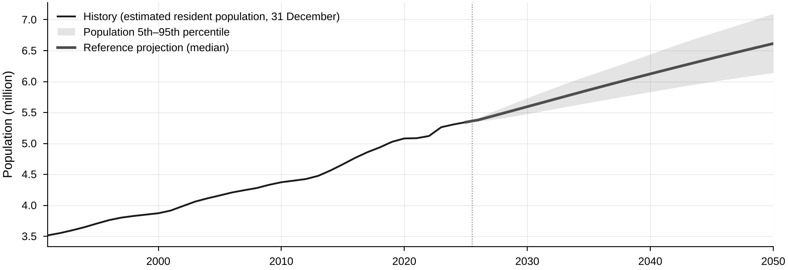

File: [data_calibration/D01_population.png](data_calibration/D01_population.png); drawn by `projection.py`.

### D02. Households: census-benchmarked history and projection

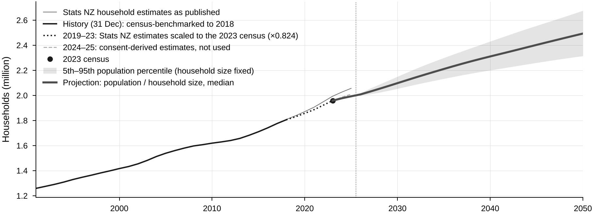

Projection from the 2023 census point; 2019–23 Stats NZ estimates scaled to the 2023 census (×0.824).

File: [data_calibration/D02_households.png](data_calibration/D02_households.png); drawn by `projection.py`.

### D03. Household size and population vs household growth

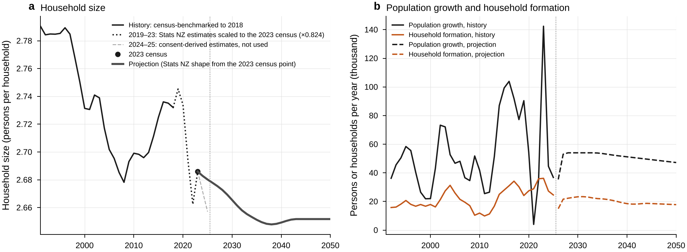

File: [data_calibration/D03_household_size.png](data_calibration/D03_household_size.png); drawn by `projection.py`.

### D04. Household size vs arrivals; households per consent (2019 on consent-derived); new households by source: history one column per census interval (population growth, household-size change; 2024–25 hatched, no census check), projection annual

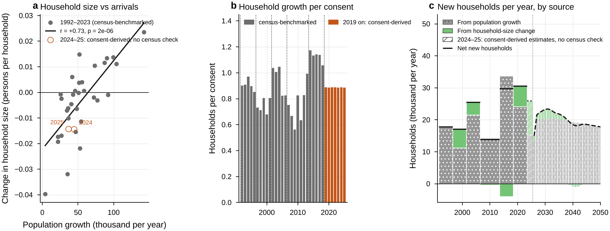

Between censuses households are consent-derived, so the relationship in a is partly mechanical (housing supply meets migration). b: households per previous-year consent vary before 2019 and are 0.885–0.889 from 2019: these years are estimated from consents and are not independent evidence. c: history one column per census interval (interval means; households census-anchored at both ends), stacked from population growth and from household-size change; 2024–2025 hatched (consent-derived estimates, no census check); projection annual and lighter, from 2026; the line is the net of the two parts.

File: [data_calibration/D04_household_formation.png](data_calibration/D04_household_formation.png); drawn by `Diagnostics.py`.

### D05. Vacancy (definitions, consistent 1986–2023 range, implied vacancy), stock, dwellings per year by component (history per census interval with census-measured net replacement and unexplained building; projection annual)

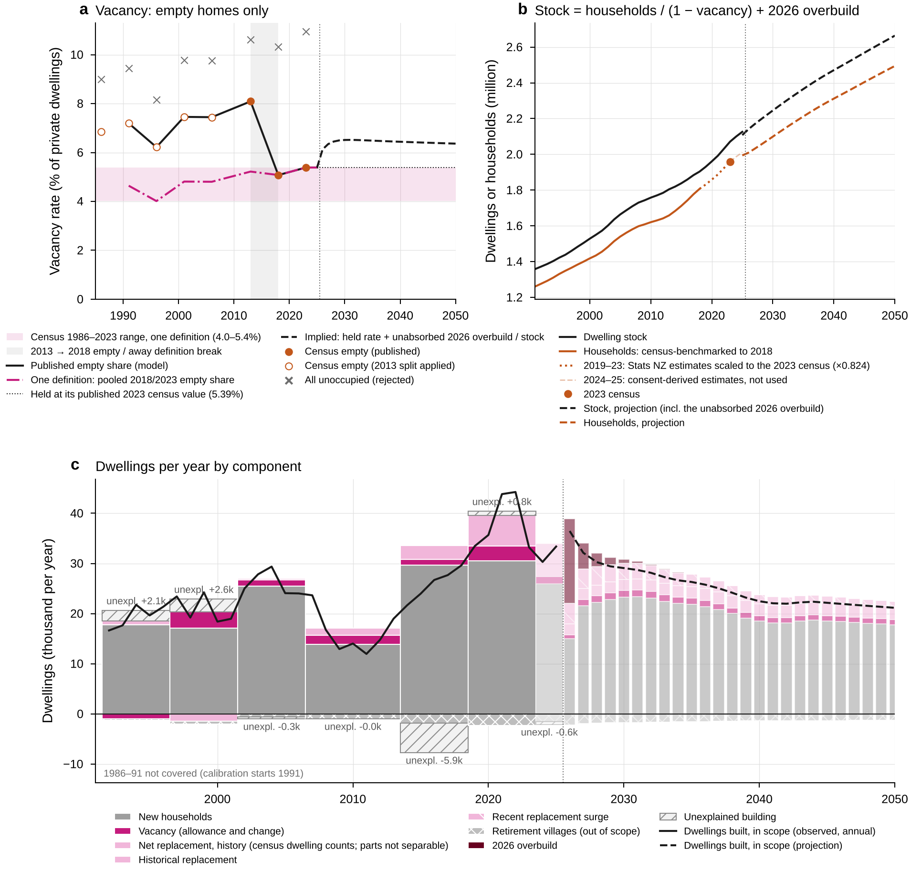

a: The vacancy-rate parameter is held at its published 2023 census value (5.39%; on the consistent definition 2023 is the series maximum, 5.38%, minimum 4.01% in 1996); implied stock vacancy rises to ≈6.4% because the 2026 overbuild is not absorbed. c: History: one bar per census interval (interval means; vacancy on one definition, the pooled 2018/2023 empty share, 49.2% of unoccupied dwellings); between censuses annual detail is not identified. Faint bar: 2024–2025, households consent-derived. Projection annual, lighter. History: net replacement is census-measured, the rate of the census dwelling-count identity of each interval (D07; under-construction corrected) x the previous year's stock, the quantity the model uses (2024–2025: the latest rate carried). Unexplained building (hatched grey, labelled per interval in thousand dwellings per year): building not explained by household formation, vacancy and census-measured replacement: redevelopment not captured by the census counts, error in the household estimates, or residual; it may be negative.

File: [data_calibration/D05_stock_and_vacancy.png](data_calibration/D05_stock_and_vacancy.png); drawn by `Diagnostics.py`.

### D06. Why empty-only vacancy is used (appendix)

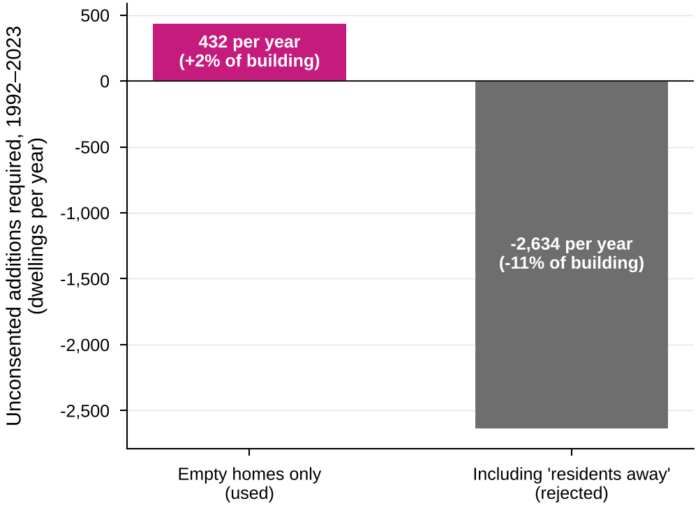

The unconsented additions each vacancy definition requires to close the stock identity, assuming the BRANZ demolition rate; counting residents-away dwellings as vacant requires implausibly many.

File: [data_calibration/D06_vacancy_definition.png](data_calibration/D06_vacancy_definition.png); drawn by `Diagnostics.py`.

### D07. Net replacement rate: census intervals and the three variants

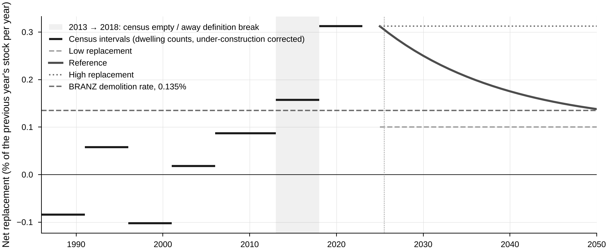

Net replacement rate (demolition net of unconsented additions). Long run 1991–2023: 0.101% per year; 2018–23: 0.312% per year. Each step is one intercensal interval; the 2018–23 step is a single interval. Negative values mean the stock grew by more than consented new building, i.e. more dwellings appeared through conversions and unconsented additions than were demolished.

File: [data_calibration/D07_net_replacement_rate.png](data_calibration/D07_net_replacement_rate.png); drawn by `tools/figures_report.py`.

### D08. Realised vs occupied floor area per new dwelling; occupancy utilisation

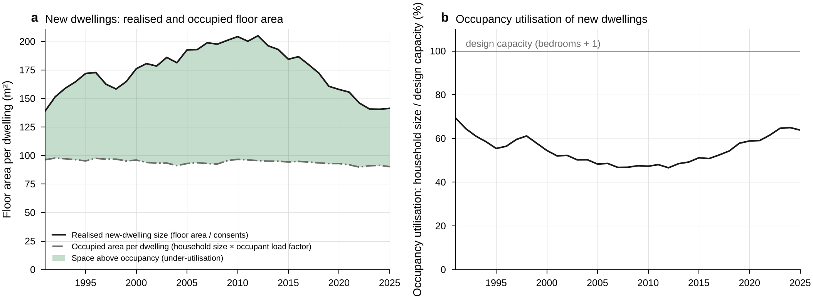

File: [data_calibration/D08_dwelling_space.png](data_calibration/D08_dwelling_space.png); drawn by `projection.py`.

### D09. Cumulative floor area 1991–2050 with the population 5th–95th band

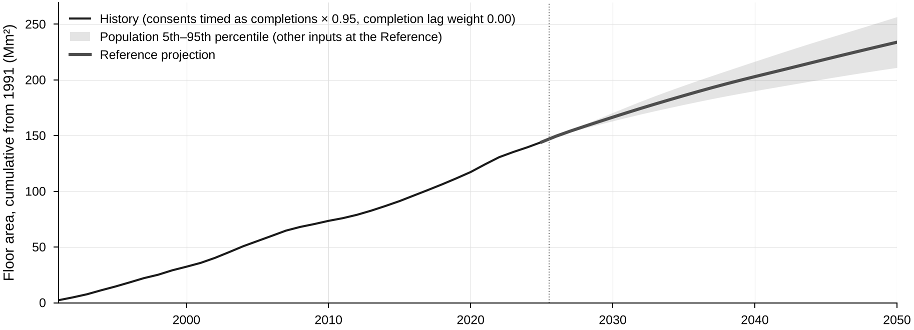

File: [data_calibration/D09_cumulative_floor_area.png](data_calibration/D09_cumulative_floor_area.png); drawn by `projection.py`.

### D10. Floor area 2026–2050 by demand band, Low / Reference / High (waterfall)

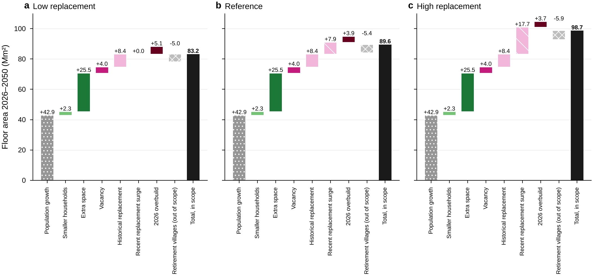

Each bar is one demand band, 2026–2050 (median population); retirement-village units are out of scope and leave the total as a negative step.

File: [data_calibration/D10_floor_area_bridge.png](data_calibration/D10_floor_area_bridge.png); drawn by `tools/figures_report.py`.

### D11. The bridge with replacement split into demolition and net unconsented additions (appendix; the split assumes the BRANZ rate)

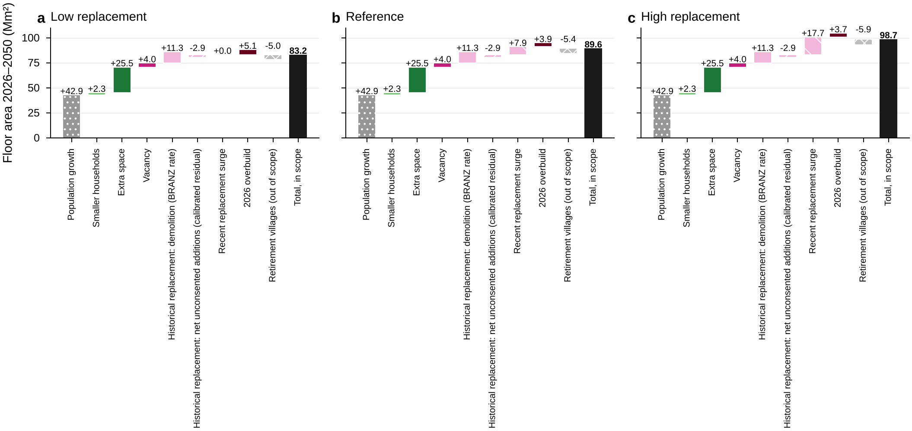

Appendix: replacement split into demolition and the calibrated residual; the split assumes the BRANZ demolition rate: only their sum is identified by the census data.

File: [data_calibration/D11_floor_area_bridge_split.png](data_calibration/D11_floor_area_bridge_split.png); drawn by `tools/figures_report.py`.

### D12. Population -> households -> dwellings -> floor area -> carbon (indices); carbon intensity of new floor area by variant

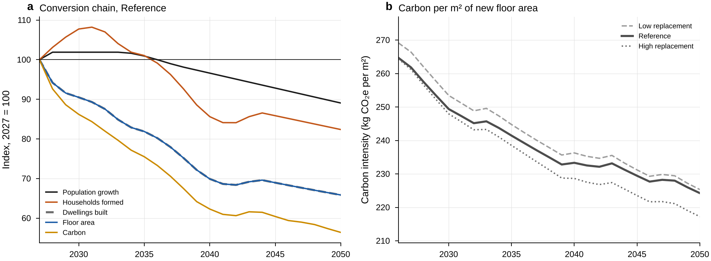

a: 2026 is not the base year: it is observed building and carries the one-off population shortfall and the 2026 overbuild. b: decarbonisation, maintenance within 2026–2050 and the soil-bearing share; typology shares held.

File: [data_calibration/D12_conversion_chain.png](data_calibration/D12_conversion_chain.png); drawn by `tools/figures_report.py`.

### D13. Embodied carbon by material, annual and cumulative

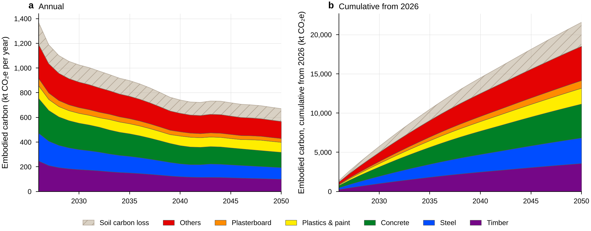

Reference, construction (A1–A5 and soil) plus maintenance (B2, B4) within 2026–2050; each material includes its maintenance.

File: [data_calibration/D13_carbon_by_material.png](data_calibration/D13_carbon_by_material.png); drawn by `projection.py`.

## Validation

### D14. Rolling-origin hindcast of dwellings built and the 2026 out-of-sample check

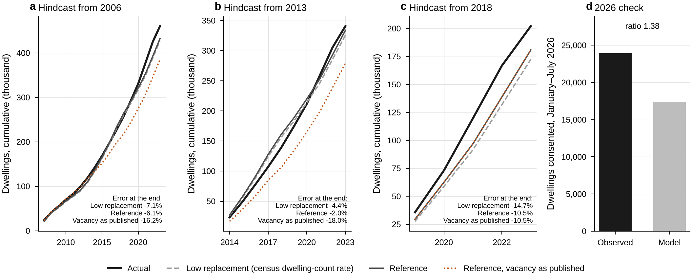

Rolling-origin hindcast of dwellings built (cumulative), each origin projected with the information available then; errors at the end of each window, vacancy on the consistent definition unless noted. d: consents observed January–July 2026 against the model, which uses no 2026 data.

File: [validation/D14_hindcast.png](validation/D14_hindcast.png); drawn by `tools/figures_report.py`.

### D15. Projection vs the 1991–2025 range and the 2026 -> 2027 handover

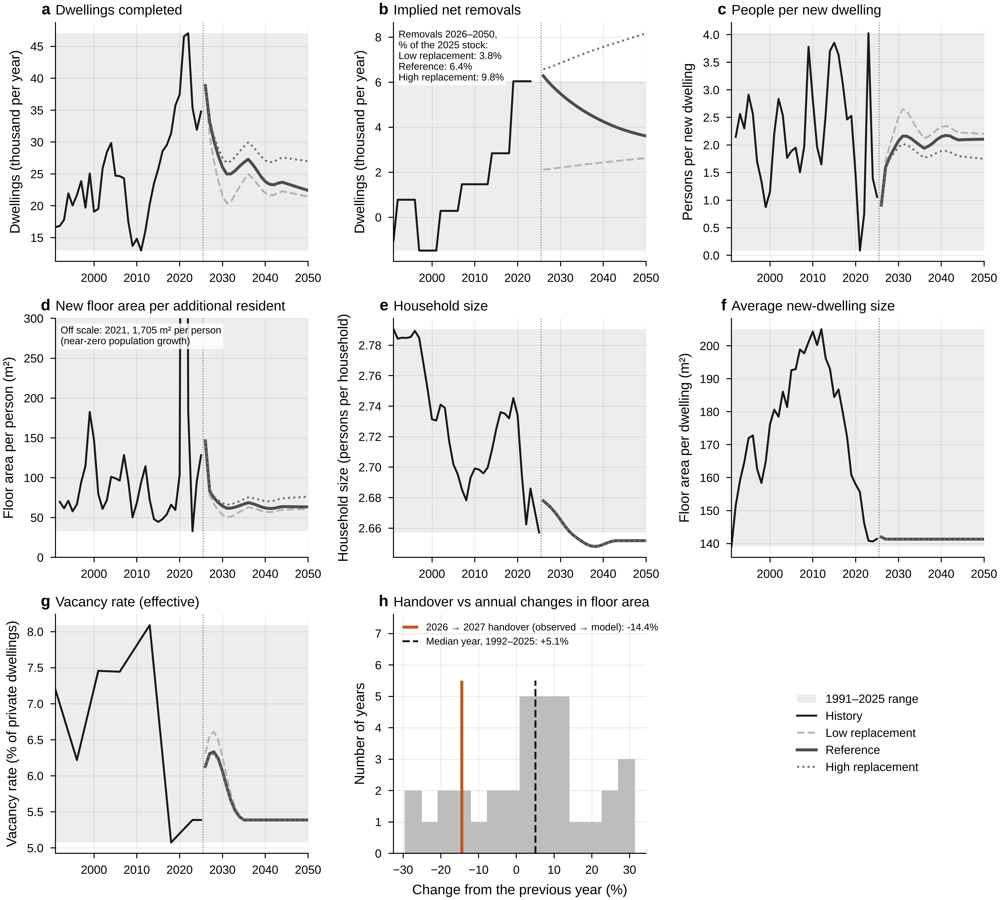

Projection 2026–2050 against the 1991–2025 range (grey band); a: in scope and retirement villages; the exceedances are tabulated in outputs/reports/reality_checks.md. h: the 2026 → 2027 step of the Reference (2026 observed, 2027 the first model year) against the year-to-year changes in consented floor area, 1992–2025.

File: [validation/D15_reality_checks.png](validation/D15_reality_checks.png); drawn by `tools/figures_report.py`.

## Sensitivity

### D18. All AESA sensitivity rows: cumulative LoE AR and AtP

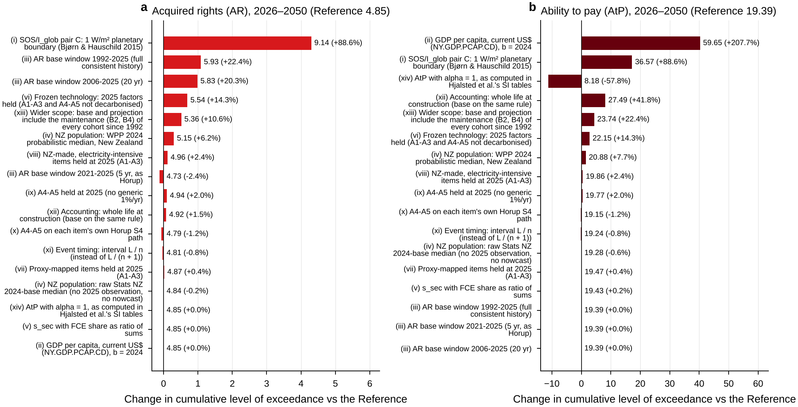

One setting changed per row; labels show the cumulative LoE of that row and its change from the Reference. Rows that do not enter a principle (e.g. the GDP measure for AR) show no change. Percentages are relative to carbon 2026–2050 (time-resolved accounting); fixed absolute terms such as soil carbon loss therefore show larger percentage effects than under whole-life accounting. The largest effects on the AR and AtP LoE, grouped: Extended Data ED4 (carbon: ED1).

File: [sensitivity/D18_aesa_sensitivity.png](sensitivity/D18_aesa_sensitivity.png); drawn by `boundaries.py`.

### D19. Annual and cumulative floor area and carbon by projection variant

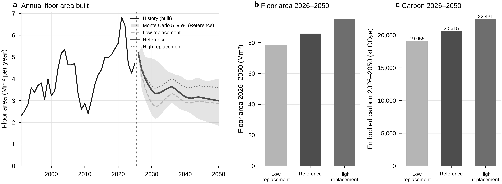

File: [sensitivity/D19_variants.png](sensitivity/D19_variants.png); drawn by `tools/figures_report.py`.

## Monte carlo

### D20. Sobol indices (Reference): what drives the joint uncertainty

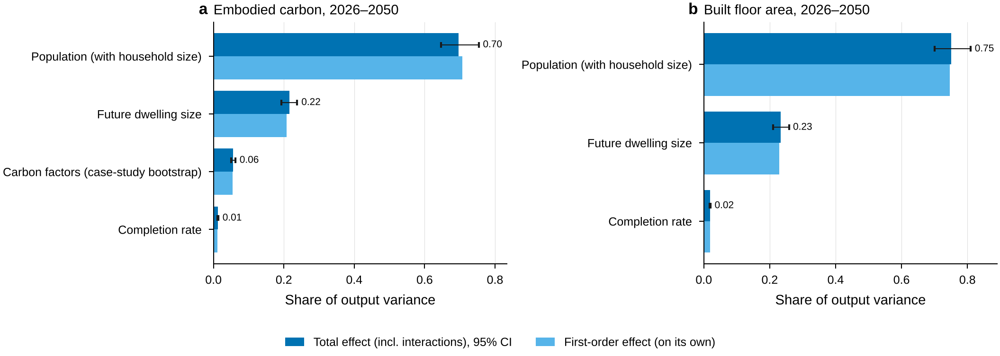

Reference, 5,000 Latin hypercube draws. Within-scenario parametric uncertainty only; the replacement variant, the carbon-factor and soil bounds are reported separately (D16).

File: [monte_carlo/D20_sobol.png](monte_carlo/D20_sobol.png); drawn by `MonteCarlo.py`.

### D21. Monte Carlo fan of carbon, the AR base window and the boundary bands

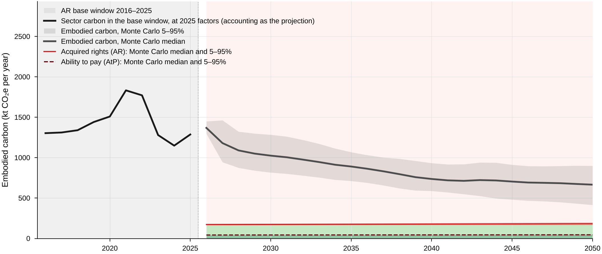

Reference. AR base window 2016–2025 at 2025 factors, soil only on non-replacement floor area (as the projection). Boundary bands: AR varies with the NZ population of each draw and its AR base (recomputed from the draw's 2025 carbon factors), AtP with population only; AR 5th–95th within 9.9% of the median in every year.

File: [monte_carlo/D21_fan_and_boundaries.png](monte_carlo/D21_fan_and_boundaries.png); drawn by `boundaries.py`.

## Planetary boundary

### D22. Boundaries AR and AtP 2025–2050, population modifier, components

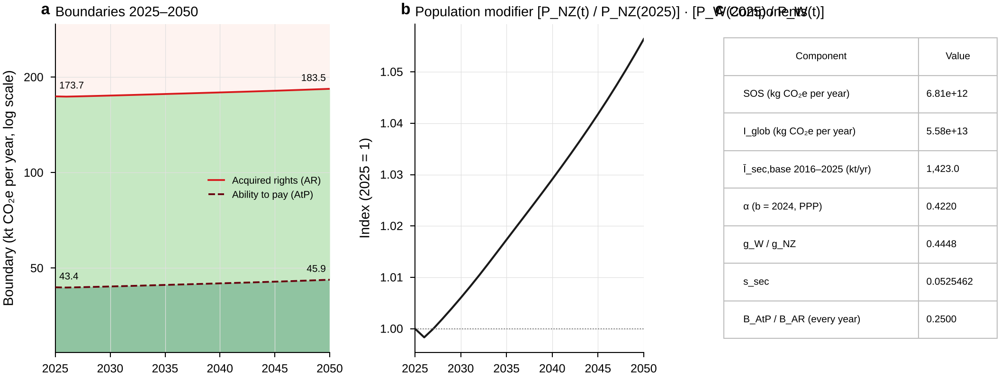

2 °C carrying capacity (Bjørn & Hauschild 2015). Log axis: the AtP boundary is 25.0% of the AR boundary in every year: both scale with P_NZ(t) / P_W(t) (static design), so their ratio is constant.

File: [planetary_boundary/D22_boundaries.png](planetary_boundary/D22_boundaries.png); drawn by `boundaries.py`.

### D23. Annual level of exceedance by variant with Monte Carlo bands

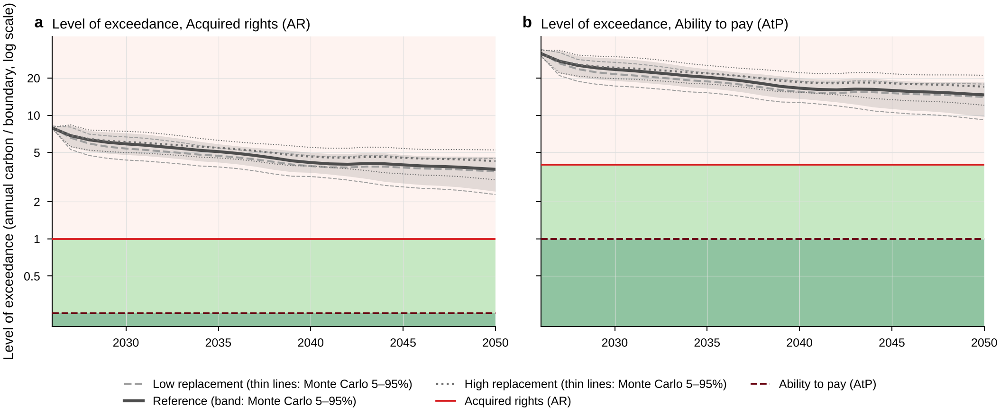

2 °C carrying capacity (Bjørn & Hauschild 2015). Log axis: the AtP LoE is 4.0 × the AR LoE in every year. Monte Carlo bands: within-variant uncertainty (population, dwelling size, completion rate, carbon factors). Carbon: construction (A1–A5 and soil) plus maintenance (B2, B4) occurring each year, buildings built from 2026; later events and C1–C4 are committed after 2050; A1–A3 of the case-study items decarbonised after Horup et al. 2025 (item-level mapping), A4–A5 e^(−0.01 (t − 2025)) after Resch et al. 2021, C1–C4 and soil at 2025.

File: [planetary_boundary/D23_annual_loe.png](planetary_boundary/D23_annual_loe.png); drawn by `boundaries.py`.

### D24. Intensity, floor area and carbon per dwelling that would fit each boundary

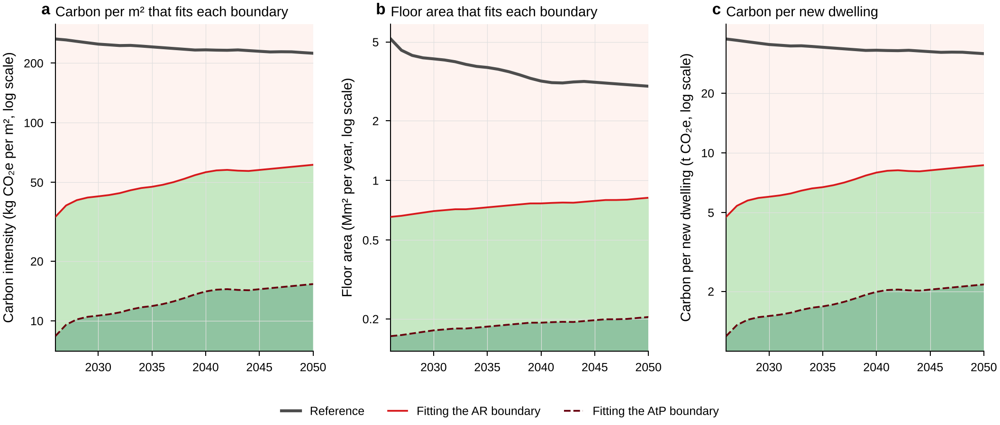

Reference, median population. Fitting carbon per m² = B(t) / floor area(t); fitting floor area = B(t) / (carbon per m² of the Reference); per dwelling = B(t) / dwellings built(t), dwellings = floor area / blended dwelling size. Carbon: construction (A1–A5 and soil) plus maintenance (B2, B4) occurring each year, buildings built from 2026; later events and C1–C4 are committed after 2050; A1–A3 of the case-study items decarbonised after Horup et al. 2025 (item-level mapping), A4–A5 e^(−0.01 (t − 2025)) after Resch et al. 2021, C1–C4 and soil at 2025; carbon per m² also varies with the mix and the soil-bearing share. 2 °C carrying capacity (Bjørn & Hauschild 2015).

File: [planetary_boundary/D24_headroom.png](planetary_boundary/D24_headroom.png); drawn by `boundaries.py`.

### D25. Annual carbon by demand band against the boundaries

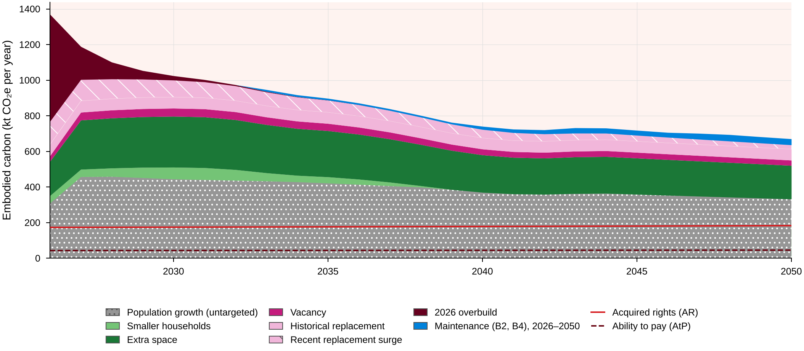

Reference, median population; the bands add up to the annual carbon. Boundaries: 2 °C carrying capacity (Bjørn & Hauschild 2015), SOS 6.81e+12 and I_glob 5.58e+13 kg CO₂e per year; AR: Horup et al. 2025 Eq. 1 (base 2016–2025); AtP: Hjalsted et al. 2021 Eqs. 5–6 (GDP per capita, PPP, 2024); AtP is 25.0% of AR in every year (static design). Carbon: construction (A1–A5 and soil) plus maintenance (B2, B4) occurring each year, buildings built from 2026; later events and C1–C4 are committed after 2050; A1–A3 of the case-study items decarbonised after Horup et al. 2025 (item-level mapping), A4–A5 e^(−0.01 (t − 2025)) after Resch et al. 2021, C1–C4 and soil at 2025.

File: [planetary_boundary/D25_annual_carbon_by_band.png](planetary_boundary/D25_annual_carbon_by_band.png); drawn by `boundaries.py`.

### D26. Cumulative carbon by demand band against the cumulative boundaries

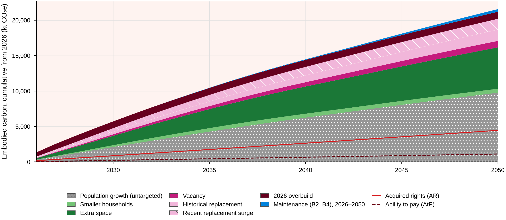

Reference, median population; boundaries cumulated from 2026. Boundaries: 2 °C carrying capacity (Bjørn & Hauschild 2015), SOS 6.81e+12 and I_glob 5.58e+13 kg CO₂e per year; AR: Horup et al. 2025 Eq. 1 (base 2016–2025); AtP: Hjalsted et al. 2021 Eqs. 5–6 (GDP per capita, PPP, 2024); AtP is 25.0% of AR in every year (static design). Carbon: construction (A1–A5 and soil) plus maintenance (B2, B4) occurring each year, buildings built from 2026; later events and C1–C4 are committed after 2050; A1–A3 of the case-study items decarbonised after Horup et al. 2025 (item-level mapping), A4–A5 e^(−0.01 (t − 2025)) after Resch et al. 2021, C1–C4 and soil at 2025.

File: [planetary_boundary/D26_cumulative_carbon_by_band.png](planetary_boundary/D26_cumulative_carbon_by_band.png); drawn by `boundaries.py`.

### D27. Annual and cumulative carbon by variant against the boundaries

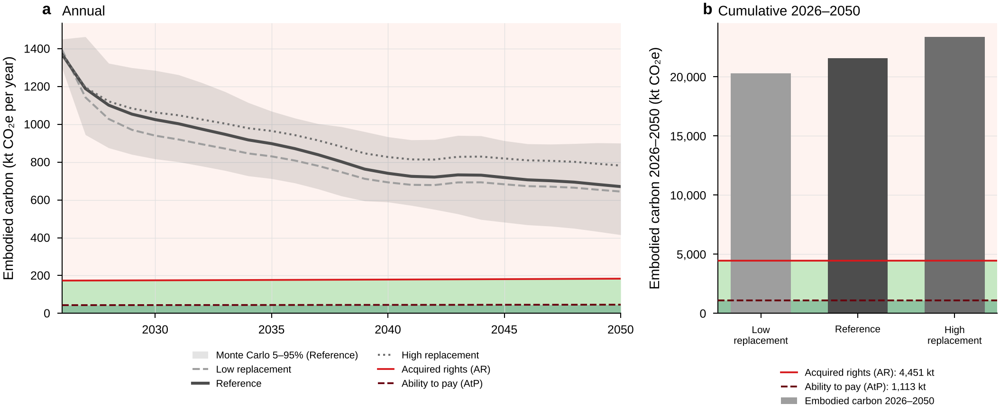

The boundaries are the same in every variant (same population path). Boundaries: 2 °C carrying capacity (Bjørn & Hauschild 2015), SOS 6.81e+12 and I_glob 5.58e+13 kg CO₂e per year; AR: Horup et al. 2025 Eq. 1 (base 2016–2025); AtP: Hjalsted et al. 2021 Eqs. 5–6 (GDP per capita, PPP, 2024); AtP is 25.0% of AR in every year (static design). Carbon: construction (A1–A5 and soil) plus maintenance (B2, B4) occurring each year, buildings built from 2026; later events and C1–C4 are committed after 2050; A1–A3 of the case-study items decarbonised after Horup et al. 2025 (item-level mapping), A4–A5 e^(−0.01 (t − 2025)) after Resch et al. 2021, C1–C4 and soil at 2025.

File: [planetary_boundary/D27_variants_vs_boundaries.png](planetary_boundary/D27_variants_vs_boundaries.png); drawn by `boundaries.py`.

## Pathways si

### D28. Annual carbon of the Reference and P1-P5 against the boundaries

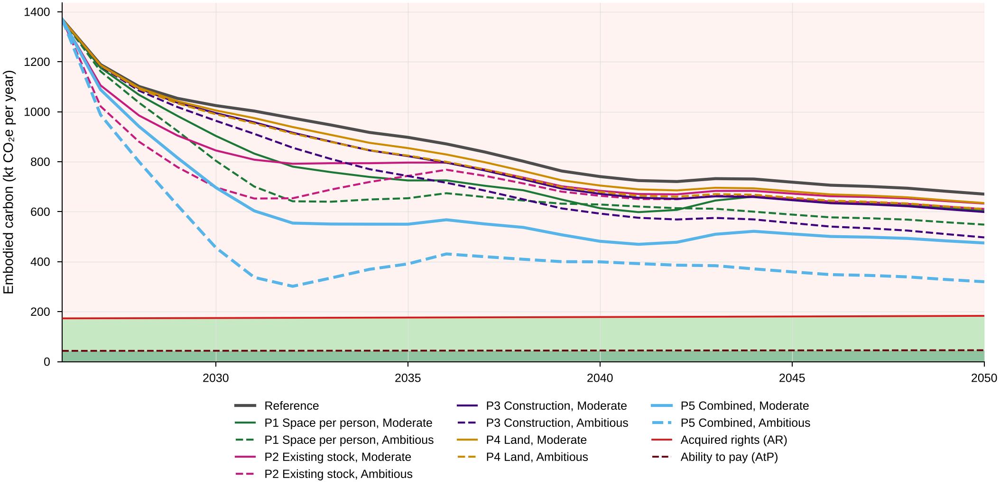

Reference variant; Moderate solid, Ambitious dashed. Construction (A1–A5 and soil) in the construction year plus maintenance (B2, B4) within 2026–2050. 2026 is observed and identical in every run; the levers follow the adopted logistic adoption path (full roll-out by 2035 (adopted)).

File: [pathways_si/D28_pathways_annual.png](pathways_si/D28_pathways_annual.png); drawn by `pathways.py`.

### D30. L6 material carbon: Harrell-Davis estimator of the case-study ratios

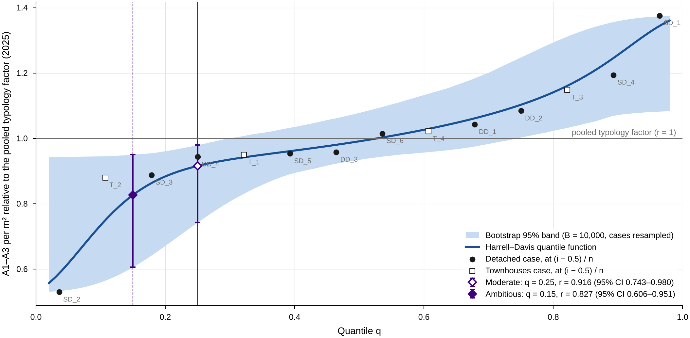

L6 best-practice ratio: Harrell–Davis quantile of 14 independent case studies (detached, townhouses); Harrell & Davis (1982) Biometrika 69, 635; percentile bootstrap (Efron & Tibshirani 1993). The Ambitious q = 0.15 follows the top-15% convention of Commission Delegated Regulation (EU) 2021/2139, Annex I s. 7.7. Apartments (one independent case) are not in the sample.

File: [pathways_si/D30_l6_estimator.png](pathways_si/D30_l6_estimator.png); drawn by `pathways.py`.

### D32. Reference -> P5 -> TL: cumulative LoE and the human terms (size, space per person, dwellings built)

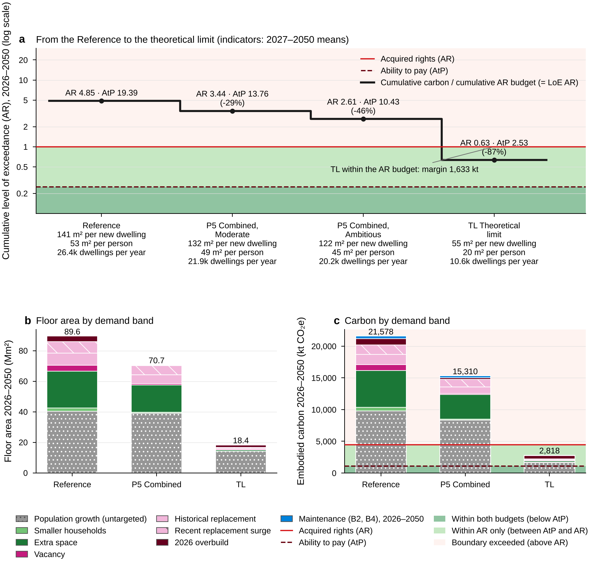

TL is a hyper-optimistic theoretical limit; a thought experiment, not a pathway: all assumptions at full strength from 1 January 2027, combining best observed attributes of different buildings and places; not a proposal or a feasible pathway (potentials hierarchy: theoretical > technical > realisable). TL = P5 Combined (Moderate) with TL1 No extra space, TL2 Historical maximum household size, TL3 No vacancy, TL4 Overbuild fully absorbed, TL5 Building lifetime extension at the limit, TL6 Best-practice materials, TL7 Zero-emission construction, TL8 Lowest-carbon soils, TL9 Brownfield maximum, TL10 Minimum space per person, each at full strength from 2027. In its zero-building years (released dwellings used, banking rule) every band is zero.

File: [pathways_si/D32_tl_staircase.png](pathways_si/D32_tl_staircase.png); drawn by `pathways.py`.

### D34. TL: dwellings built per year (banking rule) and annual carbon

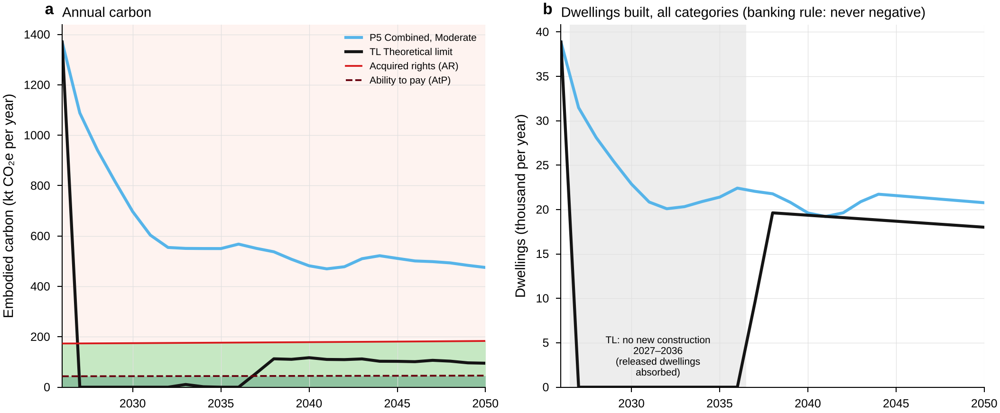

TL is a hyper-optimistic theoretical limit; a thought experiment, not a pathway: all assumptions at full strength from 1 January 2027, combining best observed attributes of different buildings and places; not a proposal or a feasible pathway (potentials hierarchy: theoretical > technical > realisable).

File: [pathways_si/D34_tl_dwellings.png](pathways_si/D34_tl_dwellings.png); drawn by `pathways.py`.

