# Extended Data

_Generated by extended_data.py from outputs/data/ (do not edit by hand). Figures: 183 mm wide, PNG 300 dpi; with run_all.py --export also the vector PDF and the source data of every figure (CSV of the same name). The figures of the paper: ../paper/PAPER.md; rows and groups of the sensitivity figures: docs/SENSITIVITY_PLAN.md._

## ED1. What moves the Reference carbon 2026–2050

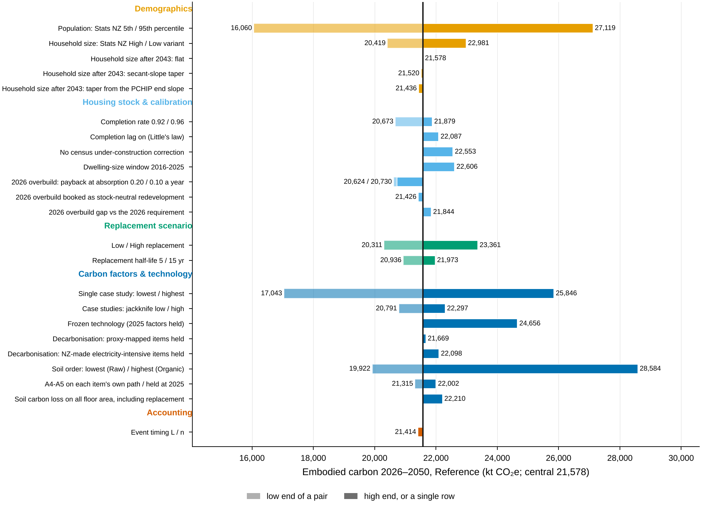

**ED1.** One-at-a-time sensitivity of the Reference carbon 2026–2050, grouped by the type of change; population rows from the exact engine paths. One-at-a-time ranges are not additive and are not a joint interval. Central: the Reference, 21,578 kt CO₂e. The largest effects: Soil carbon: highest soil order (Organic) +32%; Population: Stats NZ 95th percentile (engine path) +26%; Population: Stats NZ 5th percentile (engine path) -26%; Materials: lowest single case study -21%. The population rows are the projection run on the Stats NZ 5th / 95th percentile paths (exact engine path; the one-at-a-time approximation, carbon per m² of the Reference times the path's floor area, stays in data/baseline/sensitivity_one_at_a_time.csv). The vacancy definition is a calibration check (D06), the scope of maintenance an AESA row (ED4, D18). Every row with its basis: data/sensitivity/reference_carbon.csv.

Files: [ED1_reference_carbon_tornado.png](ED1_reference_carbon_tornado.png) (PDF and source data: run_all.py --export). Data (outputs/): data/sensitivity/reference_carbon.csv.

## ED2. What moves P5 carbon 2026–2050

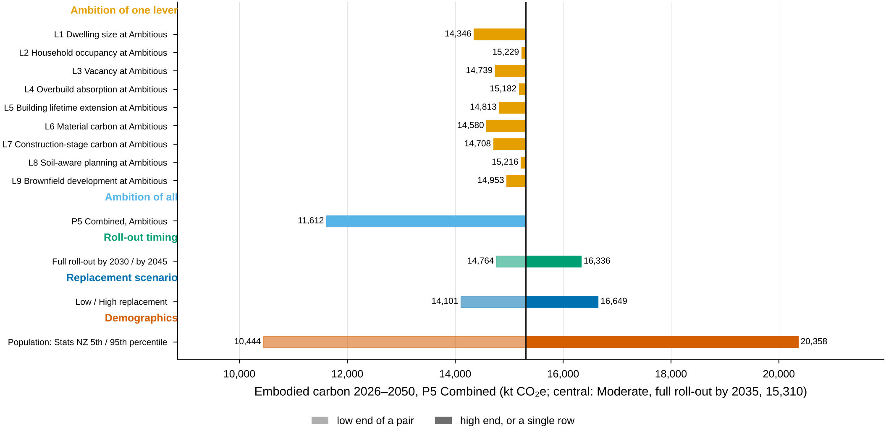

**ED2.** Sensitivity of P5 Combined (Moderate, full roll-out by 2035) to the pathway design, the roll-out timing, the replacement scenario and the population path. One-at-a-time ranges are not additive and are not a joint interval. Central: P5 Combined (Moderate, full roll-out by 2035), 15,310 kt CO₂e (LoE AR 3.44). L1–L9 at Ambitious: one lever at its Ambitious setting with the others at Moderate (new runs). Population 5th / 95th: P5 on the projection's own percentile run (exact engine path), LoE AR 2.45–4.37 with the budgets of each path. The levels of exceedance of every row: data/sensitivity/p5_carbon.csv.

Files: [ED2_p5_carbon_tornado.png](ED2_p5_carbon_tornado.png) (PDF and source data: run_all.py --export). Data (outputs/): data/sensitivity/p5_carbon.csv.

## ED3. Sensitivity paths of the Reference carbon

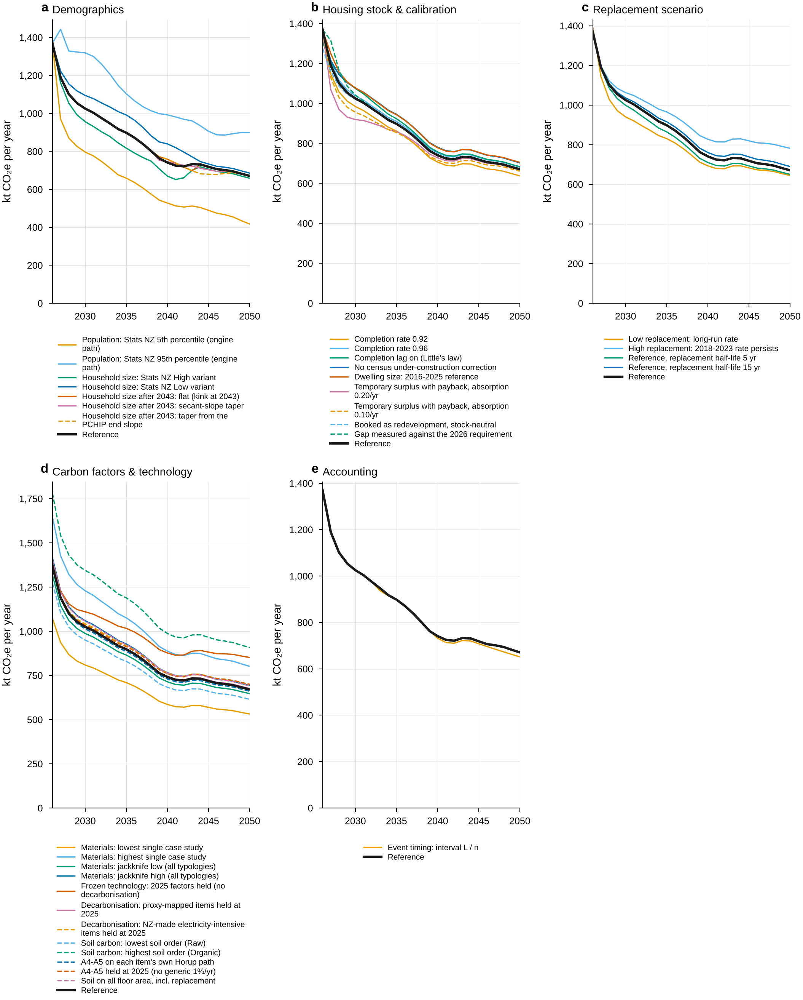

**ED3.** Annual carbon 2026–2050 of every one-at-a-time row, one panel per group; the Reference in black. Population rows: the exact engine paths. Every path adds up to its value in ED1 (checked).

Files: [ED3_sensitivity_paths.png](ED3_sensitivity_paths.png) (PDF and source data: run_all.py --export). Data (outputs/): data/baseline/sensitivity_annual_carbon.csv, data/sensitivity/reference_carbon.csv.

## ED4. What moves the cumulative level of exceedance

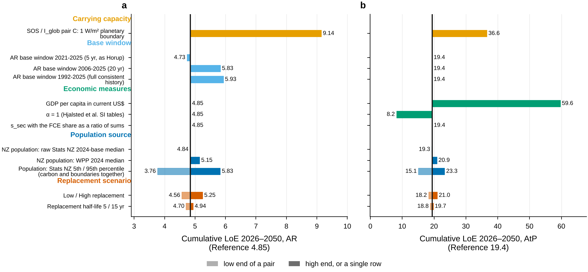

**ED4.** One-at-a-time sensitivity of the cumulative level of exceedance of the Reference, AR and AtP side by side. One-at-a-time ranges are not additive and are not a joint interval. Rows: the carrying capacity (pair C, 1 W/m², vs pair A, 2 °C), the AR base window, the economic measures of the AtP allocation, the population source and path, and the replacement variants. Model-input rows other than population and replacement change the carbon only (ED1); the technology and accounting rows of the AESA table, (vi)–(xiii), stay in data/aesa/sensitivity.csv and D18. Every row with its basis: data/sensitivity/planetary_boundary.csv.

Files: [ED4_boundary_tornado.png](ED4_boundary_tornado.png) (PDF and source data: run_all.py --export). Data (outputs/): data/sensitivity/planetary_boundary.csv.

## ED5. Monte Carlo of the Reference, P5 and TL

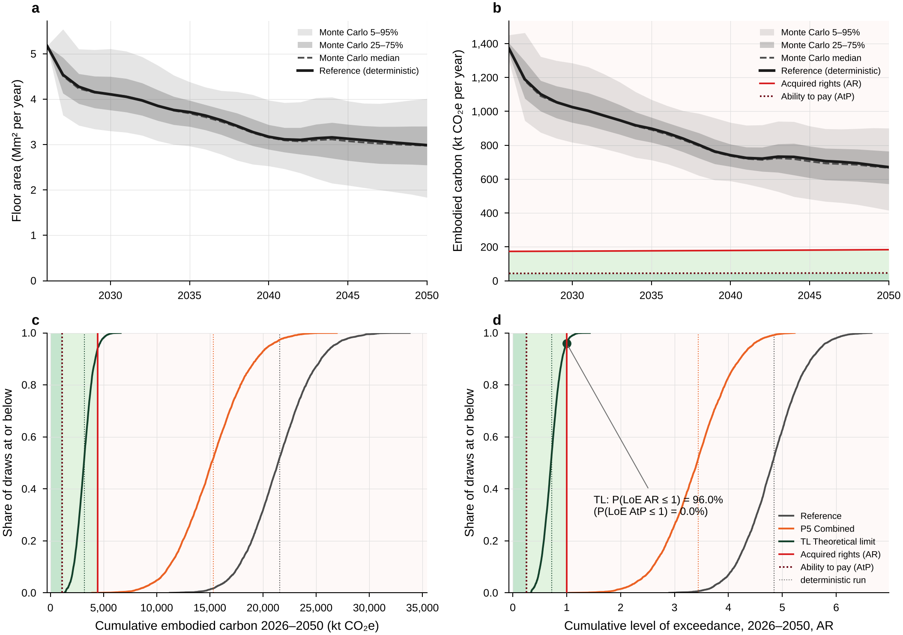

**ED5.** Joint parametric uncertainty (Latin hypercube, 5,000 draws of the Reference; each draw also run through P5 and TL). (a, b) The Reference: Monte Carlo 5–95% and 25–75% bands, median (dashed) and the deterministic Reference; cumulative floor area 2026–2050 69.1–109.9 Mm², carbon 16,678–26,596 kt (5–95%). (c, d) Cumulative distributions over the 5,000 draws of the Reference, P5 and TL (each draw run through the pathway layer with the levers applied identically and the TL targets at their absolute values; the AR and AtP budgets of each draw follow its population path and its case-study factors). TL: P(LoE AR ≤ 1) = 96.0%, P(LoE AtP ≤ 1) = 0.0%. The central draw reproduces the deterministic runs (asserted to 1e-9).

Files: [ED5_monte_carlo.png](ED5_monte_carlo.png) (PDF and source data: run_all.py --export). Data (outputs/): data/montecarlo/annual_REF.csv, data/montecarlo/summary_REF.csv, data/pathways/montecarlo_draws.csv, data/pathways/montecarlo_summary.csv.

## ED6. Ambitious settings

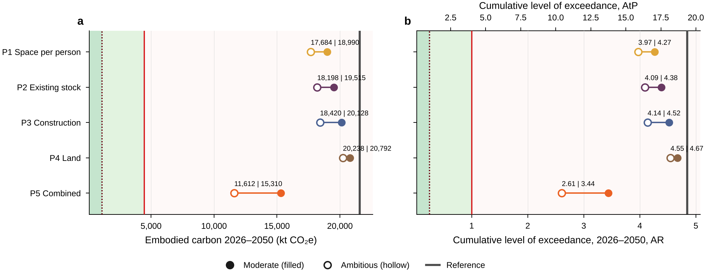

**ED6.** P1-P5 at the Ambitious setting against the Moderate setting. P5 Combined: 15,310 kt (Moderate) and 11,612 kt (Ambitious), LoE AR 3.44 and 2.61. Labels: Ambitious | Moderate. Both settings with full roll-out by 2035; the settings of every lever: Table 1.

Files: [ED6_ambitious_settings.png](ED6_ambitious_settings.png) (PDF and source data: run_all.py --export). Data (outputs/): data/pathways/runs.csv.

## ED7. Roll-out timing

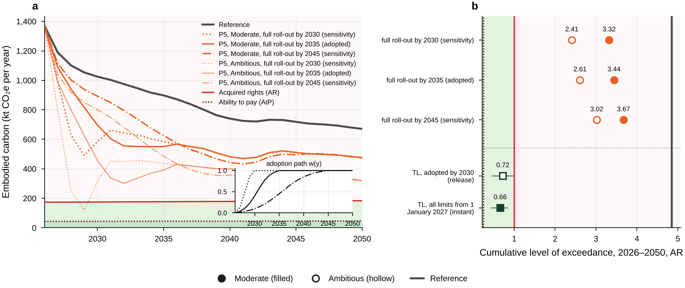

**ED7.** P5 Combined with full roll-out by 2030, 2035 (adopted) and 2045. One rule for every adoption window 2026 → E: a normalised logistic path, 10–90% of adoption within the middle two-thirds of the window (inset). Cumulative LoE AR of P5 (Moderate): 3.32 (by 2030), 3.44 (by 2035) and 3.67 (by 2045). TL sensitivity (squares, Monte Carlo 5–95% lines; not in the headline figures): TL adopted by 2030: 3,211 kt, LoE AR 0.721 (Monte Carlo 0.45–0.98; P(LoE AR ≤ 1) = 96.0%), LoE AtP 2.89 (P(LoE AtP ≤ 1) = 0.0%), released dwellings meeting 37% of each year's need; TL, all limits from 1 January 2027 (instant): 2,924 kt, LoE AR 0.657 (Monte Carlo 0.44–0.84; P(LoE AR ≤ 1) = 99.9%), LoE AtP 2.63 (P(LoE AtP ≤ 1) = 0.0%), released dwellings meeting 43% of each year's need; both with the same constant-share reoccupation.

Files: [ED7_rollout_timing.png](ED7_rollout_timing.png) (PDF and source data: run_all.py --export). Data (outputs/): data/pathways/annual.csv, data/pathways/runs.csv, levers.py (adoption paths).

## ED8. The theoretical limit: attribution and indicators

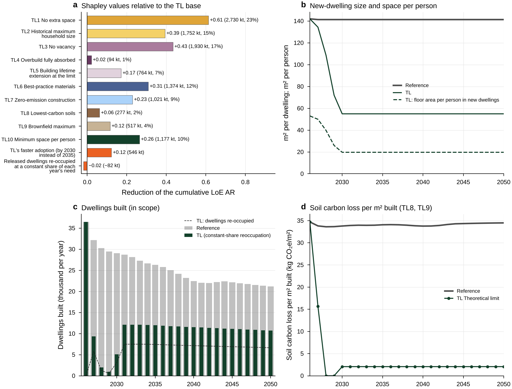

**ED8.** Order-free attribution of P5 Combined (Moderate) to TL over TL1-TL10 (1,024 subsets), and the TL indicators. TL: hyper-optimistic theoretical limit; a thought experiment, not a pathway; every lever at its limit, adopted by 2030. TL: every lever at its limit, adopted by 2030; dwellings released by zero vacancy, the household-size change and the 2026 overbuild are re-occupied gradually, meeting a constant share (~37%) of each year's need; 2026 observed. (a) Shapley values (exact, 1,024 subsets) of TL1–TL10 relative to the TL base (P5 Combined, Moderate, adopted by 2030, its released dwellings re-occupied at a constant share of each year's need), in cumulative LoE AR (carbon and share of base − TL in brackets); they add up exactly to that difference. Bars in the colour of the lever each item is the limit of (TL10 has no lever counterpart). Two separate lines, not Shapley players, close the gap to P5 exactly: TL's faster adoption (P5 by 2035 → by 2030; +0.123) and the gradual re-occupation of P5's own released dwellings (→ the base; -0.018: deferring the use of released dwellings moves construction earlier, when carbon per m² is higher). (b) New-dwelling size and floor area per person (TL10 with TL2: 19.69 m² per person in 2030). (c) Dwellings built and re-occupied. Released: 114,515 dwellings from zero vacancy (TL3), 21,876 from the household-size change (TL2) and 16,760 from the 2026 overbuild (TL4), R = 153,151, 36.9% of the 2027–2050 need (G+ = 414,909); TL builds at least 984 dwellings a year. The re-occupation never runs ahead of the cumulative release and never exceeds a year's need (a shortfall would be carried forward): neither constraint binds in TL; the release constraint binds in 128 of the 1,024 Shapley subsets and the need cap in 0. (d) Soil carbon loss per m² of floor area built (soil carbon loss / floor area, annual data).

Files: [ED8_theoretical_limit.png](ED8_theoretical_limit.png) (PDF and source data: run_all.py --export). Data (outputs/): data/pathways/shapley_theoretical_limit.csv, data/pathways/theoretical_limit.json, data/pathways/annual.csv.

## ED9. Single levers

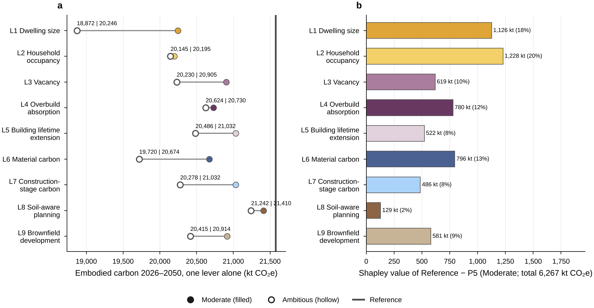

**ED9.** Each lever alone at the Moderate and Ambitious settings, and the lever attribution of P5 (Moderate). (a) Each lever alone on the Reference, Moderate (filled) and Ambitious (hollow), full roll-out by 2035; the cumulative LoE AR of every run: data/pathways/runs.csv. (b) Order-free (Shapley) attribution of Reference − P5 Combined (Moderate) to the nine levers (exact, 512 subsets; adds up to the difference).

Files: [ED9_single_levers.png](ED9_single_levers.png) (PDF and source data: run_all.py --export). Data (outputs/): data/pathways/runs.csv, data/pathways/shapley_levers.csv.

## ED10. Low and High replacement

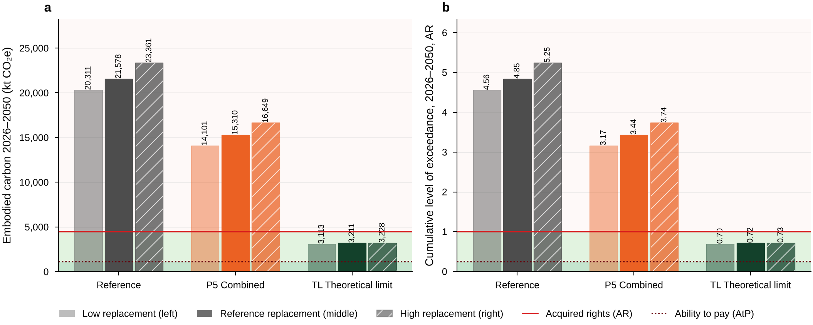

**ED10.** The Reference, P5 Combined (Moderate) and TL under the Low, Reference and High replacement variants. Low replacement: the 1991–2023 long-run net replacement rate throughout; High: the 2018–2023 census-interval rate persists. Every run is computed with the pathway engine; all but TL under Low and High replacement reproduce data/pathways/runs.csv to 1e-12, and TL under Low and High is new (TL7 then cuts that variant's replacement rates by 40%). TL: LoE AR 0.70 (Low), 0.72 (Reference) and 0.73 (High).

Files: [ED10_replacement_variants.png](ED10_replacement_variants.png) (PDF and source data: run_all.py --export). Data (outputs/): data/sensitivity/replacement_variants.csv.

## ED11. Monte Carlo inputs against outputs

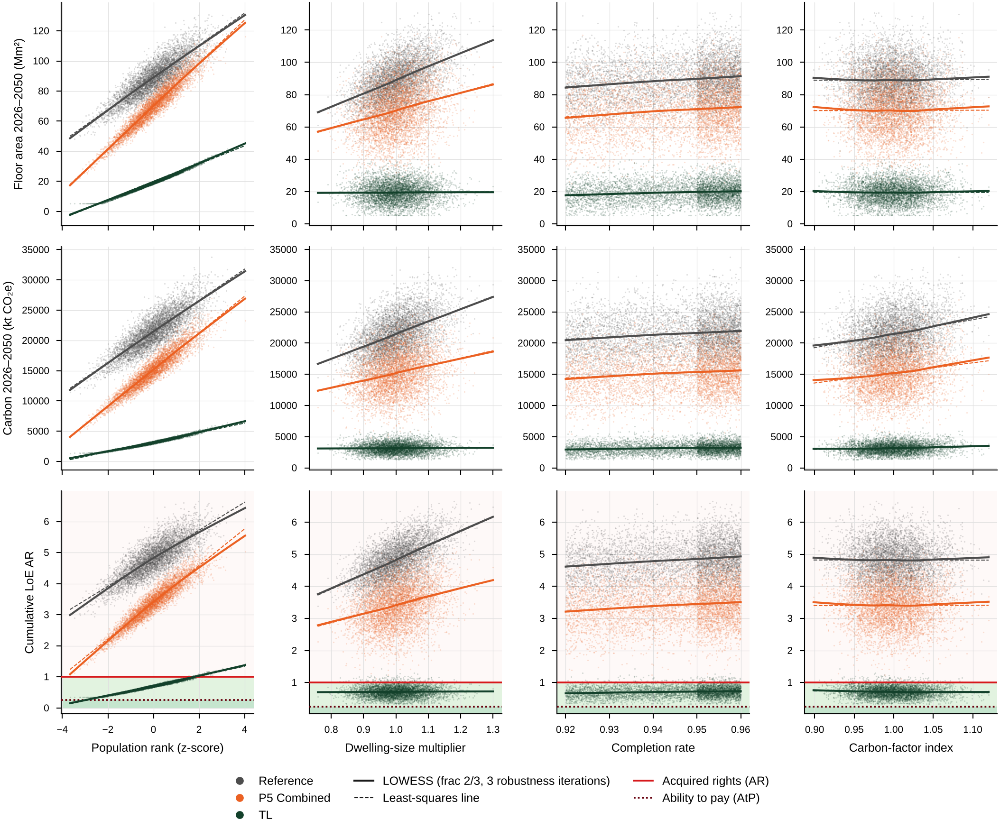

**ED11.** Scatter matrix of the four sampled inputs (population rank, which also sets household size; dwelling-size multiplier; completion rate; carbon-factor index) against floor area, carbon and the cumulative LoE AR 2026–2050 of the Reference, P5 Combined (Moderate) and TL, with ordinary least-squares and LOWESS fits. Each point is one of the 5,000 Latin-hypercube draws; population rank and household size share one draw (the household-size path is interpolated between the Stats NZ variants at the population rank). The carbon-factor index is the draw's carbon per m² at the central floor-area mix relative to the central factors (the sampled carbon input selects a bootstrap replicate and has no order). LOWESS after Cleveland (1979), implemented in mcstats.py and checked against statsmodels.

Files: [ED11_mc_scatter.png](ED11_mc_scatter.png) (PDF and source data: run_all.py --export). Data (outputs/): data/pathways/montecarlo_draws.csv, data/montecarlo/draws_REF.csv.

## ED12. What drives the joint uncertainty

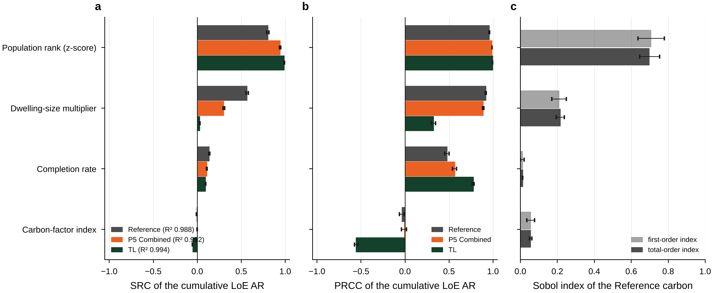

**ED12.** Standardised regression coefficients (SRC) and partial rank correlation coefficients (PRCC) of the cumulative LoE AR with percentile-bootstrap 95% intervals, for the Reference, P5 Combined (Moderate) and TL, beside the Sobol indices of the Reference carbon. (a) Standardised regression coefficients (linear model of the cumulative LoE AR on the four inputs; R² in the legend) and (b) partial rank correlation coefficients, each with its percentile bootstrap 95% interval (1,000 resamples of the draws; mcstats.py). (c) Sobol first-order and total indices of the Reference carbon 2026–2050 (MonteCarlo.py; Saltelli 2010 / Jansen estimators), where the carbon input is the bootstrap selector itself (variance-based indices need no order). Carbon-factor uncertainty barely moves the Reference LoE AR (PRCC -0.04): the AR budget is grandfathered from each draw's own 2025 carbon factors, so carbon and budget move together; under TL it lowers the LoE AR (PRCC -0.56) because TL's carbon targets are absolute while the budget scales with the factors.

Files: [ED12_mc_importance.png](ED12_mc_importance.png) (PDF and source data: run_all.py --export). Data (outputs/): data/pathways/montecarlo_importance.csv, data/montecarlo/sobol_REF.csv.

## ED13. When does the theoretical limit stay within AR?

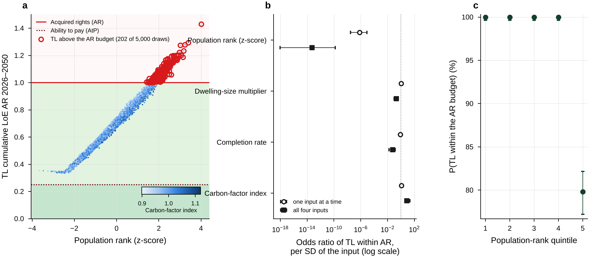

**ED13.** TL cumulative LoE AR against the population rank of each draw, coloured by the carbon-factor index, with LoE AR = 1; logistic regression of P(TL LoE AR <= 1) on the sampled inputs (odds ratios with 95% intervals). TL: hyper-optimistic theoretical limit; a thought experiment, not a pathway; every lever at its limit, adopted by 2030. TL stays within the AR budget in 4,798 of 5,000 draws (95.96%; Wilson 95% 95.38–96.47%). The 202 draws above it are the draws with the highest population ranks (percentile ranks 97.48, 99.42, 96.68, 96.28, 97.18, 97.80, 98.56, 95.82, 99.64, 99.34, 99.48, 97.20, 98.46, 99.68, 96.76, 96.06, 99.50, 97.30, 98.36, 98.30, 96.16, 96.24, 99.52, 98.92, 99.96, 97.54, 99.06, 96.08, 95.18, 99.24, 99.84, 96.98, 97.12, 98.96, 96.60, 98.34, 96.42, 98.54, 99.92, 98.20, 97.66, 98.58, 99.88, 97.46, 98.14, 97.28, 96.80, 98.62, 96.18, 98.08, 99.76, 93.70, 98.44, 98.98, 98.74, 99.90, 97.16, 98.82, 97.72, 98.66, 96.78, 96.62, 98.88, 94.64, 92.34, 94.62, 96.82, 95.80, 95.86, 98.16, 98.64, 97.94, 98.18, 97.82, 97.86, 96.50, 97.44, 99.78, 97.62, 99.04, 99.70, 98.90, 97.06, 97.60, 98.00, 96.02, 97.08, 95.10, 99.46, 96.72, 97.34, 98.10, 99.16, 98.76, 99.62, 98.68, 99.94, 97.42, 95.78, 97.02, 99.08, 96.86, 98.86, 97.70, 97.50, 98.04, 99.56, 99.22, 96.26, 97.04, 93.80, 98.94, 99.30, 97.24, 97.26, 99.32, 97.10, 97.64, 97.52, 97.40, 96.66, 96.30, 99.10, 98.06, 98.28, 96.38, 96.90, 97.88, 99.20, 99.98, 96.34, 98.72, 98.80, 98.42, 98.48, 94.98, 99.00, 95.50, 98.52, 98.84, 99.38, 96.70, 97.96, 99.44, 98.60, 95.28, 96.22, 98.02, 99.60, 96.46, 99.12, 97.36, 99.28, 96.44, 96.52, 93.94, 97.22, 97.32, 97.76, 99.82, 99.80, 96.64, 99.58, 96.12, 97.90, 98.26, 98.50, 99.54, 98.78, 99.14, 100.00, 98.22, 98.38, 99.02, 97.84, 97.78, 97.58, 99.86, 97.38, 97.92, 96.94, 99.74, 96.48, 99.72, 99.36, 98.70, 97.98, 98.24, 97.56, 95.88, 96.84, 93.44, 99.26, 97.14, 96.58, 96.96, 97.68, 99.18, 99.40, 99.66, 98.12, 98.40); TL LoE AR 1.043, 1.137, 1.006, 1.036, 1.005, 1.060, 1.060, 1.029, 1.147, 1.156, 1.119, 1.036, 1.091, 1.165, 1.027, 1.017, 1.151, 1.037, 1.011, 1.079, 1.021, 1.027, 1.149, 1.042, 1.278, 1.094, 1.077, 1.007, 1.001, 1.175, 1.201, 1.022, 1.010, 1.107, 1.008, 1.099, 1.005, 1.063, 1.187, 1.047, 1.010, 1.019, 1.274, 1.025, 1.026, 1.074, 1.028, 1.055, 1.015, 1.029, 1.171, 1.005, 1.034, 1.131, 1.054, 1.202, 1.025, 1.113, 1.029, 1.092, 1.044, 1.024, 1.102, 1.007, 1.004, 1.012, 1.053, 1.032, 1.026, 1.009, 1.114, 1.014, 1.022, 1.080, 1.021, 1.016, 1.035, 1.200, 1.038, 1.149, 1.192, 1.073, 1.016, 1.039, 1.040, 1.025, 1.053, 1.010, 1.144, 1.053, 1.054, 1.005, 1.086, 1.140, 1.144, 1.050, 1.233, 1.013, 1.014, 1.021, 1.099, 1.020, 1.110, 1.076, 1.018, 1.053, 1.194, 1.167, 1.002, 1.019, 1.001, 1.091, 1.132, 1.048, 1.028, 1.128, 1.048, 1.041, 1.041, 1.008, 1.020, 1.010, 1.134, 1.067, 1.068, 1.031, 1.041, 1.068, 1.134, 1.293, 1.009, 1.046, 1.100, 1.056, 1.036, 1.001, 1.102, 1.011, 1.072, 1.093, 1.086, 1.019, 1.031, 1.114, 1.094, 1.022, 1.029, 1.081, 1.155, 1.022, 1.149, 1.027, 1.129, 1.008, 1.016, 1.030, 1.030, 1.014, 1.030, 1.177, 1.164, 1.017, 1.151, 1.023, 1.032, 1.044, 1.089, 1.058, 1.116, 1.145, 1.430, 1.061, 1.118, 1.166, 1.051, 1.057, 1.013, 1.222, 1.041, 1.069, 1.037, 1.175, 1.022, 1.197, 1.123, 1.035, 1.054, 1.042, 1.084, 1.041, 1.019, 1.006, 1.099, 1.028, 1.057, 1.007, 1.065, 1.098, 1.060, 1.198, 1.043, 1.037. (a) Shading: the AR and AtP budget zones (the AtP line at the deterministic B_AtP / B_AR = 0.250; across draws 0.217–0.281). (b) Firth penalised-likelihood logistic regression (Heinze & Schemper 2002) with profile-likelihood 95% intervals; the maximum-likelihood estimate does not exist (separation) for the population models. Odds ratio per SD of population rank, alone: 6.9e-07 (3.1e-08–8.7e-06). With 202 exceedances (50 per variable in the multivariable model, below the conventional 10) the multivariable odds ratios are indicative only; the model is deterministic, so the intervals describe the 5,000-draw design. (c) Share of draws within the AR budget by population-rank quintile, Wilson 95% intervals.

Files: [ED13_conditional_tl.png](ED13_conditional_tl.png) (PDF and source data: run_all.py --export). Data (outputs/): data/pathways/montecarlo_draws.csv, data/pathways/montecarlo_conditional_tl.csv.

