# Headline findings and figures

_Generated by headline.py from outputs/data/ (do not edit by hand). Figures: 183 mm wide (Nature double column), PNG 300 dpi and vector PDF; the source data of every figure (every plotted value) in the CSV of the same name. Vocabulary: docs/RENAMING.md; palette: docs/PALETTE.md._

## Findings

1. New Zealand builds 89.6 million m² of new residential floor area in 2026–2050 in the Reference (Monte Carlo 90% interval 69.1–109.9); the replacement assumption brackets it at 83.2–98.7 million m². (Source: data/baseline/scenarios.json, data/montecarlo/summary_REF.csv.)
2. 48% of that floor area serves population growth and smaller households, which no construction pathway targets; the rest is extra space, vacancy, the 2026 overbuild, replacement and redevelopment. (Source: data/baseline/bands_annual.csv.)
3. Its embodied carbon is 21,578 kt CO₂e within 2026–2050 (materials and construction 18,124 kt, soil carbon loss 3,050 kt, maintenance 403 kt), with a further 8,208–8,969 kt committed after 2050. (Source: data/baseline/annual.csv, data/baseline/projection.json.)
4. This exceeds the sector's share of the 2 °C carrying capacity 4.85-fold by acquired rights (Monte Carlo 3.90–5.75) and 19.4-fold by ability to pay (15.5–23.1); the two principles are reported side by side, never averaged. (Source: data/aesa/results.json.)
5. The emissions committed after 2050 by the 2026–2050 cohorts equal 45–49 years of the 2050 acquired-rights boundary. (Source: data/aesa/results.json.)
6. Combining all pathways (P5) lowers carbon 2026–2050 by 19% (Moderate) to 32% (Ambitious): the cumulative LoE AR falls from 4.85 to 3.95 and 3.28. (Source: data/pathways/runs.csv.)
7. Even the hyper-optimistic theoretical limit (TL; a thought experiment, not a pathway) exceeds the acquired-rights budget (LoE AR 1.03); reaching it means not building 15,683 dwellings in 2027–2050, i.e. housing 41,584 new residents in existing dwellings. (Source: data/pathways/theoretical_limit.json, data/pathways/runs.csv.)
8. Of the one-at-a-time sensitivities, the largest effects on the cumulative LoE AR (Reference 4.85) are +89% for 'SOS/I_glob pair C: 1 W/m² planetary boundary (Bjørn & Hauschild 2015)', +32% for 'Soil carbon: highest soil order (Organic)' and +22% for 'AR base window 1992–2025 (full consistent history)'; the Stats NZ population 5th and 95th percentiles, which move the carbon and both boundaries, give 3.76–5.83. (Source: outputs/headline/H11_sensitivity.csv, data/aesa/results.json.)

## Figures

### H1. How the model works

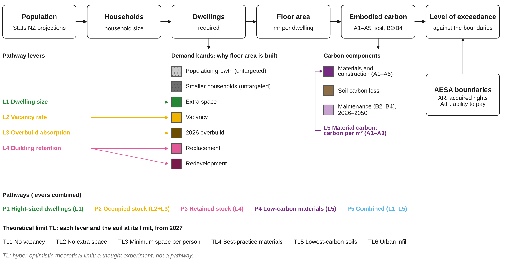

**H1.** Model structure. A bottom-up chain converts population and household projections into dwellings required, floor area by reason for building (demand bands) and embodied carbon, which is compared with two allocations of a global carrying capacity (acquired rights, AR; ability to pay, AtP). Pathway levers act on the band or quantity they target; population growth and smaller households are untargeted by design.

Files: [H1_model_schematic.png](H1_model_schematic.png), [H1_model_schematic.pdf](H1_model_schematic.pdf), source data [H1_model_schematic.csv](H1_model_schematic.csv). Data: naming.py, levers.py (structure only; no numbers).

### H2. New residential floor area, 1991–2050

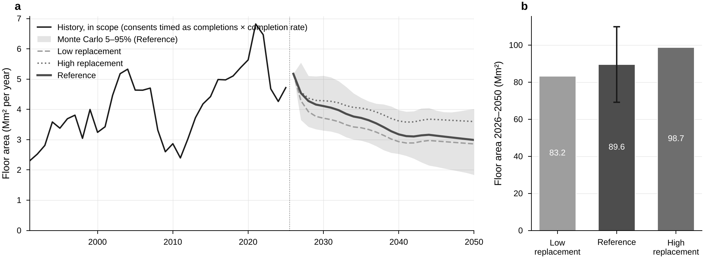

**H2.** New residential floor area. History is consented floor area converted to built floor area; the Reference projection builds 89.6 million m² in 2026–2050 (Monte Carlo 90% interval 69.1–109.9); Low and High replacement bracket the replacement assumption (83.2 and 98.7).

Files: [H2_floor_area.png](H2_floor_area.png), [H2_floor_area.pdf](H2_floor_area.pdf), source data [H2_floor_area.csv](H2_floor_area.csv). Data (outputs/): data/baseline/annual.csv, data/baseline/variants_annual.csv, data/baseline/scenarios.json, data/montecarlo/annual_REF.csv, data/montecarlo/summary_REF.csv.

### H3. Why floor area is built

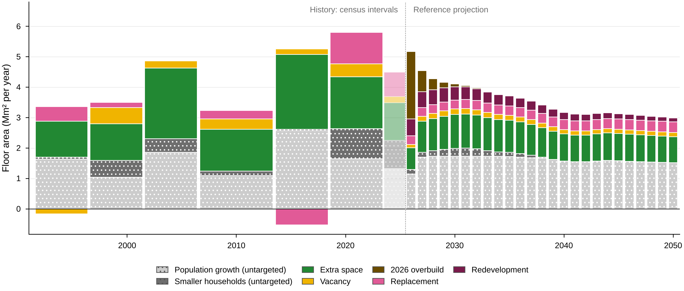

**H3.** Floor area by reason for building. Bands sum to the in-scope total. Population growth and smaller households are untargeted; extra space, vacancy and the 2026 overbuild, replacement and redevelopment are the bands the pathways act on. Over 2026–2050 the untargeted bands are 48% of the 89.6 million m² built. History: interval means between censuses (vacancy on one definition, the pooled 2018/2023 empty share); the history's replacement band holds any redevelopment (not separable); the faint bar after the latest census uses consent-derived households. Retirement villages (out of scope) are removed from every band in proportion.

Files: [H3_demand_bands.png](H3_demand_bands.png), [H3_demand_bands.pdf](H3_demand_bands.pdf), source data [H3_demand_bands.csv](H3_demand_bands.csv). Data (outputs/): data/baseline/bands_annual.csv (Reference, 2026-2050), data/baseline/bands_history.csv (census intervals).

### H4. Embodied carbon 2026–2050 by component

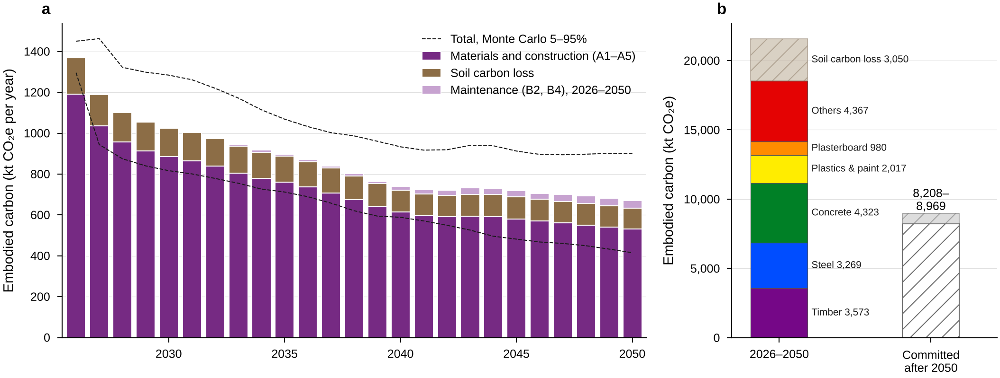

**H4.** Embodied carbon of new residential construction. Materials and construction (A1–A5) and soil carbon loss are counted in the construction year, maintenance (B2, B4) in the year it occurs within 2026–2050; later events and end of life are committed after 2050 (b, hatched). Of the 21,578 kt CO₂e emitted in 2026–2050, materials and construction are 18,124 kt, soil carbon loss 3,050 kt and maintenance 403 kt; a further 8,208–8,969 kt is committed after 2050. Dashed: Monte Carlo 5–95% of the annual total. Materials include their maintenance within 2026–2050.

Files: [H4_carbon_components.png](H4_carbon_components.png), [H4_carbon_components.pdf](H4_carbon_components.pdf), source data [H4_carbon_components.csv](H4_carbon_components.csv). Data (outputs/): data/baseline/annual.csv (components), data/baseline/projection.json (materials, committed), data/montecarlo/annual_REF.csv.

### H5. Reference emissions against the AR and AtP boundaries

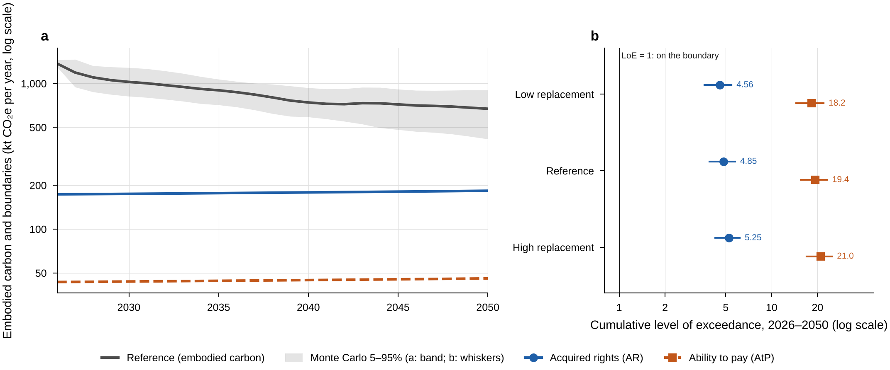

**H5.** Absolute sustainability. Over 2026–2050 the Reference exceeds the acquired-rights boundary 4.85-fold and the ability-to-pay boundary 19.4-fold; the two allocation principles are reported side by side and never averaged. Monte Carlo 5–95%: AR 3.90–5.75, AtP 15.5–23.1; the AR boundary of each draw follows its population path and its case-study carbon factors (2025 technology), the AtP boundary its population path. Boundaries: 2 °C carrying capacity (Bjørn & Hauschild 2015) allocated by acquired rights (Horup et al. 2025) and ability to pay (Hjalsted et al. 2021).

Files: [H5_boundaries.png](H5_boundaries.png), [H5_boundaries.pdf](H5_boundaries.pdf), source data [H5_boundaries.csv](H5_boundaries.csv). Data (outputs/): data/aesa/annual.csv, data/aesa/montecarlo_annual.csv, data/aesa/results.json.

### H6. Lock-in: emissions committed after 2050

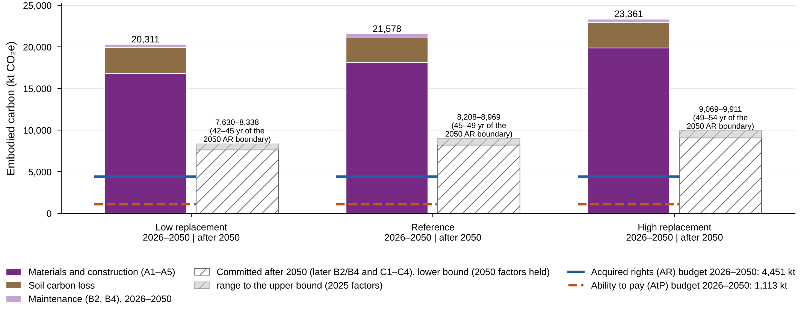

**H6.** Lock-in. The 2026–2050 cohorts commit 8,208–8,969 kt after 2050 (Reference), equal to 45–49 years of the 2050 acquired-rights boundary. Committed after 2050: the later maintenance (B2, B4) and the end of life (C1–C4) of the 2026–2050 cohorts; lower bound with the 2050 factors held, upper bound at 2025 factors; not part of the level of exceedance 2026–2050. Short lines over the 2026–2050 bars: the cumulative AR and AtP budgets 2026–2050 (the committed emissions fall after 2050 and are not compared with them).

Files: [H6_committed.png](H6_committed.png), [H6_committed.pdf](H6_committed.pdf), source data [H6_committed.csv](H6_committed.csv). Data (outputs/): data/aesa/results.json (committed, budgets), data/baseline/scenarios.json.

### H7. What each pathway removes, by demand band

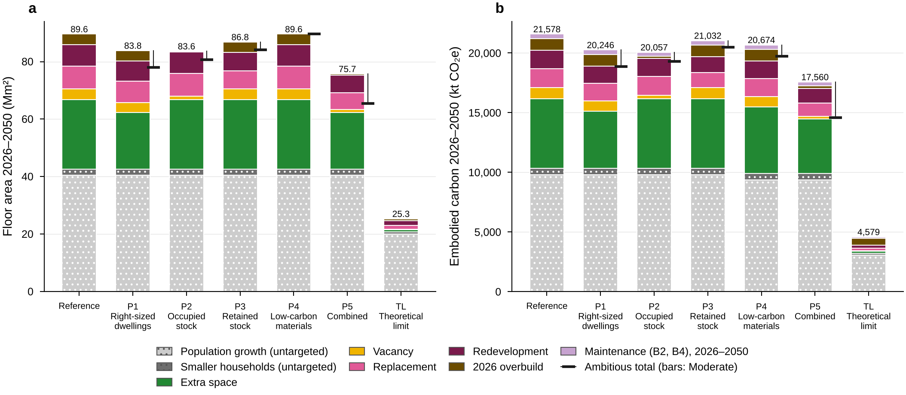

**H7.** Pathways by demand band. Each pathway acts on the bands it targets; P4 lowers carbon per m² of every band. TL: hyper-optimistic theoretical limit; a thought experiment, not a pathway. P5 Combined lowers carbon 2026–2050 by 19% (Moderate) to 32% (Ambitious) against the Reference; TL by 79%. Bars: Moderate setting; whiskers: Ambitious totals. Untargeted bands (grey, dotted) are not acted on by any pathway; negative bands (below zero) release existing dwellings.

Files: [H7_pathways_bands.png](H7_pathways_bands.png), [H7_pathways_bands.pdf](H7_pathways_bands.pdf), source data [H7_pathways_bands.csv](H7_pathways_bands.csv). Data (outputs/): data/pathways/bands.csv, data/pathways/runs.csv.

### H8. Annual emissions 2026–2050 against the boundaries

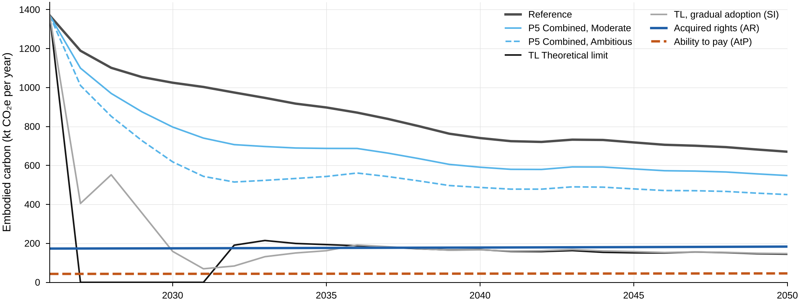

**H8.** Annual embodied carbon of the combined pathways and the theoretical limit against the annual boundaries. TL: hyper-optimistic theoretical limit; a thought experiment, not a pathway. In 2050 the Reference emits 671 kt, P5 Ambitious 451 kt and TL 145 kt against an AR boundary of 183 kt. 2026 is observed and identical in every run; the pathways follow the adopted logistic adoption path (full roll-out by 2035), TL is at full strength from 2027 (TL, gradual adoption: on the adopted path).

Files: [H8_annual_emissions.png](H8_annual_emissions.png), [H8_annual_emissions.pdf](H8_annual_emissions.pdf), source data [H8_annual_emissions.csv](H8_annual_emissions.csv). Data (outputs/): data/pathways/annual.csv.

### H9. From the Reference to P5 Ambitious and TL

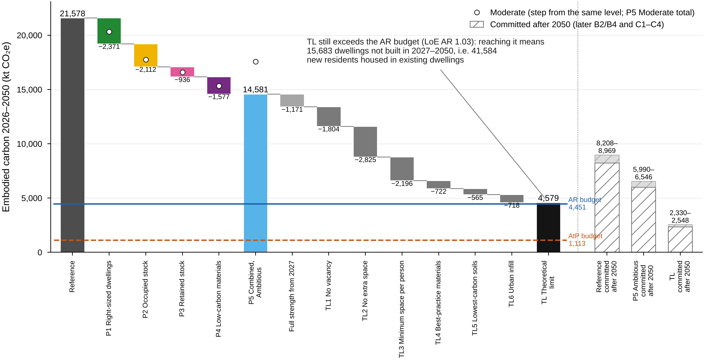

**H9.** Order-free attribution (Shapley values, exact). Even the theoretical limit exceeds the acquired-rights budget: closing the residual means 15,683 dwellings not built in 2027–2050 (41,584 residents housed in existing dwellings). TL: hyper-optimistic theoretical limit; a thought experiment, not a pathway. Steps: the Shapley value of each pathway (Ambitious bars; open circles: Moderate, drawn from the same level), the effect of starting P5 Ambitious at full strength in 2027 (a separate line, not a Shapley player) and the Shapley values of TL1–TL6; the values add up exactly to each total. TL needs a further 4.1% cut of 2027–2050 construction to reach the AR budget.

Files: [H9_waterfall.png](H9_waterfall.png), [H9_waterfall.pdf](H9_waterfall.pdf), source data [H9_waterfall.csv](H9_waterfall.csv). Data (outputs/): data/pathways/shapley_pathways.csv, data/pathways/shapley_theoretical_limit.csv, data/pathways/runs.csv, data/pathways/theoretical_limit.json.

### H10. Solution space: demand and intensity

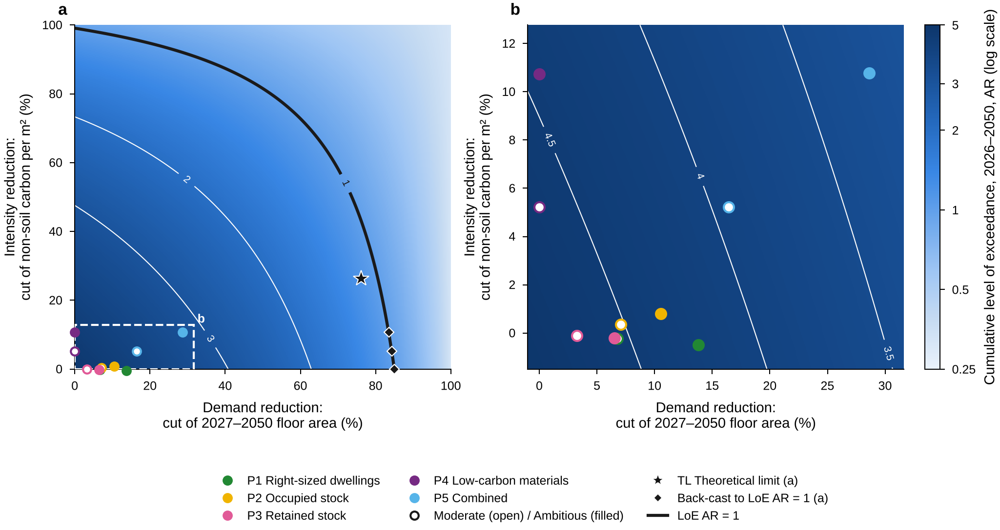

**H10.** Solution space (after Horup et al. 2025, Fig. 6). Markers sit at each run's effective reductions of 2027–2050 floor area and non-soil carbon per m²; TL also lowers soil carbon (TL5, TL6), which the plane does not show. Cutting 2027–2050 construction alone by 85.0% would bring the Reference to LoE AR = 1 (back-cast); P5 Ambitious sits at 29% demand and 11% intensity reduction, TL at 76% and 26% (at these coordinates the plane reads LoE AR 1.16; the TL run, with its lower soil carbon, 1.03). b: zoom on the pathway markers (dashed box in a); P1's effective intensity change is slightly negative, so b extends just below 0 on the same relation. Contours: the exact bilinear LoE of the plane, read from the 5% grid (outputs/data/pathways/solution_space.csv).

Files: [H10_solution_space.png](H10_solution_space.png), [H10_solution_space.pdf](H10_solution_space.pdf), source data [H10_solution_space.csv](H10_solution_space.csv). Data (outputs/): data/pathways/solution_space.csv, data/pathways/backcast.json, data/pathways/theoretical_limit.json (TL marker).

### H11. What moves the cumulative level of exceedance

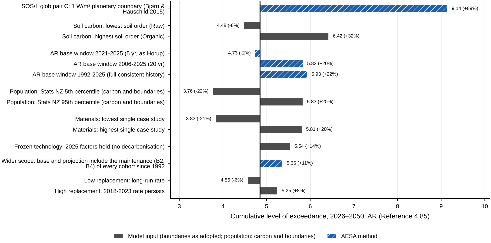

**H11.** One-at-a-time sensitivities of the cumulative acquired-rights level of exceedance; bars are not additive and not a joint interval. The 8 parameters with the largest effect on the cumulative LoE AR (Reference 4.85), both ends of a paired parameter shown; every row: outputs/headline/H11_sensitivity.csv (AtP: D18). Model-input rows hold the boundaries as adopted (the boundaries depend on the population path and the AESA method only), as the AESA sensitivity rows of the same runs; the population rows move the carbon and both boundaries together.

Files: [H11_sensitivity.png](H11_sensitivity.png), [H11_sensitivity.pdf](H11_sensitivity.pdf), source data [H11_sensitivity.csv](H11_sensitivity.csv). Data (outputs/): data/baseline/sensitivity_one_at_a_time.csv, data/aesa/sensitivity.csv, data/aesa/results.json (population paths).

