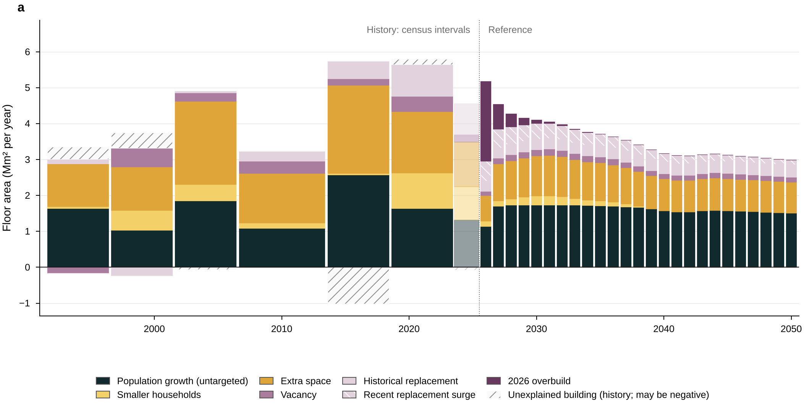
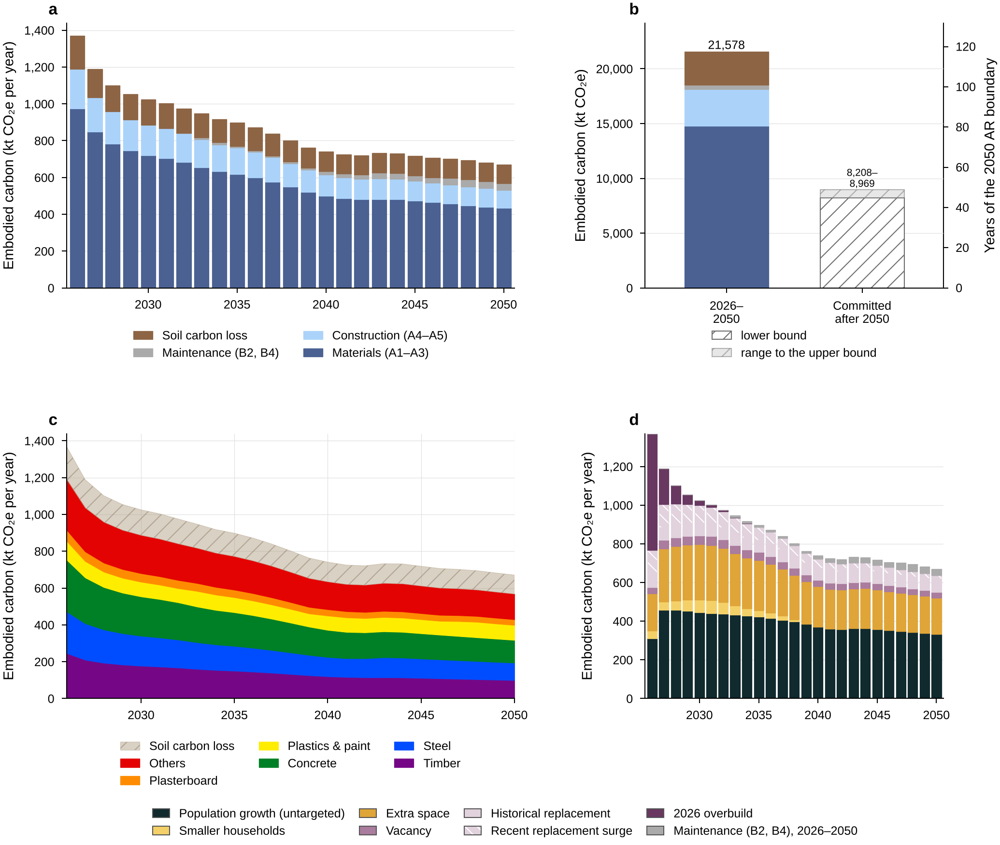
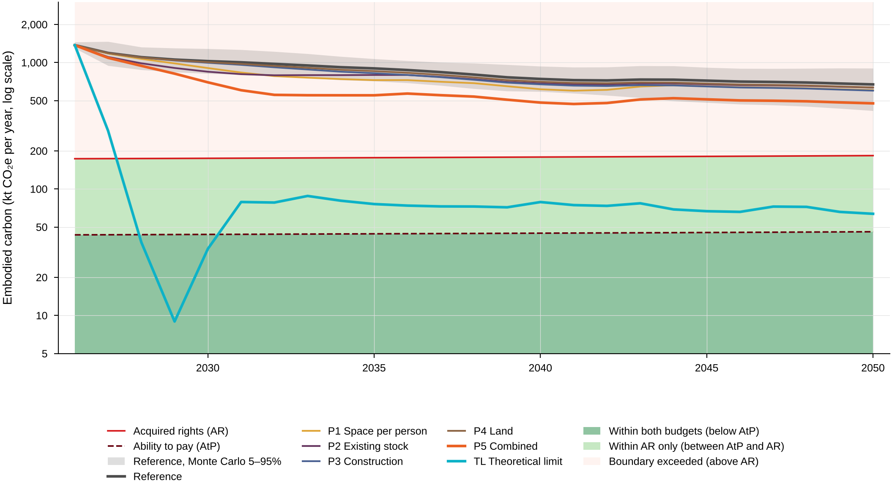
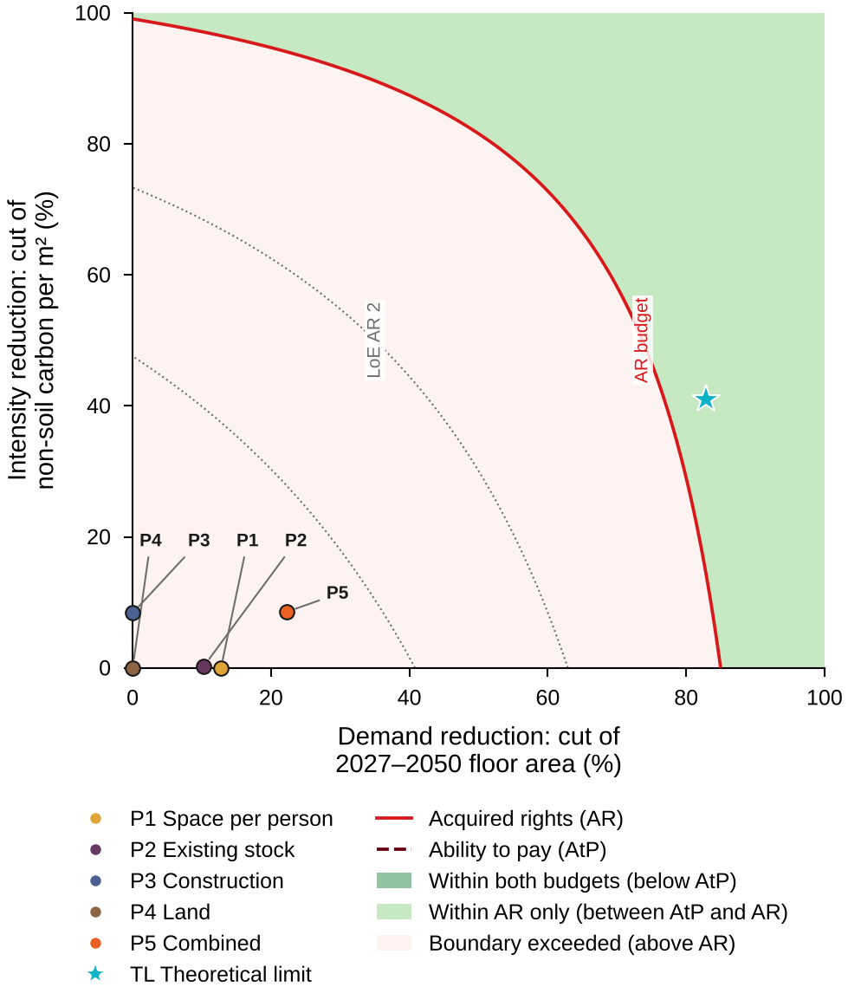
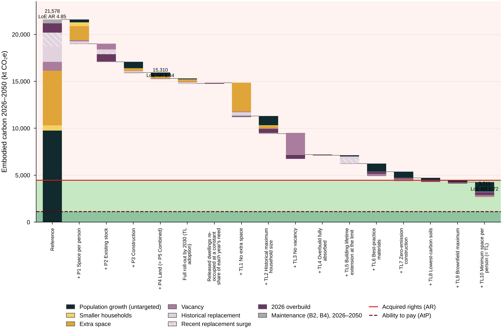
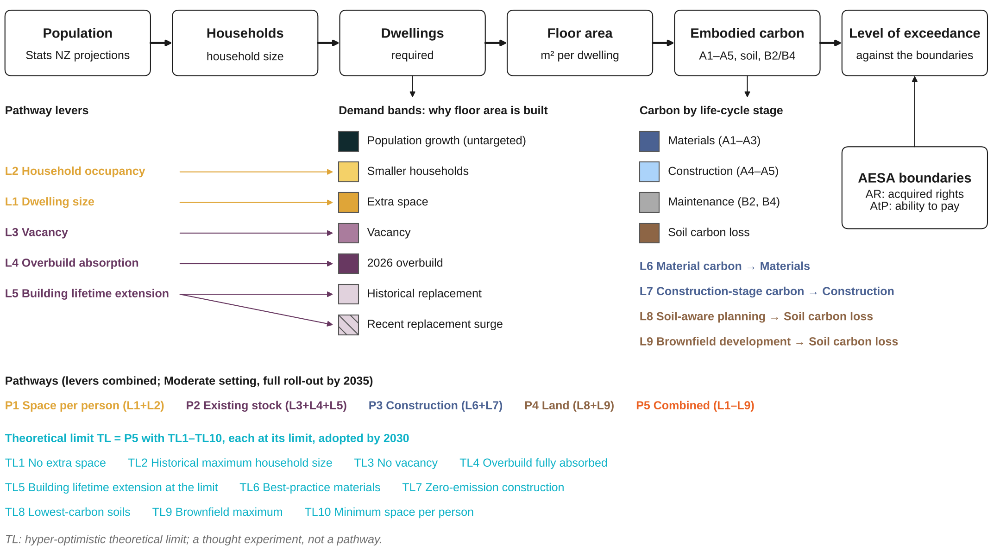

# Key figures

_Generated by key_figures.py from outputs/data/ (do not edit by hand): the story of the model in six figures. PNG 300 dpi; with run_all.py --export also vector PDF and source data. The paper figures: ../paper/PAPER.md; Extended Data: ../extended_data/EXTENDED_DATA.md._

## K1. Why floor area is built

**K1.** Floor area by demand band: history per census interval and the Reference projection 2026–2050. Population growth, the only untargeted band, is 45% of the 89.6 million m² built in 2026–2050. History: interval means between censuses; the hatched band is the building that household formation, vacancy and census-measured replacement leave unexplained.

Files: [K1_demand_bands.png](K1_demand_bands.png) (PDF and source data: run_all.py --export). Data (outputs/): data/baseline/bands_history.csv, data/baseline/bands_annual.csv.

## K2. Embodied carbon of the Reference

**K2.** Reference carbon 2026–2050 by life-cycle stage, by material and by demand band, and the emissions committed after 2050. (a) By stage and (b) cumulative: 21,578 kt CO₂e in 2026–2050 and a further 8,208–8,969 kt committed after 2050 (hatched; not part of the level of exceedance). (c) By material, soil carbon loss on top. (d) By demand band, maintenance its own layer.

Files: [K2_reference_carbon.png](K2_reference_carbon.png) (PDF and source data: run_all.py --export). Data (outputs/): data/baseline/annual_by_stage.csv, data/baseline/annual_by_material.csv, data/baseline/bands_annual.csv, data/pathways/runs.csv.

## K3. Annual emissions against the boundaries

**K3.** Annual embodied carbon of the Reference (Monte Carlo 5–95% band), P1-P5 (Moderate) and TL against the AR and AtP boundaries. TL: hyper-optimistic theoretical limit; a thought experiment, not a pathway; every lever at its limit, adopted by 2030. Log scale. TL: every lever at its limit, adopted by 2030; dwellings released by zero vacancy, the household-size change and the 2026 overbuild are re-occupied gradually, meeting a constant share (~37%) of each year's need; 2026 observed. TL builds 9,352 dwellings in 2027 (at least 929 a year in 2027–2050). Shading: below AtP (darker green), between AtP and AR (light green), above AR (light red, boundary exceeded).

Files: [K3_annual_emissions.png](K3_annual_emissions.png) (PDF and source data: run_all.py --export). Data (outputs/): data/pathways/annual.csv, data/aesa/montecarlo_annual.csv, data/pathways/theoretical_limit.json.

## K4. Solution space

**K4.** Cumulative LoE AR over uniform cuts of 2027–2050 floor area and non-soil carbon per m², in the boundary zones; P1-P5 (Moderate) and TL at their effective coordinates. Cutting 2027–2050 construction alone by 85.0% would bring the Reference to LoE AR = 1 (back-cast); P5 sits at 22% demand and 9% intensity reduction, TL at 83% and 41% (at these coordinates the plane reads LoE AR 0.82; the TL run, with its lower soil carbon, 0.72). LoE AtP = 1 (LoE AR 0.25) is not reachable on the plane: the observed 2026 cohort alone, which no cut changes, gives LoE AR 0.32 (LoE AtP 1.28). Contours: the exact bilinear LoE of the plane, read from the 5% grid (outputs/data/pathways/solution_space.csv).

Files: [K4_solution_space.png](K4_solution_space.png) (PDF and source data: run_all.py --export). Data (outputs/): data/pathways/solution_space.csv, data/pathways/backcast.json, data/pathways/theoretical_limit.json.

## K5. From the Reference to the theoretical limit

**K5.** Sequential waterfall of carbon 2026–2050, each step segmented by its exact demand-band deltas: Reference -> P1 -> P2 -> P3 -> P4 (= P5 Combined, Moderate) -> full roll-out by 2030 -> released dwellings re-occupied at a constant share of need -> TL1 ... TL10 (= TL), against the cumulative budgets. Sequential steps depend on the order; the order-free Shapley values are in Table 2, ED8 and ED9. TL: hyper-optimistic theoretical limit; a thought experiment, not a pathway; every lever at its limit, adopted by 2030. Reference 21,578 kt (LoE AR 4.85), P5 15,310 kt (3.44), TL 3,211 kt (0.72); cumulative AR budget 4,451 kt, AtP 1,113 kt. A segment above its step's start marks a band that grows at that step (a lever shifts building between bands). From the re-occupation step on, the 2026-overbuild band also carries the re-occupation of released dwellings (zero vacancy, the household-size change and the absorbed overbuild) at a constant share of each year's need. TL: every lever at its limit, adopted by 2030; dwellings released by zero vacancy, the household-size change and the 2026 overbuild are re-occupied gradually, meeting a constant share (~37%) of each year's need; 2026 observed.

Files: [K5_band_waterfall.png](K5_band_waterfall.png) (PDF and source data: run_all.py --export). Data (outputs/): data/pathways/waterfall_sequential.csv.

## K6. Levers, pathways and the theoretical limit

**K6.** The nine levers (L1-L9) by the demand band or quantity they target, grouped into P1-P4 and combined in P5; TL1-TL10 at the end of the same arrows. Arrows: the demand band or carbon quantity each lever acts on; colours: the pathway family (lever shades in the other figures). Hyper-optimistic theoretical limit; a thought experiment, not a pathway.

Files: [K6_schematic.png](K6_schematic.png) (PDF and source data: run_all.py --export). Data (outputs/): naming.py, levers.py (structure only; no numbers).

