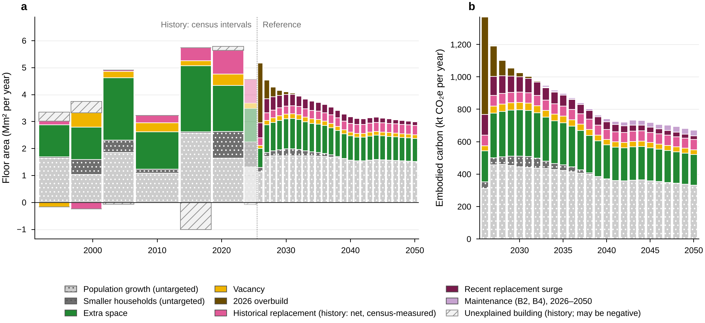
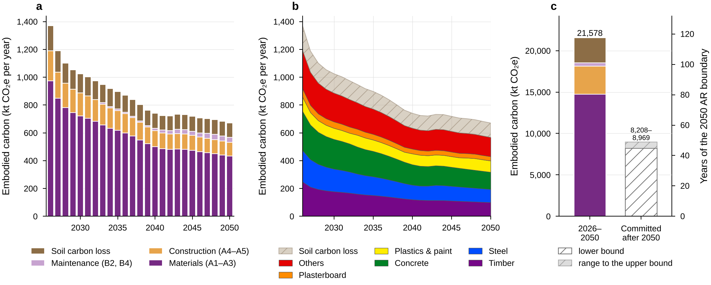
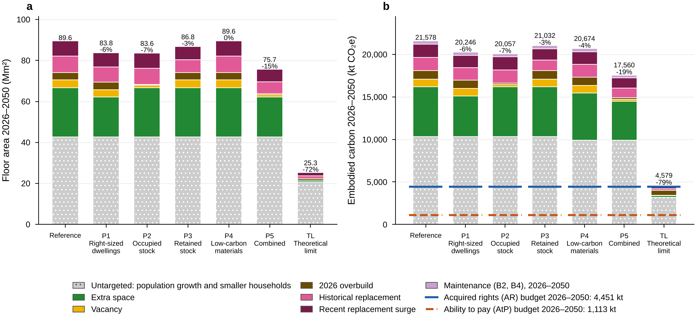
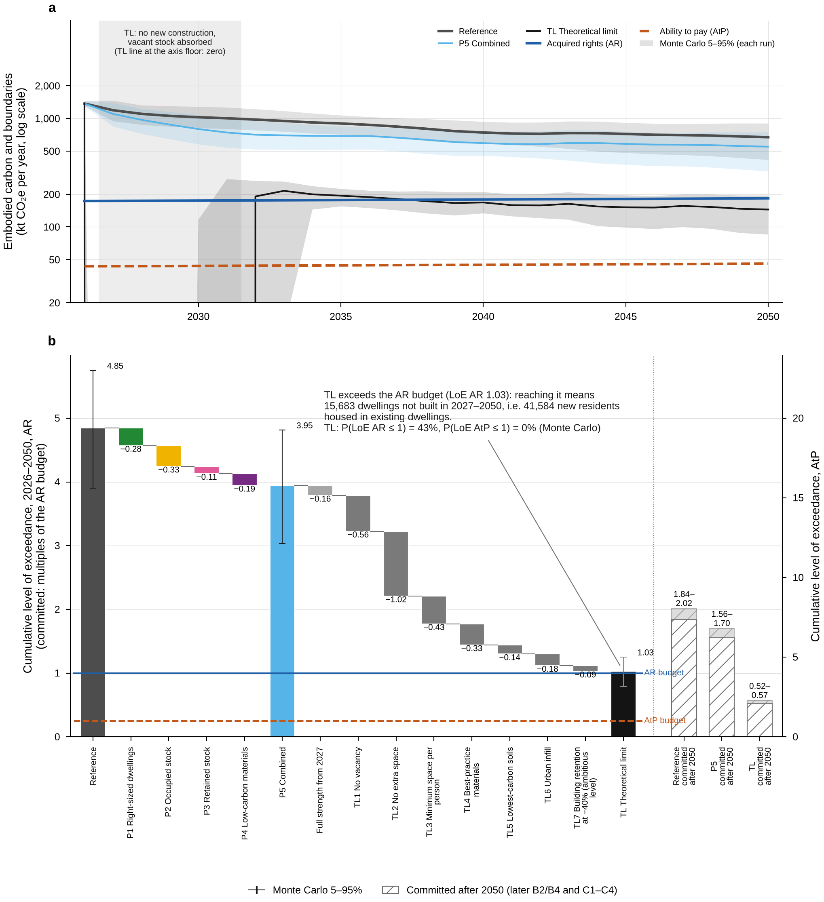
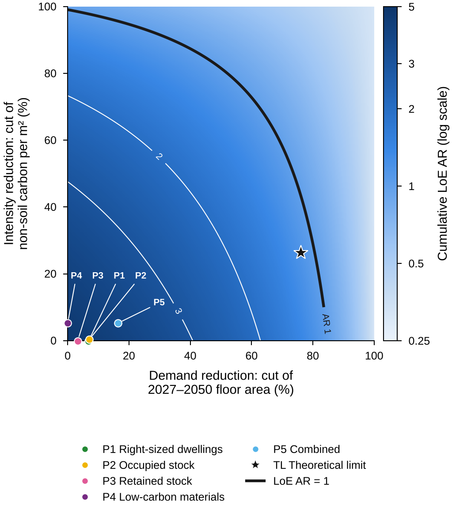

# Paper: headline findings, figures and tables

_Generated by paper.py from outputs/data/ (do not edit by hand). Figures: PNG 300 dpi and vector PDF at Nature widths (89 mm single, 183 mm double column); the source data of every figure (every plotted value) in the CSV of the same name. P1–P5 are at the Moderate setting with full roll-out by 2035; other settings are in Extended Data (../extended_data/EXTENDED_DATA.md). Vocabulary: docs/RENAMING.md; palette: docs/PALETTE.md._

## Findings

1. New Zealand builds 89.6 million m² of new residential floor area in 2026–2050 in the Reference (Monte Carlo 90% interval 69.1–109.9); 48% of it serves population growth and smaller households, which no construction pathway targets. (Source: data/pathways/runs.csv, data/montecarlo/summary_REF.csv, data/baseline/bands_annual.csv.)
2. Its embodied carbon is 21,578 kt CO₂e within 2026–2050 (Monte Carlo 16,678–26,596; materials A1–A3 14,760 kt), with a further 8,208–8,969 kt committed after 2050, 45–49 years of the 2050 acquired-rights boundary. (Source: data/baseline/annual_by_stage.csv, data/aesa/results.json, data/pathways/montecarlo_summary.csv.)
3. This exceeds the sector's share of the 2 °C carrying capacity 4.85-fold by acquired rights (Monte Carlo 3.90–5.75) and 19.4-fold by ability to pay (15.5–23.1); the two principles are reported side by side, never averaged. (Source: data/pathways/runs.csv, data/pathways/montecarlo_summary.csv.)
4. Combining the four pathways (P5, Moderate, full roll-out by 2035) lowers carbon 2026–2050 by 19%: the cumulative LoE AR falls from 4.85 to 3.95 (Monte Carlo 3.03–4.81), far above the acquired-rights budget. (Source: data/pathways/runs.csv, data/pathways/montecarlo_summary.csv.)
5. Even the hyper-optimistic theoretical limit (TL; a thought experiment, not a pathway) reaches only LoE AR 1.03 (Monte Carlo 0.79–1.25; P(LoE AR ≤ 1) = 43%) and LoE AtP 4.1 (P(LoE AtP ≤ 1) = 0%); reaching the AR budget means not building 15,683 dwellings in 2027–2050, i.e. housing 41,584 new residents in existing dwellings. (Source: data/pathways/runs.csv, data/pathways/montecarlo_summary.csv, data/pathways/theoretical_limit.json.)
6. Of the gap between P5 and TL, the largest contributions are removing the extra space (TL2, 1.02 of LoE AR) and the vacancy (TL1, 0.56); starting at full strength in 2027 adds 0.16. (Source: data/pathways/shapley_theoretical_limit_moderate.csv.)
7. No cut of 2027–2050 floor area or carbon per m² reaches the ability-to-pay budget: the observed 2026 cohort alone gives a cumulative LoE AtP of 1.28. (Source: data/pathways/solution_space.csv, data/pathways/runs.csv.)

## Figures

### Fig1. How the model works

**Fig1.** Model structure. A bottom-up chain converts population and household projections into dwellings required, floor area by reason for building (demand bands) and embodied carbon, which is compared with two allocations of a global carrying capacity (acquired rights, AR; ability to pay, AtP). Pathway levers act on the band or quantity they target; population growth and smaller households are untargeted by design.

Files: [Fig1_model_schematic.png](Fig1_model_schematic.png), [Fig1_model_schematic.pdf](Fig1_model_schematic.pdf), source data [Fig1_model_schematic.csv](Fig1_model_schematic.csv). Data: naming.py, levers.py (structure only; no numbers).

### Fig2. Why floor area is built

**Fig2.** Floor area and carbon by reason for building. Bands sum to the in-scope total. Population growth and smaller households are untargeted; extra space, vacancy, the 2026 overbuild, historical replacement and the recent replacement surge are the bands the pathways act on. Over 2026–2050 the untargeted bands are 48% of the 89.6 million m² built (a) and 48% of the carbon (b). History (a): interval means between censuses (vacancy on one definition, the pooled 2018/2023 empty share); the net replacement is census-measured (the census-interval rate of the dwelling-count identity × the previous year's stock) and the hatched band is the building that household formation, vacancy and census-measured replacement leave unexplained (it may be negative); the faint column after the latest census uses consent-derived households. Retirement villages (out of scope) are removed from every band in proportion. (b): maintenance (B2, B4) within 2026–2050 is its own layer.

Files: [Fig2_demand_bands.png](Fig2_demand_bands.png), [Fig2_demand_bands.pdf](Fig2_demand_bands.pdf), source data [Fig2_demand_bands.csv](Fig2_demand_bands.csv). Data (outputs/): data/baseline/bands_history.csv, data/baseline/bands_history_replacement_split.csv, data/baseline/bands_annual.csv.

### Fig3. Embodied carbon of the Reference

**Fig3.** Embodied carbon of new residential construction in the Reference. Materials (A1–A3), construction (A4–A5) and soil carbon loss are counted in the construction year, maintenance (B2, B4) in the year it occurs within 2026–2050; later events and end of life are committed after 2050 (c, hatched). Of the 21,578 kt CO₂e emitted in 2026–2050, materials (A1–A3) are 14,760 kt, construction (A4–A5) 3,364 kt, maintenance 403 kt and soil carbon loss 3,050 kt (a); by material (b) each material includes its maintenance within 2026–2050. A further 8,208–8,969 kt is committed after 2050 (later B2/B4 and C1–C4 of the 2026–2050 cohorts; lower bound with the 2050 factors held, upper bound at 2025 factors), 45–49 years of the 2050 acquired-rights boundary (183 kt a year; right axis of c). The committed emissions are not part of the level of exceedance 2026–2050.

Files: [Fig3_reference_carbon.png](Fig3_reference_carbon.png), [Fig3_reference_carbon.pdf](Fig3_reference_carbon.pdf), source data [Fig3_reference_carbon.csv](Fig3_reference_carbon.csv). Data (outputs/): data/baseline/annual_by_stage.csv, data/baseline/annual_by_material.csv, data/aesa/results.json.

### Fig4. What each pathway removes, by demand band

**Fig4.** Pathways by demand band (each pathway at its Moderate setting, full roll-out by 2035). Each pathway acts on the bands it targets; P4 lowers carbon per m² of every band. TL: hyper-optimistic theoretical limit; a thought experiment, not a pathway. P5 Combined lowers carbon 2026–2050 by 19% against the Reference and TL by 79%. Bottom segment (grey, dotted): the untargeted bands (population growth and smaller households), which no pathway acts on; negative bands (below zero) release existing dwellings; maintenance (B2, B4) within 2026–2050 is its own layer in b. Labels: total and change against the Reference. Short lines in b: the cumulative AR and AtP budgets 2026–2050.

Files: [Fig4_pathways_bands.png](Fig4_pathways_bands.png), [Fig4_pathways_bands.pdf](Fig4_pathways_bands.pdf), source data [Fig4_pathways_bands.csv](Fig4_pathways_bands.csv). Data (outputs/): data/pathways/bands.csv, data/pathways/runs.csv.

### Fig5. Emissions against the boundaries, and what closes the gap

**Fig5.** Absolute sustainability of the Reference, P5 Combined and the theoretical limit. TL: hyper-optimistic theoretical limit; a thought experiment, not a pathway. (a) Annual embodied carbon against the annual AR and AtP boundaries (log scale), with the Monte Carlo 5–95% band of each run (5,000 Latin-hypercube draws of the Reference, each also run through P5 and TL with the levers applied identically and the TL targets held at their absolute values). In 2027–2031 TL builds nothing (banking rule: the vacant stock released by TL1 absorbs the requirement); its true value, zero, is drawn at the axis floor. In 2050 the Reference emits 671 kt, P5 548 kt and TL 145 kt against an AR boundary of 183 kt and an AtP boundary of 46 kt. (b) Order-free attribution (Shapley values, exact) of the cumulative LoE AR 2026–2050: the four pathways (Moderate; they add up exactly to Reference − P5), the effect of starting P5 at full strength in 2027 (0.16; a separate line, not a Shapley player) and TL1–TL7 relative to P5 at full strength from 2027 (128 subsets; they add up exactly to that run − TL). Right axis: the same quantity as a cumulative AtP level of exceedance (×4.00; the budgets of every run are the Reference's). Whiskers: Monte Carlo 5–95% (Reference 3.90–5.75, P5 3.03–4.81, TL 0.79–1.25); P(LoE AR ≤ 1) for TL 43.4%, P(LoE AtP ≤ 1) 0.0%. Hatched bars: emissions committed after 2050, in multiples of the cumulative AR budget 2026–2050 (not part of the level of exceedance). TL needs a further 4.1% cut of 2027–2050 construction to reach the AR budget.

Files: [Fig5_boundaries_attribution.png](Fig5_boundaries_attribution.png), [Fig5_boundaries_attribution.pdf](Fig5_boundaries_attribution.pdf), source data [Fig5_boundaries_attribution.csv](Fig5_boundaries_attribution.csv). Data (outputs/): data/pathways/annual.csv, data/pathways/montecarlo_annual.csv, data/aesa/montecarlo_annual.csv, data/pathways/shapley_pathways.csv, data/pathways/shapley_theoretical_limit_moderate.csv, data/pathways/montecarlo_summary.csv, data/pathways/runs.csv, data/pathways/theoretical_limit.json.

### Fig6. Solution space: demand and intensity

**Fig6.** Solution space (after Horup et al. 2025, Fig. 6). Markers sit at each run's effective reductions of 2027–2050 floor area and non-soil carbon per m²; TL also lowers soil carbon (TL5, TL6), which the plane does not show. Cutting 2027–2050 construction alone by 85.0% would bring the Reference to LoE AR = 1 (back-cast); P5 sits at 16% demand and 5% intensity reduction, TL at 76% and 26% (at these coordinates the plane reads LoE AR 1.16; the TL run, with its lower soil carbon, 1.03). LoE AtP = 1 (LoE AR 0.25) is not reachable on the plane: the observed 2026 cohort alone, which no cut changes, gives LoE AR 0.32 (LoE AtP 1.28). Contours: the exact bilinear LoE of the plane, read from the 5% grid (outputs/data/pathways/solution_space.csv).

Files: [Fig6_solution_space.png](Fig6_solution_space.png), [Fig6_solution_space.pdf](Fig6_solution_space.pdf), source data [Fig6_solution_space.csv](Fig6_solution_space.csv). Data (outputs/): data/pathways/solution_space.csv, data/pathways/backcast.json, data/pathways/theoretical_limit.json.

## Tables

### Table 1. Levers and the theoretical-limit assumptions

Moderate is the setting of the paper; Ambitious is reported in Extended Data. TL: hyper-optimistic theoretical limit; a thought experiment, not a pathway.

| item | pathway | demand band targeted | how it works (model terms) | assumption | Moderate (paper) / TL value | Ambitious (Extended Data) | source | tag |
|---|---|---|---|---|---|---|---|---|
| L1 Dwelling size | P1 Right-sized dwellings | Extra space (and the dwelling size of every band except Population growth) | size_t(y) = occ_t(y) + [1 - f w(y)] (size_ref_t - occ_t(y)), occ_t = S(y) x OLF_t (engine `size`): a share f of the extra-space margin (new-dwelling size - occupied area) is removed; full strength in 2035, f constant to 2050, so sizes then follow S(y) | new dwellings keep the occupied area S x OLF of the engine; only the space above it shrinks | f = 0.25; 2050: Detached 158.9 m² (-11.5%), Townhouses 102.8 m² (-4.6%), Apartments 87.2 m² (-11.1%) | f = 0.50; 2050: Detached 138.1 m² (-23.1%), Townhouses 97.8 m² (-9.2%), Apartments 76.4 m² (-22.1%) | DECISION (author): f; benchmarks Pellan M, et al. (2024) Building and Environment 256, 111505, Table 2 (individual dwellings 107 -> 100 m², -6.5%); Pauliuk S, et al. (2024) Journal of Industrial Ecology 28, 1699 (LEMD EU_UK 37.7 -> 31.2 m²/cap, -17%) | DECISION |
| L2 Vacancy rate | P2 Occupied stock | Vacancy (including the change in the vacancy rate) | v(y) = v0 + w(y)(v* - v0) (engine `v`); while v falls the vacancy-change term of the stock identity releases existing dwellings once | consistent definition: the pooled 2018/2023 empty share of unoccupied dwellings (49.2%) applied to every census; 4.0% is the lowest NZ vacancy rate on that definition in 1986–2023 (1996: 4.01%) | 5.39% -> 4.7% (midpoint of the 1986–2023 range 4.01% (1996) - 5.38% (2023)) | -> 4.0% (range minimum) | DATA: Stats NZ censuses 1986–2023 (data/derived/census_dwellings.csv, data/occ-unocc-2013.xlsx) | DATA |
| L3 Overbuild absorption | P2 Occupied stock | 2026 overbuild | engine.market_excess(..., surplus, absorption a): a share a of the remaining 2026 overbuild is absorbed each year (`join`) | the 2026 observed building stays; later building is lower by the absorbed overbuild | a = 0.10 a year | a = 0.20 a year | DECISION (author): the absorption sensitivities of the 2026 overbuild in the projection (projection.OVERBUILD_ABSORPTION 0.10 / 0.20) | DECISION |
| L4 Building retention | P3 Retained stock | Historical replacement and Recent replacement surge | demolition x (1 - w d); recent-surge component of the residual x (1 - w d) (`rate_demol`, `rate_unc`); the long-run residual untouched | renovation carbon of the kept stock not modelled (upper bound; Napiontek et al. 2025, Resources, Conservation and Recycling 215, 108117) | d = 20% | d = 40% | LITERATURE: Pellan M, et al. (2024) Building and Environment 256, 111505 (demolition 150,000 -> 90,000 a year, -40%); Pauliuk S, et al. (2024) Journal of Industrial Ecology 28, 1699 (lifetime extension up to +90%) | LITERATURE |
| L5 Material carbon | P4 Low-carbon materials | None: carbon per m² (A1–A3) of every band | A1–A3(y) = [1 - w(y)(1 - r)] (A1-A3_2025 - decarbonisation reduction(y)) (`intensity`, A1–A3 term only); r = Harrell-Davis quantile of the case ratios A1-A3_i / pooled typology A1–A3 | the same r for all typologies (apartments held as a sensitivity); decarbonisation on top; A4–A5, B events, C1–C4 and soil unchanged | q = 0.25: r = 0.916 (95% CI 0.743–0.980), n = 14 | q = 0.15: r = 0.827 (0.606–0.951) | DATA: Christoforatos G, Pickering K (2025) Smart and Sustainable Built Environment, doi:10.1108/SASBE-06–2025–0304; Harrell FE, Davis CE (1982) Biometrika 69, 635–640; top-15% convention of Commission Delegated Regulation (EU) 2021/2139, Annex I s. 7.7 | DATA / LITERATURE |
| TL1 No vacancy | TL (replaces P2) | Vacancy (including the change in the vacancy rate); 2026 overbuild | v = 0 from 2027 (`v`); the 2026 overbuild absorbed in full; banking rule: built_t = max(0, raw_t - bank_(t-1)), unused release carried forward; stock-adding join = built - requirement | every vacant dwelling usable where needed, reallocated from 1 January 2027 | v = 0; absorption 1 |  | DECISION (author): theoretical limit of L2 / L3 | DECISION |
| TL2 No extra space | TL (replaces P1) | Extra space (and the dwelling size of every band except Population growth) | L1 with f = 1: size = occupied area S(t) x OLF (TL3's OLF) (`size`) | no space above the occupied area | f = 1 (2050 size 52.2 m² with TL3) |  | DECISION (author): theoretical limit of L1 | DECISION |
| TL3 Minimum space per person | TL | Occupied area of every band (population growth and extra space) | OLF of every new building = the lowest design OLF (floor area / design occupants) of the independent case studies (`olf`, all typologies) | an apartment-block occupancy applied to every typology | 19.69 m²/person (A_1); replaces Detached 36.46, Townhouses 33.11, Apartments 20.63 |  | DATA: Christoforatos G, Pickering K (2025) Smart and Sustainable Built Environment, doi:10.1108/SASBE-06–2025–0304 (data/building_data.xlsx; duplicate A_2 excluded) | DATA |
| TL4 Best-practice materials | TL (replaces P4) | None: carbon per m² (A1–A3) of every band | each typology's A1–A3 per m² at its own best independent case, on top of decarbonisation (as L5) | the best observed design of each typology built everywhere | Detached r = 0.530 (SD_2), Townhouses r = 0.880 (T_2), Apartments r = 1.000 (held: one independent case) |  | DATA: case studies (outputs/data/factors/factors_building.csv, 2025 factors) | DATA |
| TL5 Lowest-carbon soils | TL | Soil carbon loss of the non-replacement floor area | soil factor at the lowest soil order (SOC_low), applied exactly through the soil-bearing share | the lowest of 10 soil orders under every new footprint | Detached 22.9 (vs 50.1), Townhouses 13.8 (vs 30.3), Apartments 2.5 (vs 5.5) kg CO₂e/m² |  | DATA: Christoforatos G, Pickering K, Schipper LA (2026) Journal of Environmental Management 415, 130603 (the existing lower-bound sensitivity) | DATA |
| TL6 Urban infill | TL | Soil carbon loss of the non-replacement floor area | a share s of each year's non-replacement new floor area 2027–2050 is on previously developed land (zero soil carbon loss); the rest carries the TL5 factor: soil factor x (1 - s) on the soil-bearing floor area | (i) Auckland's observed share applied nationally (demonstrated-limit logic, as TL3 / TL4); (ii) a dwelling-count share applied to floor area; (iii) intensification on developed land seals no additional soil (upper bound: some infill builds over garden soil); (iv) replacement floor area keeps its existing zero-soil treatment; (v) the soil factor on the remaining share is TL5's lowest soil order | s = 0.82 x 0.79 = 0.648, rounded 0.65 |  | DATA: Auckland Council (2021). Auckland Plan 2050 Development Strategy Monitoring Report, December 2021: in 2020/21, 82% of dwelling consents were in the existing urban area, of which 79% occurred through intensification (Auckland monitoring); DECISION (author): national application | DATA + DECISION |
| TL7 Building retention at −40% (ambitious level) | TL (relative to P5 Moderate) | Historical replacement and Recent replacement surge | L4 at its Ambitious reduction d = 0.40 (`rate_demol`, recent-surge component of `rate_unc`), from 2027; the element of P5 Ambitious that TL1-TL6 do not replace | demolition and the recent replacement surge reduced by 40% (Pellan et al. 2024: 150,000 -> 90,000 demolitions a year) | d = 0.40 (P5 Moderate: 0.20) |  | LITERATURE: Pellan2024 (the Ambitious level of L4) | LITERATURE |

File: [Table1_levers.csv](Table1_levers.csv). Full text with the adoption rule: ../reports/LEVERS_TABLE.md.

### Table 2. Results 2026–2050: the Reference, P1–P5 and TL

P1–P5 at the Moderate setting, full roll-out by 2035. In brackets: Monte Carlo 5–95% (5,000 draws of the Reference, each also run through P5 and TL). P(LoE ≤ 1): share of the draws at or below the budget. Committed after 2050: lower–upper bound, not part of the level of exceedance.

| run | floor area 2026–2050 (Mm²) | carbon 2026–2050 (kt CO₂e) | change vs Reference | committed after 2050 (kt CO₂e) | cumulative LoE AR | cumulative LoE AtP | P(LoE ≤ 1), AR / AtP |
|---|---|---|---|---|---|---|---|
| Reference | 89.6 | 21,578 (16,678–26,596) | – | 8,208–8,969 | 4.85 (3.90–5.75) | 19.4 (15.5–23.1) | – |
| P1 Right-sized dwellings | 83.8 | 20,246 | -6.2% | 7,675–8,386 | 4.55 | 18.2 | – |
| P2 Occupied stock | 83.6 | 20,057 | -7.0% | 7,672–8,384 | 4.51 | 18.0 | – |
| P3 Retained stock | 86.8 | 21,032 | -2.5% | 7,952–8,689 | 4.73 | 18.9 | – |
| P4 Low-carbon materials | 89.6 | 20,674 | -4.2% | 8,208–8,969 | 4.64 | 18.6 | – |
| P5 Combined | 75.7 | 17,560 (12,975–22,332) | -18.6% | 6,936–7,579 | 3.95 (3.03–4.81) | 15.8 (12.1–19.3) | – |
| TL Theoretical limit | 25.3 | 4,579 (3,383–5,800) | -78.8% | 2,330–2,548 | 1.03 (0.79–1.25) | 4.1 (3.2–5.0) | 43.4% / 0.0% |

File: [Table2_results.csv](Table2_results.csv).
