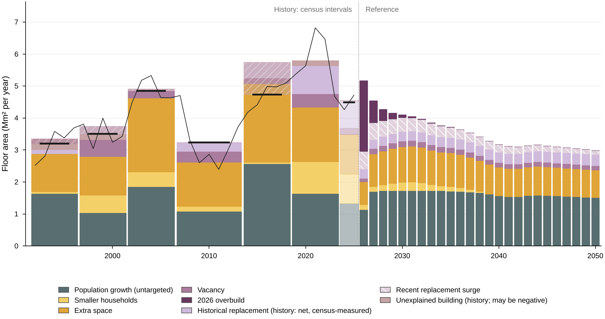
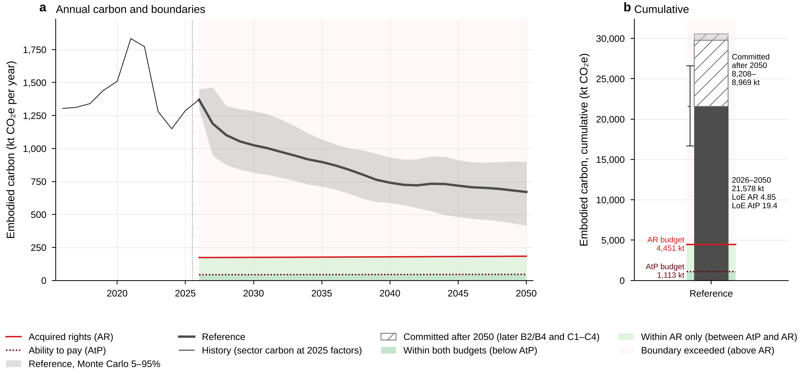
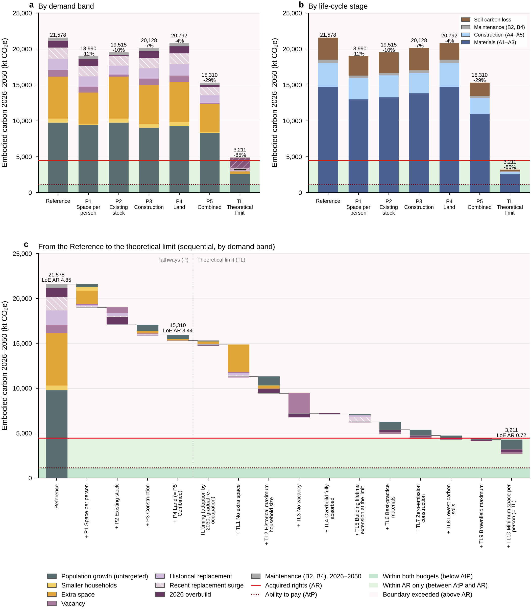
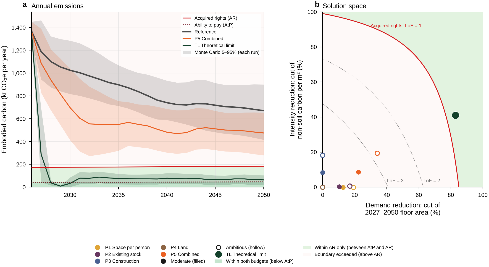

# Paper: headline findings, figures and tables

_Generated by paper.py from outputs/data/ (do not edit by hand). Figures: PNG 300 dpi and vector PDF at Nature widths (89 mm single, 183 mm double column); the source data of every figure (every plotted value) in the CSV of the same name. P1–P5 are at the Moderate setting with full roll-out by 2035; other settings are in Extended Data (../extended_data/EXTENDED_DATA.md). Vocabulary: docs/RENAMING.md; palette: docs/PALETTE.md._

## Findings

1. New Zealand builds 89.6 million m² of new residential floor area in 2026–2050 in the Reference (Monte Carlo 90% interval 69.1–109.9); 45% of it serves population growth, the only demand no pathway targets. (Source: data/pathways/runs.csv, data/montecarlo/summary_REF.csv, data/baseline/bands_annual.csv.)
2. Its embodied carbon is 21,578 kt CO₂e within 2026–2050 (Monte Carlo 16,678–26,596; materials A1–A3 14,760 kt), with a further 8,208–8,969 kt committed after 2050, 45–49 years of the 2050 acquired-rights boundary. (Source: data/baseline/annual_by_stage.csv, data/aesa/results.json, data/pathways/montecarlo_summary.csv.)
3. This exceeds the sector's share of the 2 °C carrying capacity 4.85-fold by acquired rights (Monte Carlo 3.90–5.75) and 19.4-fold by ability to pay (15.5–23.1); the two principles are reported side by side, never averaged. (Source: data/pathways/runs.csv, data/pathways/montecarlo_summary.csv.)
4. Combining the four pathways (P5, Moderate, full roll-out by 2035) lowers carbon 2026–2050 by 29%: the cumulative LoE AR falls from 4.85 to 3.44 (Monte Carlo 2.36–4.43; P(LoE AR ≤ 1) = 0%), far above the acquired-rights budget. (Source: data/pathways/runs.csv, data/pathways/montecarlo_summary.csv.)
5. The hyper-optimistic theoretical limit (TL; a thought experiment with every lever at its limit, adopted by 2030, not a pathway) reaches LoE AR 0.72 (Monte Carlo 0.45–0.98; P(LoE AR ≤ 1) = 96.0%), within the acquired-rights budget by 1,240 kt, but LoE AtP 2.9 (P(LoE AtP ≤ 1) = 0%); it re-occupies all vacant dwellings and returns to the 1991 household size, the released dwellings meeting 37% of each year's need. (Source: data/pathways/runs.csv, data/pathways/montecarlo_summary.csv, data/pathways/theoretical_limit.json.)
6. Of the gap between P5 and TL, the largest contributions are TL1 no extra space (0.61 of LoE AR) and TL3 no vacancy (0.43); TL's faster adoption (by 2030 instead of 2035) lowers it by 0.12, and re-occupying released dwellings gradually, at a constant share of each year's need, raises it by 0.02. (Source: data/pathways/shapley_theoretical_limit.csv.)
7. No cut of 2027–2050 floor area or carbon per m² reaches the ability-to-pay budget: the observed 2026 cohort alone gives a cumulative LoE AtP of 1.28. (Source: data/pathways/solution_space.csv, data/pathways/runs.csv.)

## Figures

### Fig1. How the model works

**Fig1.** Model structure. A bottom-up chain converts population and household projections into dwellings required, floor area by reason for building (demand bands) and embodied carbon, which is compared with two allocations of a global carrying capacity (acquired rights, AR; ability to pay, AtP). Pathway levers act on the band or quantity they target; only population growth is untargeted by design.

Files: [Fig1_model_schematic.png](Fig1_model_schematic.png) (PDF and source data: run_all.py --export). Data: naming.py, levers.py (structure only; no numbers).

### Fig2. Why floor area is built

**Fig2.** Floor area by reason for building. Bands sum to the in-scope total. Only population growth is untargeted; smaller households, extra space, vacancy, the 2026 overbuild, historical replacement and the recent replacement surge are the bands the pathways act on. Over 2026–2050 the untargeted band (population growth) is 45% of the 89.6 million m² built. History: interval means between censuses (vacancy on one definition, the pooled 2018/2023 empty share); the net replacement is census-measured (the census-interval rate of the dwelling-count identity × the previous year's stock) and the faded red band is the building that household formation, vacancy and census-measured replacement leave unexplained (it may be negative); the faint column after the latest census uses consent-derived households. The thin line is the observed floor area built each year (consented floor area timed as completions, as the model uses it); each history column is its interval mean. Retirement villages (out of scope) are removed from every band in proportion. Negative: dwellings released by lower vacancy replace new building (a negative band is drawn down from the top of the stack, so each column ends at its net total, marked by a short tick).

Files: [Fig2_floor_area_bands.png](Fig2_floor_area_bands.png) (PDF and source data: run_all.py --export). Data (outputs/): data/baseline/bands_history.csv, data/baseline/bands_history_replacement_split.csv, data/baseline/bands_annual.csv, data/baseline/annual.csv.

### Fig3. Embodied carbon of the Reference

**Fig3.** Embodied carbon of new residential construction in the Reference, per year. Materials (A1–A3), construction (A4–A5) and soil carbon loss are counted in the construction year, maintenance (B2, B4) in the year it occurs within 2026–2050. Of the 21,578 kt CO₂e emitted in 2026–2050, materials (A1–A3) are 14,760 kt, construction (A4–A5) 3,364 kt, maintenance 403 kt and soil carbon loss 3,050 kt (b); by material (c) each material includes its maintenance within 2026–2050; by demand band (a) maintenance is its own layer. The emissions committed after 2050 are in Fig4 b. Negative: dwellings released by lower vacancy replace new building (drawn down from the top of the stack; the bar ends at its net total, marked by a short tick).

Files: [Fig3_reference_carbon.png](Fig3_reference_carbon.png) (PDF and source data: run_all.py --export). Data (outputs/): data/baseline/bands_annual.csv, data/baseline/annual_by_stage.csv, data/baseline/annual_by_material.csv.

### Fig4. The Reference against the boundaries

**Fig4.** Absolute sustainability of the Reference. (a) Annual embodied carbon of the Reference with its Monte Carlo 5–95% band (5,000 Latin-hypercube draws) against the annual AR and AtP boundaries; the thin line is the sector carbon of the AR base window 2016–2025 at 2025 factors (accounting as the projection), joined to the projection in 2026. (b) Cumulative carbon 2026–2050, 21,578 kt (Monte Carlo 16,678–26,596), LoE AR 4.85 and LoE AtP 19.4 against the cumulative budgets (4,451 kt AR, 1,113 kt AtP; lines over the 2026–2050 column only); stacked above it (hatched), the emissions committed after 2050 by the 2026–2050 cohorts (later B2/B4 and C1–C4), 8,208–8,969 kt by the accounting choice (lower bound with the 2050 factors held, upper bound at 2025 factors), 45–49 years of the 2050 AR boundary; they are not part of the level of exceedance and carry no whisker.

Files: [Fig4_reference_boundaries.png](Fig4_reference_boundaries.png) (PDF and source data: run_all.py --export). Data (outputs/): data/pathways/annual.csv, data/pathways/montecarlo_annual.csv, data/pathways/montecarlo_summary.csv, data/pathways/runs.csv, data/aesa/annual.csv, data/aesa/results.json.

### Fig5. What the pathways and the theoretical limit remove

**Fig5.** Pathways by demand band and life-cycle stage, and the sequential path to the theoretical limit. TL: hyper-optimistic theoretical limit; a thought experiment, not a pathway; every lever at its limit, adopted by 2030. (a, b) Cumulative embodied carbon 2026–2050 of the Reference, P1–P5 (Moderate, full roll-out by 2035) and TL by demand band and by life-cycle stage, against the cumulative AR (4,451 kt) and AtP (1,113 kt) budgets; labels: total and change against the Reference. P5 Combined lowers carbon by 29% and TL by 85%. Negative: dwellings released by lower vacancy replace new building (drawn down from the top of the stack; the bar ends at its net total, marked by a short tick). (c) Reference 21,578 kt (LoE AR 4.85), P5 15,310 kt (3.44), TL 3,211 kt (0.72); cumulative AR budget 4,451 kt, AtP 1,113 kt. TL timing (+464 kt reduction) combines TL's faster adoption (full roll-out by 2030 instead of 2035) and the gradual re-occupation of released dwellings; the dotted line separates the pathways (P) from the theoretical limit (TL). A segment above its step's start marks a band that grows at that step (a lever shifts building between bands); from TL timing on, the 2026-overbuild band also carries the re-occupation of released dwellings. Sequential steps depend on the order; the order-free Shapley values are in Table 2, ED8 and ED9. TL: every lever at its limit, adopted by 2030; dwellings released by zero vacancy, the household-size change and the 2026 overbuild are re-occupied gradually, meeting a constant share (~37%) of each year's need; 2026 observed.

Files: [Fig5_pathways.png](Fig5_pathways.png) (PDF and source data: run_all.py --export). Data (outputs/): data/pathways/bands.csv, data/pathways/runs.csv, data/pathways/waterfall_sequential.csv, data/pathways/theoretical_limit.json.

### Fig6. Emissions and the solution space

**Fig6.** Annual emissions of the Reference, P5 Combined and the theoretical limit, and the solution space (after Horup et al. 2025, Fig. 6). Markers sit at each run's effective reductions of 2027–2050 floor area and non-soil carbon per m²; L8, L9, TL8 and TL9 also lower soil carbon, which the plane does not show. TL: hyper-optimistic theoretical limit; a thought experiment, not a pathway; every lever at its limit, adopted by 2030. (a) Annual embodied carbon 2026–2050 of the Reference, P5 Combined (Moderate) and TL, each with its Monte Carlo 5–95% band (5,000 Latin-hypercube draws of the Reference, each also run through P5 and TL with the levers applied identically and the TL targets held at their absolute values), against the annual AR and AtP boundaries. In 2050 the Reference emits 671 kt, P5 475 kt and TL 64 kt against an AR boundary of 183 kt and an AtP boundary of 46 kt; TL: P(LoE AR ≤ 1) = 96.0%, P(LoE AtP ≤ 1) = 0.0% (Monte Carlo). (b) Cutting 2027–2050 construction alone by 85.0% would bring the Reference to LoE AR = 1 (back-cast); P5 (Moderate) sits at 22% demand and 9% intensity reduction, TL at 83% and 41% (at these coordinates the plane reads LoE AR 0.82; the TL run, with its lower soil carbon, 0.72). Filled markers: Moderate; hollow: Ambitious. LoE AtP = 1 (LoE AR 0.25) is not reachable on the plane: the observed 2026 cohort alone, which no cut changes, gives LoE AR 0.32 (LoE AtP 1.28). Contours: the exact bilinear LoE of the plane, read from the 5% grid (outputs/data/pathways/solution_space.csv). TL: every lever at its limit, adopted by 2030; dwellings released by zero vacancy, the household-size change and the 2026 overbuild are re-occupied gradually, meeting a constant share (~37%) of each year's need; 2026 observed.

Files: [Fig6_emissions_solution_space.png](Fig6_emissions_solution_space.png) (PDF and source data: run_all.py --export). Data (outputs/): data/pathways/annual.csv, data/pathways/montecarlo_annual.csv, data/pathways/montecarlo_summary.csv, data/pathways/solution_space.csv, data/pathways/backcast.json, data/pathways/theoretical_limit.json.

## Tables

### Table 1. Levers and the theoretical-limit assumptions

Moderate is the setting of the paper; Ambitious is reported in Extended Data. TL: hyper-optimistic theoretical limit; a thought experiment, not a pathway; every lever at its limit, adopted by 2030.

| item | pathway | demand band targeted | how it works (model terms) | assumption | Moderate (paper) / TL value | Ambitious (Extended Data) | source | tag |
|---|---|---|---|---|---|---|---|---|
| L1 Dwelling size | P1 Space per person | Extra space (and the dwelling size of every band except Population growth) | size_t(y) = occ_t(y) + [1 - f w(y)] (size_ref_t - occ_t(y)), occ_t = S(y) x OLF_t (engine `size`); never below occ_t; a share f of the extra-space margin removed, full strength in 2035 | new dwellings keep the occupied area S x OLF; only the space above it shrinks | f = 0.25; 2050 (alone): Detached 158.9 m² (-11.5%), Townhouses 102.8 m² (-4.6%), Apartments 87.2 m² (-11.1%) | f = 0.50; 2050 (alone): Detached 138.1 m² (-23.1%), Townhouses 97.8 m² (-9.2%), Apartments 76.4 m² (-22.1%) | DECISION (author): f; benchmarks Pellan M, et al. (2024) Building and Environment 256, 111505, Table 2 (individual dwellings 107 -> 100 m², -6.5%); Pauliuk S, et al. (2024) Journal of Industrial Ecology 28, 1699 (LEMD EU_UK 37.7 -> 31.2 m²/cap, -17%) | DECISION |
| L2 Household occupancy | P1 Space per person | Smaller households (and the number of households of every band) | S(y) = S_ref(y) + w(y) (S_target(y) - S_ref(y)); households = population / S (engine `hh`); the occupied area S x OLF follows | households form at the larger size (co-living, shared and multigenerational living); population unchanged | S_target = Stats NZ High household-size variant (the largest S path); S 2050 = 2.693 (Reference 2.652) | S held at 2.6933 (the highest value of the High variant, 2043) through the adoption path; >= Moderate every year | DATA: Stats NZ (2021) Family and household projections: 2018(base)-2043, Low / Medium / High household-size variants (data/Householddata.xlsx); LITERATURE: [to complete: co-living / shared-housing embodied-carbon literature; no reference in refs/]; DECISION (author): the Ambitious level | DATA + DECISION |
| L3 Vacancy | P2 Existing stock | Vacancy (including the change in the vacancy rate) | v(y) = v0 + w(y)(v* - v0) (engine `v`); while v falls the vacancy-change term of the stock identity releases existing dwellings once | consistent definition: the pooled 2018/2023 empty share of unoccupied dwellings (49.2%) applied to every census; absorbs the unabsorbed post-2018 excess vacancy (2023 is the series maximum, 5.38%) | 5.39% -> 4.7% (midpoint of the consistent 1986–2023 range 4.01% (1996) - 5.38% (2023)) | -> 4.0% (the 1996 minimum) | DATA: Stats NZ census dwelling counts 1986–2023 (data/derived/census_dwellings.csv, occ-unocc-2013.xlsx) | DATA |
| L4 Overbuild absorption | P2 Existing stock | 2026 overbuild | engine.market_excess(..., surplus, absorption a): a share a of the remaining 2026 overbuild is absorbed each year (`join`) | the 2026 observed building stays; later building is lower by the absorbed overbuild | a = 0.10 a year | a = 0.20 a year | DECISION (author): the absorption sensitivities of the 2026 overbuild in the projection (projection.OVERBUILD_ABSORPTION 0.10 / 0.20) | DECISION |
| L5 Building lifetime extension | P2 Existing stock | Historical replacement and Recent replacement surge | demolition x (1 - w d); recent-surge component of the residual x (1 - w d) (`rate_demol`, `rate_unc`); the long-run residual untouched | renovation carbon of the kept stock not modelled (upper bound; Napiontek et al. 2025, Resources, Conservation and Recycling 215, 108117) | d = 20% | d = 40% | LITERATURE: Pellan M, et al. (2024) Building and Environment 256, 111505 (demolition 150,000 -> 90,000 a year, -40%) | LITERATURE |
| L6 Material carbon | P3 Construction | None: carbon per m² (A1–A3) of every band | A1–A3(y) = [1 - w(y)(1 - r)] (A1-A3_2025 - decarbonisation reduction(y)) (`intensity`, A1–A3 term only); r = Harrell-Davis quantile of the case ratios A1-A3_i / pooled typology A1–A3 | the same pooled r for all three typologies (apartments held as a sensitivity); decarbonisation on top; B events, C1–C4 and soil unchanged | q = 0.25: r = 0.916 (95% CI 0.743–0.980), n = 14 | q = 0.15: r = 0.827 (0.606–0.951) | DATA: Christoforatos G, Pickering K (2025) Smart and Sustainable Built Environment, doi:10.1108/SASBE-06–2025–0304; Harrell FE, Davis CE (1982) Biometrika 69, 635–640; top-15% convention of Commission Delegated Regulation (EU) 2021/2139, Annex I s. 7.7 | DATA / LITERATURE |
| L7 Construction-stage carbon | P3 Construction | None: carbon per m² (A4–A5) of every band | A4–A5 factor(y) = ref(y) + w(y) (target(y) - ref(y)), ref(y) = e^(-0.01 (y - 2025)) (the adopted path); A4–A5(y) = A4-A5_2025 x factor(y) (`intensity`, A4–A5 term only) | A5 treated as energy: site waste assumed eliminated (upper bound); B events unchanged | target e^(-(ln 2 / 25)(y - 2025)): -50% by 2050 (factor 2050 0.500) | target 1 - (y - 2025) / 25: zero by 2050 (factor 2050 0.000) | LITERATURE: Climate Change Response (Zero Carbon) Amendment Act 2019 (NZ), s. 5Q: net zero emissions of long-lived greenhouse gases by 2050; City of Oslo (2025) Climate and environmental requirements for the City of Oslo's construction sites (emission-free construction sites) | LITERATURE |
| L8 Soil-aware planning | P4 Land | None: soil carbon loss per m² of every soil-bearing band | soil carbon loss per m² of footprint on the non-replacement floor area x (1 - w(y) x) (engine `soil` by year and the soil term of `intensity`) | the published SOC-aware allocation (same developed area, inverse-SOC siting) applies to the national soil factor; the same BAU soil factor as the model | x = 0.073 (half the published reduction) | x = 0.146 (the published SOC-aware scenario) | LITERATURE: Christoforatos G, Pickering K, Schipper LA (2026) Integrating soil organic carbon loss into building life cycle assessment and urban planning. Journal of Environmental Management 415, 130603, doi:10.1016/j.jenvman.2026.130603 (SOC-aware scenario: same developed area, inverse-SOC allocation, 14.6% less SOC loss than BAU) | LITERATURE |
| L9 Brownfield development | P4 Land | None: the soil-bearing share of every band | target share s of ALL new floor area on previously developed land (zero soil carbon loss): soil-free floor area = replacement + w(y) max(0, s x total - replacement) (engine `brownfield_share`), taken from the soil-bearing floor area; never below the replacement share (no double counting) | the Reference's implied share (replacement floor area / total) is 17.2% over 2026–2050; no national NZ statistic of new residential floor area on previously developed land exists; England is the international benchmark | s = 0.41 (North East England, the lowest English region) | s = 0.59 (England, three-year average) | DATA: UK Department for Levelling Up, Housing and Communities (2022) Land use change statistics in England: new residential addresses 2020 to 2021 (66% on previously developed land in 2020–21; 59% three-year average; regions 41% North East - 89% London) | DATA |
| TL1 No extra space | limit of L1 Dwelling size | Extra space (and the dwelling size of every band except Population growth) | L1 with f = 1: new-dwelling size = occupied area S x OLF | vs Ambitious: f = 0.5 | f = 1 |  | DECISION (author): limit of L1 | DECISION |
| TL2 Historical maximum household size | limit of L2 Household occupancy | Smaller households (and the number of households of every band) | S = the highest household size in the model history, reached by 2030; households = population / S; household decline releases dwellings (re-occupied at a constant share of each year's need) | vs Ambitious: S target 2.6933 | S = 2.7905 (1991; history 1991–2025) |  | DATA: Stats NZ population and household estimates (projection history) | DATA |
| TL3 No vacancy | limit of L3 Vacancy | Vacancy (including the change in the vacancy rate) | v = 0 by 2030; the dwellings released are re-occupied at a constant share s = min(R, G+) / G+ of each year's need, never ahead of the cumulative release | vs Ambitious: v* = 0.04 | v = 0 |  | DECISION (author): limit of L3 | DECISION |
| TL4 Overbuild fully absorbed | limit of L4 Overbuild absorption | 2026 overbuild | the 2026 overbuild absorbed in full from 2027 (absorption 1; L4 / TL4 act through the absorption rate, not the adoption path) | vs Ambitious: a = 0.2 | a = 1 |  | DECISION (author): limit of L4 | DECISION |
| TL5 Building lifetime extension at the limit | limit of L5 Building lifetime extension | Historical replacement and Recent replacement surge | demolition x (1 - 0.40); the recent replacement surge removed (replacement at the long-run 1991–2023 rate, as the Low variant) | vs Ambitious: d = 0.4 (both) | d = 0.40 (demolition); surge removed |  | LITERATURE: Pellan2024; DATA: the long-run census rate | LITERATURE + DATA |
| TL6 Best-practice materials | limit of L6 Material carbon | None: carbon per m² (A1–A3) of every band | r per typology = min(own best independent case, r_Ambitious); exceeds Ambitious only where case-study evidence exists (detached) | vs Ambitious: r = 0.827 | Detached r = 0.530 (SD_2), Townhouses r = 0.827 (= r_Ambitious), Apartments r = 0.827 (= r_Ambitious) |  | DATA: case studies (outputs/data/factors/factors_building.csv, 2025 factors) | DATA |
| TL7 Zero-emission construction | limit of L7 Construction-stage carbon | None: carbon per m² (A4–A5) of every band | A4–A5 = 0 by 2030 (emission-free construction sites, zero-carbon transport) | vs Ambitious: linear to zero in 2050 | A4–A5 factor 0 |  | LITERATURE: City of Oslo (2025) Climate and environmental requirements for the City of Oslo's construction sites (emission-free construction sites) | LITERATURE |
| TL8 Lowest-carbon soils | limit of L8 Soil-aware planning | None: soil carbon loss per m² of every soil-bearing band | soil factor at the lowest soil order (SOC_low) for every typology | vs Ambitious: Detached 42.81, Townhouses 25.85, Apartments 4.71 | Detached 22.9 (vs 50.1), Townhouses 13.8 (vs 30.3), Apartments 2.5 (vs 5.5) kg CO₂e/m² |  | DATA: Christoforatos G, Pickering K, Schipper LA (2026) Integrating soil organic carbon loss into building life cycle assessment and urban planning. Journal of Environmental Management 415, 130603, doi:10.1016/j.jenvman.2026.130603 (SOC-aware scenario: same developed area, inverse-SOC allocation, 14.6% less SOC loss than BAU) | DATA |
| TL9 Brownfield maximum | limit of L9 Brownfield development | None: the soil-bearing share of every band | L9 with s = 0.89 | vs Ambitious: s = 0.59 | s = 0.89 (London) |  | DATA: UK Department for Levelling Up, Housing and Communities (2022) Land use change statistics in England: new residential addresses 2020 to 2021 (66% on previously developed land in 2020–21; 59% three-year average; regions 41% North East - 89% London) | DATA |
| TL10 Minimum space per person | no lever counterpart | Occupied area of every band | OLF of every new building = the lowest design OLF of the independent case studies (`olf`) | vs Ambitious: no lever (Reference OLF per typology) | 19.69 m²/person (A_1); replaces Detached 36.46, Townhouses 33.11, Apartments 20.63 |  | DATA: Christoforatos G, Pickering K (2025) Smart and Sustainable Built Environment, doi:10.1108/SASBE-06–2025–0304 | DATA |

File: [Table1_levers.csv](Table1_levers.csv). Full text with the adoption rule: ../reports/LEVERS_TABLE.md.

### Table 2. Results 2026–2050: the Reference, P1–P5 and TL

P1–P5 at the Moderate setting, full roll-out by 2035. In brackets: Monte Carlo 5–95% (5,000 draws of the Reference, each also run through P5 and TL). P(LoE ≤ 1): share of the draws at or below the budget. Committed after 2050: lower–upper bound, not part of the level of exceedance.

| run | floor area 2026–2050 (Mm²) | carbon 2026–2050 (kt CO₂e) | change vs Reference | committed after 2050 (kt CO₂e) | cumulative LoE AR | cumulative LoE AtP | P(LoE ≤ 1), AR / AtP |
|---|---|---|---|---|---|---|---|
| Reference | 89.6 | 21,578 (16,678–26,596) | – | 8,208–8,969 | 4.85 (3.90–5.75) | 19.4 (15.5–23.1) | – |
| P1 Space per person | 78.8 | 18,990 | -12.0% | 7,217–7,885 | 4.27 | 17.1 | – |
| P2 Existing stock | 80.9 | 19,515 | -9.6% | 7,418–8,106 | 4.38 | 17.5 | – |
| P3 Construction | 89.6 | 20,128 | -6.7% | 8,208–8,969 | 4.52 | 18.1 | – |
| P4 Land | 89.6 | 20,792 | -3.6% | 8,208–8,969 | 4.67 | 18.7 | – |
| P5 Combined | 70.7 | 15,310 (10,111–20,571) | -29.0% | 6,482–7,083 | 3.44 (2.36–4.43) | 13.8 (9.4–17.7) | 0.0% / 0.0% |
| TL Theoretical limit | 19.6 | 3,211 (1,939–4,556) | -85.1% | 1,783–1,947 | 0.72 (0.45–0.98) | 2.9 (1.8–3.9) | 96.0% / 0.0% |

File: [Table2_results.csv](Table2_results.csv).
